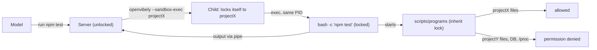

# Design: Teams, Organizations, and Shared Projects

Status: Proposal (investigation only — no code changed)
Scope: Multi-user support in a GitHub-like model: Organization → Members → Projects (private or shared) → per-project roles.

---

## 0. Summary

Today OpenVibely is a **single-principal application**. Authentication, when enabled at all, gates the entire instance with one identity (`AUTH_USERNAME`/`AUTH_PASSWORD`, or one hosted-SSO subject). Nothing in the schema records *who* did anything, and every authenticated request can read and change every project. "Project" is the only tenancy boundary. It is enforced inconsistently: some handlers check task→project ownership, but many load rows by ID alone.

To support teams we need:

1. **Identity**: real `users` rows, sessions bound to a user ID, and API tokens.
2. **Tenancy**: an `organizations` root. Projects get `org_id`, `owner_user_id`, and `visibility`. A `project_members` table holds per-project roles.
3. **One authorization chokepoint**: a `service.Authorizer` that every surface calls: HTTP, runtime tools, channels, webhooks, scheduler, workers, automations, and WebSocket subscriptions. Cross-project checks done per handler become `authz.RequireProject(ctx, principal, projectID, perm)`.
4. **Attribution**: `created_by_user_id`/`author_user_id` on tasks, thread inputs, executions, schedules, automations, alerts decisions, review comments, and usage events.
5. **Re-scoping global state**: model configs, OAuth connections, channel credentials, `app_settings`, UI preferences, global agents/skills, and worker limits currently live at instance level. Each must be explicitly assigned to user, org, or project.
6. **A kernel sandbox for agent execution**: agents execute `bash -c` on the host (`pkg/agenttools/tools.go:343`) with the server's OS privileges. Project-level ACLs do not stop an agent in project A from writing a script that edits project B's checkout or reads the SQLite DB. The fix is a Landlock launcher that locks every agent command, and every server git call, to its own project's folders (§3.5–3.6).

Two layers, both required:

- **App policy (database)** decides *who* can do *what*: which people can see a project, start tasks, change settings, or share it.
- **Kernel sandbox (Landlock)** decides *where* a running agent can reach: only its own project's folders, with no other projects, no database file, no secrets, and no localhost API.

Recommended path: ship **"one org, many users"** first. Keep a single implicit org per instance and add users, project membership, attribution, and the authorizer. Then add the Landlock sandbox before calling private projects private. Single-user mode keeps working with no visible change. Real multi-org tenancy and per-user credentials come later. On hosted, each org gets its own container, so orgs never share a disk.

---

## 1. Current-State Audit

### 1.1 Authentication and sessions

| Concern | Today | Where |
|---|---|---|
| Auth modes | `disabled`, `local`, `hosted_sso` | `internal/auth/auth.go` (`AuthMode*`), `internal/config/config.go:100-165` |
| Local login | One username/password from env (`AUTH_USERNAME`, `AUTH_PASSWORD`), constant-time compare | `auth.Config.ValidateCredentials` |
| Session | Stateless HMAC cookie `ov_session` = `username:v2:expiryNanos` signed with `AUTH_SESSION_SECRET`. No server-side session table, no revocation | `auth.Config.SignToken/VerifyToken` |
| Hosted SSO | OAuth-style PKCE against a control plane. Claims carry `sub`, `email`, `display`, `instance_id`, 1h lifetime | `internal/auth/hosted_sso.go` (`SessionClaims`, `HostedIdentity`, `VerifyHostedSession`) |
| Middleware | `Handler.AuthMiddleware` stores `*auth.User` or `*auth.SessionClaims` in `c.Set("auth_user")`. It only answers "is authenticated", never "is allowed" | `internal/handler/auth_handler.go:115` |
| Principal ID | `authPrincipalID` returns `"web:<username>"` or `"local"`. It is used only for automation chat confirmation receipts | `auth_handler.go:502`, `chat_handler.go:338`, `api_chat_handler.go:445`, `service/automation_confirmation_service.go:70` |
| Brute-force | Instance-wide in-memory failure counter, not per account | `auth_handler.go:449-490` |
| Machine auth | `Authorization: Bearer` only for hosted/docker update agent on `/api/system/*` | `handler/system_handler.go:90-101` |
| Public paths | Login/SSO, health, static, swagger, `/webhooks/inbound/*`, and OAuth callbacks for models, GitHub, and Slack | `isAuthPublicPath` |
| Disabled mode | Default for desktop and dev. Every request is anonymous and fully privileged | `AuthMiddleware` early return |

**Single-user assumptions:** the `users` concept does not exist in the DB. `auth.User` is just `{Username, Display}`. `/auth/me` returns the env username. Hosted SSO identity (`sub`) is never persisted.

### 1.2 Data scoping inventory (schema at goose version 210)

I derived this by migrating a scratch DB and listing columns. **55 tables carry `project_id`**. These tables are **instance-global**, or reach a project only through a parent row:

| Category | Table(s) | Scope today | Notes |
|---|---|---|---|
| Projects | `projects` | global list | `is_default` flag. No owner, no visibility. `ListSelectorOptions` returns all |
| Tasks / chat | `tasks` | project | Chat messages are `tasks` rows with `category='chat'` (`models.CategoryChat`). There is **one chat thread per project**: `ExecutionRepo.ListChatHistory(projectID)` and `ClearChat` delete all chat for the project |
| Executions | `executions` | via `task_id` (+ denormalized `task_project_id`, `task_category`) | No author. `prompt_sent` holds the user's message |
| Thread inputs | `thread_inputs` | project (+ `task_id`) | Has channel-identity columns (`slack_user_id`, `discord_user_id`, `email_from`, `x_user_id`…) but **no app user** |
| Schedules | `schedules`, `schedule_dispatch_admissions` | via `task_id` | `schedule_skips`, `schedule_project_pauses` have `project_id` |
| Goals, PRs, commit stats, review comments, attachments | `task_goals`, `task_pull_requests`, `task_commit_stats`, `review_comments` (`reviewed_by` free text), `task_attachments`, `chat_attachments` | via task/execution | |
| Automations | `automations` + ~25 `automation_*` tables | project | `automations.created_via` exists but no user |
| Alerts | `alerts` | project (`scope='project'` only) | `claimant` is a task ID. `decision_state` has no decider user |
| Agents | `agents` | `scope` = `global` or `project` | `created_by` is `'user'` or `'system'`, not a user ID |
| Model configs | `agent_configs` | **global** | Contains `api_key`, OAuth tokens, `max_workers` |
| OAuth connections | `oauth_connections`, `oauth_refresh_leases` | **global** | Shared provider subscriptions (`187_shared_oauth_connections.sql`) |
| Usage | `llm_usage_events` | project, task, execution | No user. `account_usage_snapshots` is global per provider account |
| Settings | `app_settings` (k/v) | **global** | Holds GitHub PAT/App private key (`service/github_service.go:36`), Slack/Discord/Email/Telegram/X secrets, `github_api_endpoint`, and **UI preferences** (`ui.theme`, `ui.selected_project_id`, `ui.pinned_project_ids`, `ui.model_favorites`: `handler/ui_preferences_handler.go:16-20`, `handler/model_favorites_handler.go:11`) |
| Workers | `worker_settings` | **global** single row | `projects.max_workers` and `agent_configs.max_workers` add caps |
| Personalities | `custom_personalities` | **global** | |
| Channel authorization | `telegram_/slack_/discord_/x_authorized_users`, `email_authorized_senders` | project (migration `180_project_scoped_channel_authorization.sql`) | `added_by` is free text |
| GitHub authorization | `github_authorized_actors` | **global** | `permission` column. `github_project_inboxes` is per project |
| Channel → project selection | `slack_user_projects`, `discord_user_projects`, `telegram_user_projects`, `x_user_projects`, `email_sender_projects` | per external identity | `SlackUserProjectRepo.SetUserProject` lets a channel identity switch to **any** project |
| Webhooks | `webhook_endpoints` | project | Path token + secret. Public route |
| Outbound targets | `channel_targets`, `channel_message_sends` | project | |
| Memory | Files in `<repo>/.openvibely/memories/` plus `knowledge_entries`, `project_memory_settings` | project (filesystem) | Memory is **in the repo**, so anyone with repo access can read it |
| Skills | Built-in, global agent skills, and project skills under the repo | mixed | `handler/agent_skills_handler.go:339 currentProjectSkillRoot` |
| Chat context | `chat_compaction_checkpoints`, `chat_context_usage` | `(scope_type, scope_id)` | scope_id = project or task |
| Worktrees | `<repo_path>/.worktrees/task_<id>` | project filesystem | `service/worktree_service.go:249`. Managed clones under `PROJECT_REPO_ROOT` |

### 1.3 How "current project" is resolved

`Handler.getCurrentProjectID` (`internal/handler/handler.go:653`) resolves in this order: `?project_id=` → `app_settings['ui.selected_project_id']` → first project. It is called about 68 times in handlers. Most routes are **unprefixed** (`/tasks/:taskId`, `/schedules/:id`, `/agents/:id`, `/alerts/:id`, `/models/:id`; 316 routes in `handler.go`). In a multi-user world this creates two problems:

- The selected-project fallback is **shared across all users**, because it is one `app_settings` row.
- ID-addressed routes often trust the ID. Example: `Handler.GetTask` (`handler/task_handler.go:1248`) calls `loadTaskDetailContentData`, which loads `taskSvc.GetByID(taskID)` with **no project or principal check**. `GetTaskExecutions` is similar. Some routes check (`requireTaskInRequestProject` in `schedule_handler.go:107`, `requireTaskGoalInRequestProject`, and `service/task_reference_resolver.go:34`), but those checks compare to the *request's* project, which is user-controlled. Once users exist, this becomes a set of IDOR vulnerabilities.

### 1.4 Runtime tools and agents

- Chat and task-thread runtime tools (`handler/chat_action_tools.go`, 1.6k lines; `service/chat_action_runtime.go`, 3.5k lines) carry `streamingResponseParams{ProjectID, PrincipalID, TaskID, IsTaskFollowup, Surface…}` (`handler/chat_processing.go:58`). Tools enforce *current-project* ownership, which is good. They do not know who the human is or what that human's role is.
- `switch_project` on channels can move a channel identity to any project.
- Agent tools run `bash -c` on the host (`pkg/agenttools/tools.go:343`) with the server's full environment. Default cwd is the worktree, but no sandbox exists (by design for single-user; see project guidance "worktree default is a convenience, not a sandbox"). Multi-user private projects change that decision (§3.5).
- The read/write/edit file tools run inside the server process. `resolvePath` (`pkg/agenttools/tools.go:53`) accepts any absolute path.
- MCP servers are started directly by the server (`pkg/mcp_client/client.go:394`).
- The server runs git in about 93 places with no shared helper (69 in `internal/service/worktree_service.go`). It never sets `core.hooksPath` or `--no-verify`, so repo hooks run on every server-side commit, merge, rebase, and checkout (`worktree_service.go:628`, `:1206`, `:1369`, `:1385`, `:1540`).

### 1.5 Background actors (no human principal)

- `SchedulerService` (`service/scheduler_service.go:121 checkDueTasks`), `WorkerService` (`service/worker_service.go`), automation reconciler and dispatcher (`server/server.go:1084-1086`), OAuth refresh, memory consolidation schedules, the Goal Agent continuation, channel pollers (Telegram, Email, X), and the GitHub Dev Inbox all act **as the instance**.

### 1.6 Realtime

- Live transport uses `/events/ws` (`internal/handler/live_websocket.go`, `LiveWebSocket`). One connection multiplexes `live` and `execution` subscriptions, each with its own subscription ID.
- `liveSubscriptionAllowed` requires an existing project and verifies that requested tasks/executions belong to it. Task/chat events use `SubscribeProject`; file events use a verified task subscription. Execution subscriptions support replay from an offset.
- The connection rechecks instance-session validity on incoming commands and every 15 seconds. This is not user/project membership authorization. Org support must authorize each subscription and stop delivery when membership, conversation visibility, or session access changes.

### 1.7 Explicit single-user / single-owner assumptions (checklist)

1. `auth.Config` holds one username/password. Sessions carry a username, not a user ID.
2. `authPrincipalID` collapses everyone to `"local"` when auth is disabled.
3. `app_settings` mixes secrets, integration config, and **per-person UI preferences**.
4. `ui.selected_project_id` is a global "current project". So are `ui.pinned_project_ids` and the desktop tab set.
5. `projects.is_default` is a single global default project.
6. One chat thread per project (`category='chat'` rows, `ClearChat` wipes for everyone).
7. Model configs and OAuth connections are global and usable from any project.
8. Channel credentials are global. Channel → project switching is unrestricted.
9. `github_authorized_actors` is global. The PAT owner is "the" approver.
10. Alerts approval and claims have no human decider identity.
11. `review_comments.reviewed_by`, `*_authorized_users.added_by`, and `agents.created_by` hold free text, not FKs.
12. Usage analytics has no user dimension.
13. Global worker limit and global model caps are shared by everyone.
14. WebSocket subscriptions check project/resource consistency, but do not yet enforce per-user project membership.
15. The project list (`ProjectRepo.ListSelectorOptions`, ordered `is_default DESC, name`) is unfiltered.
16. Agent shell runs as the server OS user, with access to every repo under `PROJECT_REPO_ROOT` and to `openvibely.db`.

---

## 2. Proposed Data Model

All new tables are added through goose migrations starting at `211_*.sql`. IDs follow the existing `repository/id.go` convention (hex text).

### 2.1 Entities

```sql
-- 211_users_orgs.sql
CREATE TABLE users (
  id            TEXT PRIMARY KEY,
  email         TEXT,                       -- unique when not null (COLLATE NOCASE)
  username      TEXT NOT NULL,              -- unique handle, @-mentionable
  display_name  TEXT NOT NULL DEFAULT '',
  avatar_url    TEXT NOT NULL DEFAULT '',
  password_hash TEXT,                       -- argon2id; NULL for SSO-only
  is_instance_admin INTEGER NOT NULL DEFAULT 0,
  disabled_at   DATETIME,
  created_at    DATETIME NOT NULL DEFAULT (datetime('now')),
  updated_at    DATETIME NOT NULL DEFAULT (datetime('now'))
);
CREATE UNIQUE INDEX idx_users_username ON users(username COLLATE NOCASE);
CREATE UNIQUE INDEX idx_users_email ON users(email COLLATE NOCASE) WHERE email IS NOT NULL;

CREATE TABLE user_identities (              -- external logins (hosted SSO, GitHub OAuth, OIDC)
  id TEXT PRIMARY KEY,
  user_id TEXT NOT NULL REFERENCES users(id) ON DELETE CASCADE,
  provider TEXT NOT NULL CHECK (provider IN ('hosted_sso','github','oidc')),
  subject  TEXT NOT NULL,                   -- e.g. hosted `sub`, GitHub numeric user id
  email TEXT, login TEXT,
  created_at DATETIME NOT NULL DEFAULT (datetime('now')),
  UNIQUE(provider, subject)
);

CREATE TABLE organizations (
  id TEXT PRIMARY KEY,
  slug TEXT NOT NULL UNIQUE,
  name TEXT NOT NULL,
  is_personal INTEGER NOT NULL DEFAULT 0,   -- reserved; see alternatives
  default_project_visibility TEXT NOT NULL DEFAULT 'private'
      CHECK (default_project_visibility IN ('private','org')),
  created_at DATETIME NOT NULL DEFAULT (datetime('now')),
  updated_at DATETIME NOT NULL DEFAULT (datetime('now'))
);

CREATE TABLE org_memberships (
  org_id  TEXT NOT NULL REFERENCES organizations(id) ON DELETE CASCADE,
  user_id TEXT NOT NULL REFERENCES users(id) ON DELETE CASCADE,
  role    TEXT NOT NULL CHECK (role IN ('owner','admin','member')),
  created_at DATETIME NOT NULL DEFAULT (datetime('now')),
  PRIMARY KEY (org_id, user_id)
);
CREATE INDEX idx_org_memberships_user ON org_memberships(user_id);
```

### 2.2 Project ownership, visibility, and shares

```sql
-- 212_project_ownership.sql (table-rebuild migration: NO TRANSACTION, FK off/on, recreate indexes)
ALTER TABLE projects ADD COLUMN org_id TEXT REFERENCES organizations(id);
ALTER TABLE projects ADD COLUMN owner_user_id TEXT REFERENCES users(id);
ALTER TABLE projects ADD COLUMN visibility TEXT NOT NULL DEFAULT 'private'
    CHECK (visibility IN ('private','shared','org'));
-- backfill, then rebuild to make org_id/owner_user_id NOT NULL
CREATE INDEX idx_projects_org_visibility ON projects(org_id, visibility, name);

CREATE TABLE project_members (
  project_id TEXT NOT NULL REFERENCES projects(id) ON DELETE CASCADE,
  user_id    TEXT NOT NULL REFERENCES users(id) ON DELETE CASCADE,
  role       TEXT NOT NULL CHECK (role IN ('owner','maintainer','editor','viewer')),
  added_by_user_id TEXT REFERENCES users(id),
  created_at DATETIME NOT NULL DEFAULT (datetime('now')),
  PRIMARY KEY (project_id, user_id)
);
CREATE INDEX idx_project_members_user ON project_members(user_id, project_id);
```

Visibility semantics:

- `private`: only `owner_user_id`, org owners and admins (break-glass, audited), and explicit `project_members`. Default.
- `shared`: same as private, plus the UI shows a "Shared" badge. This is a **derived/UX state**, effectively `private` with members ≥1. **Recommendation:** store only `private`/`org` and derive "shared" from membership count, to avoid two sources of truth. The CHECK above lists all three for discussion; the final migration should pick one.
- `org`: every org member gets an implicit `viewer` role (configurable to `editor` via `organizations.default_project_visibility`). Explicit `project_members` rows can raise a role. Org-wide visibility never *lowers* an explicit role.

**Effective project role** = max(explicit membership, owner → `owner`, org admin/owner → `maintainer`, org-visible → org default role).

The owner is also stored in `project_members` with role `owner`. This makes listing a single join, and `owner_user_id` is denormalized for transfers.

### 2.3 Invitations

```sql
CREATE TABLE invitations (
  id TEXT PRIMARY KEY,
  org_id TEXT NOT NULL REFERENCES organizations(id) ON DELETE CASCADE,
  project_id TEXT REFERENCES projects(id) ON DELETE CASCADE,  -- NULL = org-only invite
  email TEXT NOT NULL,
  org_role TEXT NOT NULL DEFAULT 'member' CHECK (org_role IN ('admin','member')),
  project_role TEXT CHECK (project_role IN ('maintainer','editor','viewer')),
  token_hash TEXT NOT NULL UNIQUE,          -- sha256 of single-use token; never store raw
  invited_by_user_id TEXT NOT NULL REFERENCES users(id),
  expires_at DATETIME NOT NULL,
  accepted_at DATETIME, revoked_at DATETIME,
  created_at DATETIME NOT NULL DEFAULT (datetime('now'))
);
```

Sharing a project with an existing org member writes `project_members` directly. Invites cover people who are not yet users.

### 2.4 Attribution columns (additive, nullable for legacy rows)

| Table | New column(s) | Purpose |
|---|---|---|
| `tasks` | `created_by_user_id`, `assignee_user_id` (optional, later) | Who created the task; board filtering |
| `thread_inputs` | `author_user_id` | Message author for chat/task-thread input |
| `executions` | `initiated_by_user_id` (NULL = system/schedule/automation), `initiator_kind` (`user`,`schedule`,`automation`,`goal`,`channel`,`webhook`,`system`) | Attribution of runs and cost |
| `schedules` | `created_by_user_id`, `run_as_user_id` | Background run principal (see §3.4) |
| `automations`, `automation_versions` | `created_by_user_id`, `published_by_user_id` | |
| `alerts` | `decided_by_user_id` | Approval provenance |
| `review_comments` | `author_user_id` (keep `reviewed_by` for display) | |
| `task_pull_requests` | `opened_by_user_id` | |
| `llm_usage_events` | `user_id`, `org_id` | Usage/billing |
| `*_authorized_users`, `email_authorized_senders`, `github_authorized_actors` | `added_by_user_id`, `linked_user_id` | Channel identity → app user (§4.4) |
| `agents` | `owner_user_id` (for user-scoped agents, later) | |
| `webhook_endpoints`, `channel_targets` | `created_by_user_id` | |

For chat, the first user turn of a chat "message" is currently the chat-category task's `prompt` plus the execution's `prompt_sent`. Attribution should live on `thread_inputs.author_user_id`, copied to `executions.initiated_by_user_id` at promotion (`ThreadInputRepo.ClaimQueuedForChatExecution`, `repository/thread_input_repo.go:1187`), so history rendering can show an avatar per bubble without a join through tasks.

### 2.5 Chat conversations

Today: one implicit chat per project, made of `tasks.category='chat'`, one row per turn, and history = `ListChatHistory(projectID)`. For collaboration we need:

```sql
CREATE TABLE chat_conversations (
  id TEXT PRIMARY KEY,
  project_id TEXT NOT NULL REFERENCES projects(id) ON DELETE CASCADE,
  title TEXT NOT NULL DEFAULT '',
  visibility TEXT NOT NULL DEFAULT 'project' CHECK (visibility IN ('private','project')),
  created_by_user_id TEXT REFERENCES users(id),
  is_default INTEGER NOT NULL DEFAULT 0,     -- the legacy per-project thread
  created_at DATETIME NOT NULL DEFAULT (datetime('now')),
  updated_at DATETIME NOT NULL DEFAULT (datetime('now')),
  archived_at DATETIME
);
CREATE TABLE chat_conversation_participants (
  conversation_id TEXT NOT NULL REFERENCES chat_conversations(id) ON DELETE CASCADE,
  user_id TEXT NOT NULL REFERENCES users(id) ON DELETE CASCADE,
  last_read_execution_id TEXT,
  PRIMARY KEY (conversation_id, user_id)
);
ALTER TABLE tasks ADD COLUMN conversation_id TEXT REFERENCES chat_conversations(id);
ALTER TABLE thread_inputs ADD COLUMN conversation_id TEXT REFERENCES chat_conversations(id);
ALTER TABLE executions ADD COLUMN conversation_id TEXT; -- denormalized like task_project_id
```

- The migration creates one `is_default=1, visibility='project'` conversation per project and backfills `conversation_id` on chat-category tasks, inputs, and executions.
- `chat_compaction_checkpoints` / `chat_context_usage` gain `scope_type='conversation'`, keyed by conversation ID, instead of the project.
- `ClearChat` becomes "archive conversation" for editors+. It no longer deletes history for everyone.
- `private` conversations are visible only to their creator and participants within a project they can access. They can be **shared** by flipping to `project` or by adding participants. This answers "chat should be shareable with other people".
- The queue/FIFO semantics in `thread_inputs` (per project chat today) must become per-conversation. Two people chatting in the same conversation share one ordered queue. That is the intended collaborative semantic: each message is attributed, and the agent sees `[@alice]: …` in history.
- Execution history for the LLM must include author labels when more than one human participated (prompt builder in `handler/chat_processing.go` / `service/task_creation.go BuildChatContext*`).

### 2.6 Backend-neutral persistence: implemented

The persistence prerequisite is implemented in the current checkout:

- `internal/persistence/backend.go` defines `Backend` and the `Stores` bundle. The backend owns schema version reporting, maintenance, and shutdown.
- `internal/persistence/stores.go` defines domain store interfaces; projection types, errors, and the transaction marker live in the neutral package.
- `internal/persistence/sqlite/` owns SQLite repositories, connections, migrations, and store construction. `internal/server/server.go` selects the backend at startup; SQLite is currently the only supported driver.
- Application services and handlers use the neutral interfaces. Application tests use `internal/testutil/teststores`; its boundary tests guard against backend imports in application tests and test-helper imports in production code.

Remaining teams work:

- Add backend-neutral `Principal` / `AccessScope` types and authorization-aware store operations. Existing project-scoped methods help, but methods such as `TaskStore.GetByID` and `ProjectStore.GetByID` still accept only an ID. Interfaces alone do not enforce user membership or roles.
- Add `UserStore`, `OrgStore`, `ProjectMemberStore`, `InvitationStore`, `ConversationStore`, and `AuditStore` to the neutral package and `Stores` bundle. Construct their SQLite implementations inside the backend, keeping server startup independent of concrete repositories.
- Keep membership filters, pagination, counts, and writes consistent; verify denial and revocation through the application policy and persistence tests.
- A future Postgres backend can implement the same contracts, but still needs its own queries, migrations, concurrency semantics, and tests. This refactor does not deliver Postgres or change SQLite's concurrency limits. Multiple orgs do not inherently require Postgres; choosing it should depend on measured load and deployment requirements.

This completes the persistence refactor portion of Phase 0, not the route-ownership, event-stream, authorization, or sandbox work.

---

## 3. Authorization

### 3.1 Permission matrix (project-level)

| Action | viewer | editor | maintainer | owner | org admin* |
|---|:-:|:-:|:-:|:-:|:-:|
| See project, tasks, threads, diffs, schedules, analytics | ✓ | ✓ | ✓ | ✓ | ✓ |
| Read project-visible chat conversations | ✓ | ✓ | ✓ | ✓ | ✓ |
| Post in chat / task thread (starts LLM runs, spends money) | – | ✓ | ✓ | ✓ | ✓ |
| Create/edit/move/run/cancel tasks, steer, stop | – | ✓ | ✓ | ✓ | ✓ |
| Create/edit schedules, goals | – | ✓ | ✓ | ✓ | ✓ |
| Answer `request_user_input`, approve Native alerts | – | ✓ | ✓ | ✓ | ✓ |
| Merge worktree branch / open PR / auto-merge settings | – | configurable (default ✗) | ✓ | ✓ | ✓ |
| Create/publish/pause automations, webhooks, outbound targets | – | – | ✓ | ✓ | ✓ |
| Project agents/skills/memory curation, lifecycle hooks | – | – | ✓ | ✓ | ✓ |
| Channel authorized users / GitHub inbox for project | – | – | ✓ | ✓ | ✓ |
| Project settings (repo path, default model, worker cap) | – | – | ✓ | ✓ | ✓ |
| Share project / manage members / change visibility | – | – | ✓ (≤ own role) | ✓ | ✓ |
| Transfer ownership, delete project | – | – | – | ✓ | ✓ |

\* Org owners and admins get maintainer-level break-glass access to *private* projects. **Open question:** GitHub lets org owners see all repos, but some teams want true privacy. Recommend a per-org setting, `admins_can_access_private_projects`, default `true`, with every break-glass access written to the audit log.

Org-level permissions:

| Action | member | admin | owner |
|---|:-:|:-:|:-:|
| Create projects (owned by self) | ✓ (org setting) | ✓ | ✓ |
| See org-visible projects, member directory | ✓ | ✓ | ✓ |
| Invite/remove members, change org roles (< owner) | – | ✓ | ✓ |
| Manage org-shared model configs / OAuth connections / channel credentials | – | ✓ | ✓ |
| Use org-shared models | ✓ | ✓ | ✓ |
| Global worker limits, org analytics, audit log | – | ✓ | ✓ |
| Rename/delete org, billing, transfer ownership | – | – | ✓ |

Instance-level (`users.is_instance_admin`): updates (`/api/system/*`, `internal/update`), creating orgs (multi-org mode), and the server-wide worker cap.

### 3.2 Enforcement design

Introduce `internal/service/authz`:

```go
type Principal struct {
    UserID   string        // "" for system actors
    Kind     PrincipalKind // user, schedule, automation, channel, webhook, system, api_token
    OrgID    string
    TokenScopes []string   // for API tokens
}
type Permission string // "project.view", "task.run", "task.merge", "project.share", ...

func (a *Authorizer) Require(ctx context.Context, p Principal, projectID string, perm Permission) error
func (a *Authorizer) AccessibleProjectIDs(ctx context.Context, p Principal) ([]string, error) // cached per request
func PrincipalFromContext(ctx context.Context) Principal
func WithPrincipal(ctx context.Context, p Principal) context.Context
```

- The principal travels in `context.Context`, set by `AuthMiddleware`. Services read it, so the check works identically from HTTP, runtime tools, and channels.
- In disabled-auth / single-user mode, the middleware injects the **bootstrap user** principal (see §7), so every code path exercises the same authorizer.
- The deny response for objects outside the caller's access is **404, not 403**, to avoid confirming that a project or task exists.

Where checks must go:

| Surface | Entry points | Required change |
|---|---|---|
| HTTP pages / HTMX | 316 routes in `handler/handler.go` | Replace `getCurrentProjectID` with `requireProject(c, perm)`. For ID routes (`/tasks/:taskId`, `/schedules/:id`, `/alerts/:id`, `/automations/:automationId`, `/agents/:id`, `/reviews/:id`, `/thread-inputs/:inputId`, `/chat/attachments/*`, worktree/diff routes), load the row and then `Require(row.ProjectID)`. **Fix `GetTask`/`loadTaskDetailContentData` (`task_handler.go:1205,1248`) and `GetTaskExecutions` first**. Consider an Echo route-group helper: `withTask(perm, h.X)` |
| JSON API | `/api/tasks`, `/api/chat`, `/api/projects`, `/api/analytics`, `/api/capacity` (`api_*_handler.go`) | Same, plus API-token scope checks |
| Project list/selector | `ProjectRepo.ListSelectorOptions`, `ListAPI`, breadcrumb selector, desktop project picker (`cmd/desktop/project_picker.go`) | Filter by accessible IDs |
| Runtime tools | `handler/chat_action_tools.go`, `service/chat_action_runtime.go`, `chat_merge_tool.go`, `automation_chat_actions.go` | `streamingResponseParams.PrincipalID` becomes a `Principal`. Each tool maps to a `Permission` (e.g. `create_task`→`task.create`, `merge`→`task.merge`, `schedule_task`→`schedule.edit`, `create_alert`→`alert.create`, `github_*`→`integration.github.use`). Enforce in the shared runtime, **not** in prompts. `switch_project` checks `project.view` for the human |
| Runtime tool policy | `llm/contracts/runtime_tool_policy.go` | Viewers in Chat get read-only tool policy (as in Plan mode) |
| Channels | Slack/Discord/Telegram/Email/X services and `service/channel_chat_ingress.go` | Inbound identity → linked app user (§4.4) → principal. Unlinked identities keep today's project-scoped allowlist behavior as a `channel` principal limited to that project. `switch_project` and `*_user_projects` must reject projects the linked user cannot access |
| Webhooks | `/webhooks/inbound/*` (`handler/webhook_handler.go`) | Principal is `webhook` scoped to the endpoint's project. Runs are attributed to `webhook_endpoints.created_by_user_id`. Effective permission is capped at that creator's current role, so the webhook stops working if the creator loses access |
| Scheduler | `SchedulerService.checkDueTasks` | Run as `schedules.run_as_user_id`. Before dispatch, re-check that the user still has `task.run`. If not, skip, pause, and alert the project owner |
| Workers / follow-ups | `WorkerService`, Goal Agent continuation, swarm planner | Inherit the initiating principal from `executions.initiated_by_user_id`/task creator. Re-check on admission |
| Automations | reconciler, dispatcher, `automation_*_repo.go` | Run as `published_by_user_id` with a `automation` principal kind. Re-check on dispatch. GitHub inbox → task creation is attributed to the automation publisher |
| WebSocket | `handler/live_websocket.go LiveWebSocket`, `liveSubscriptionAllowed`, `dispatchLiveFrame` | Authenticate the connection, then check `project.view` for **every subscription**, including execution replay and reconnects. Preserve task/execution ownership checks and enforce conversation visibility. On access revocation, cancel affected subscriptions and discard queued frames before delivery; session revocation closes the connection. A valid connection never authorizes every project on it |
| Attachments / files | `attachment_handler.go`, `chat_attachment_handler.go`, worktree file/diff endpoints | Check via the owning task/execution |
| Memory/skills | `agent_skills_handler.go`, `skills_handler.go`, `MemoryService` | Project scope check. Global skills edit = org admin |
| Analytics / insights / upcoming / workers | `analytics_handler.go`, `insights_handler.go`, `upcoming_handler.go`, worker capacity | Project-scoped views check `project.view`. Global dashboards aggregate only accessible projects. Org-wide totals for org admins |
| Alerts | `alert_handler.go`, `alert_repo.go` | `decision` requires `alert.decide`. Record `decided_by_user_id` |

### 3.3 Preventing cross-project and cross-org leakage

1. **Repository-level guardrails**: list/query methods gain a mandatory `AccessScope` argument (using the existing persistence interfaces). Any query on a project-scoped table without a project filter must be an explicit "system" method, named as such (`ListAllForSchedulerSystem`), and grep-audited in CI.
2. **No trust in request project IDs**: the request's `project_id` is an *input* to authorization, never proof of access.
3. **Entity → project resolution** happens server-side from the row (task, execution, schedule…), then the authorizer runs.
4. **Model-facing context**: chat context builders (`BuildChatContextWithAgentDefinitions`) must include only the current project's data. That is already true; keep it under test. Cross-project tools (e.g. global `list_tasks`) must filter by principal.
5. **Caches**: channel project-selection caches (Slack, Discord, Telegram) and any `sync.Map` keyed by project must not serve another user's selection. Key them by (external identity) and re-authorize on read.
6. **Logs**: do not log other users' message contents at info (existing rule). Add user IDs, not emails, to operational logs.
7. **Filesystem**: ACLs alone do not stop the agent; the kernel sandbox does (§3.5–3.6, §9 R1).
8. **Tests**: add a reusable `authz` contract test that walks every registered route (there is already `broad_route_coverage_test.go` / `coverage_route_contracts_test.go`) with a user who is *not* a member and asserts 404. This is the highest-leverage test in the plan.

### 3.4 Background-run principal semantics

| Initiator | Runs as | Revocation behavior |
|---|---|---|
| Human chat/task-thread send | That user | — |
| Schedule | `run_as_user_id` (creator by default; maintainers may reassign) | Skip and pause schedule, notify |
| Automation | `published_by_user_id` | Pause automation (health `blocked`), notify |
| Goal continuation | Initiator of the goal's task | Pause goal |
| Webhook | Endpoint creator | Disable endpoint |
| Channel (linked) | Linked user | Reject with a channel message |
| Channel (unlinked allowlisted) | `channel` principal capped at `editor` on the allowlisted project | Remove from allowlist |
| System (memory consolidation, OAuth refresh, cleanup) | `system` | n/a |

### 3.5 Kernel sandbox for agent execution (Landlock)

App policy (§3.1–3.4) only decides whether a person may *start* a run. Once an agent is running, it runs as the same OS user (uid `10001`, `Dockerfile:168`) that owns every project folder. It could write a script that edits project Y and run it, and Linux would allow it. Private projects are not private without a kernel-level limit.

**Choice: Landlock.** Landlock is a Linux kernel feature (5.13+). A process can restrict itself to a list of folders. The restriction can't be removed, and every program the process starts inherits it. It needs no root, no extra Linux users, no user namespaces, and no new container capabilities. Docker's default seccomp profile allows it, and hosted's `no-new-privileges` setting (`openvibely-hosted/internal/provisioner/provisioner.go`) is exactly what Landlock requires.

**How it runs.** Today `execBash` (`pkg/agenttools/tools.go:343`) starts `bash -c <command>`. With the sandbox it starts the OpenVibely binary in a launcher mode instead:

```
/app/openvibely --sandbox-exec <policy> -- bash -c "<command>"
```

The first lines of `main()` detect `--sandbox-exec`, skip all server startup, apply the Landlock rules, and `syscall.Exec` into the command. The process does not stay running beside the command; it *becomes* the command (same PID). That still means one process per bash call, as today, and output flows back through the same pipe. The server itself is never locked, so it can still show diffs and merge. Go can't safely lock a single child after `fork`, so this re-exec is the standard approach (as used by `go-landlock`).



**Policy per run:**

| Access | Paths |
|---|---|
| Read and write | The task's worktree, the project's main repo (git metadata for worktrees), a per-run temp folder |
| Read only | System tools and libraries (`/usr`, `/bin`, `/lib`, `/etc` minus secrets), language toolchains, global git config |
| None | Other projects, `/data` (SQLite DB), app config, `/proc` of other processes |
| Network | Outbound allowed by default. The app's own API on localhost is blocked (Landlock TCP rules on Linux 6.7+, or a firewall rule) |

**Gaps Landlock does not close on its own, and their fixes:**

| Path an agent could take | Fix |
|---|---|
| Read/write/edit file tools run inside the unlocked server; `resolvePath` (`pkg/agenttools/tools.go:53`) accepts any absolute path | Reject paths outside the run's allowed folders (resolve symlinks first) |
| Child gets the server's full environment, including API keys | Pass an allow-listed environment only |
| Git hooks or config programs (`core.fsmonitor`, diff/merge drivers) run later by the unlocked server | Run all server git calls through the lock (§3.6) |
| A program calls the app's API on localhost to ask the server to make an edit | Block localhost from locked processes |
| MCP servers (`pkg/mcp_client/client.go:394`) and provider-local tools | Start them through the same launcher |
| Attaching to the server process | Already blocked by Landlock (`ptrace` restriction); keep `/proc` out of the policy |

**When Landlock is unavailable** (old kernel, macOS/Windows desktop): the app refuses to create or keep *private* projects in a multi-user org, instead of quietly running unlocked. Single-user installs and the desktop app don't need the sandbox and keep today's behavior.

**Compared with per-project Linux users:** that approach also works (a Linux user per project, agents run as that user), but it needs the app to run as root or a root helper to switch users, and every worktree needs the right owner. Landlock gives the same per-project wall without root, so it is the recommended choice. A container per run is stronger but slower and hard on desktop; it stays a fallback.

**Before building:** a one-day test on a hosted server. Start a container with hosted's settings and check that a locked shell, a program it writes and runs, and a git hook can't read or edit another project or reach the localhost API.

### 3.6 Server git calls through the lock

The server runs git in about 93 places (69 in `internal/service/worktree_service.go`, the rest across about 7 files), with no shared helper and no hook protection (§1.4). An agent can write `.git/hooks/post-merge` inside its own project, and the next server-side merge runs that hook unlocked.

Fix: one helper, `runGitLocked(ctx, project, args...)`, that starts git through the Landlock launcher with that project's policy (main repo and all its worktrees read-write; network only for push/fetch). Hooks keep working for projects that rely on them (formatters, linters), but they can only reach their own project. A test fails on any direct `exec.Command("git", ...)` outside the helper. Size: about 2–3 days, mostly mechanical.

---

## 4. Authentication and Identity

### 4.1 Login options

1. **Local accounts** (self-hosted default when >1 user): argon2id password hashes in `users.password_hash`, per-account lockout (replace the instance-wide counter in `auth_handler.go:449`), and an admin-created reset link. The current `AUTH_USERNAME`/`AUTH_PASSWORD` env pair becomes a **bootstrap admin** seed. On first start the env pair is created or updated as an instance-admin user. Keep the env path working for Docker users.
2. **Hosted SSO** (existing `auth/hosted_sso.go`): persist `HostedIdentity.Subject` in `user_identities(provider='hosted_sso')`, and auto-provision users on first login when the control plane asserts org membership. The control plane should add `org_id`/`roles` claims later. Until then, treat all hosted-SSO users of an instance as members of the instance's single org, and the first user as owner.
3. **GitHub OAuth login**: natural for this product, because GitHub is already the primary integration. Reuse the GitHub App OAuth (`handler/github_auth_handler.go`) callback infrastructure. Optionally restrict sign-in to members of a GitHub org and auto-map GitHub org/team → OpenVibely org/project roles (later).
4. **Generic OIDC** (later): Google Workspace/Okta for self-hosted enterprises.

### 4.2 Sessions

- Replace stateless username cookies with **server-side sessions**: `user_sessions(id_hash, user_id, created_at, last_seen_at, expires_at, revoked_at, user_agent, ip)`. The cookie holds an opaque random token; the DB stores only its hash. This enables logout-everywhere, revocation on member removal, and an "active sessions" UI.
- Hosted SSO cookies can remain signed claims (1h). Map `sub` → `user_id` on each request (cached), so disabling a user takes effect within one request.
- Keep the `HX-Redirect` handling in `AuthMiddleware`.
- Desktop (Wails) runs on loopback. Keep auth disabled → bootstrap user (see §7).

### 4.3 API tokens

`api_tokens(id, user_id, name, token_hash, scopes_json, project_ids_json NULL, last_used_at, expires_at, revoked_at)` hold personal access tokens with scopes (`read`, `tasks:write`, `chat:write`, `admin`) and optional project restriction. Authorize them via `Authorization: Bearer ov_pat_…` in `AuthMiddleware`. The existing hosted/docker agent tokens stay separate (instance-level).

### 4.4 Channel identities → org users

Today each channel has its own allowlist (`telegram_authorized_users`, `slack_authorized_users`, `discord_authorized_users`, `x_authorized_users`, `email_authorized_senders`, global `github_authorized_actors`). Proposal:

- Add `linked_user_id` to each allowlist row (or a unified `channel_identity_links(platform, external_id, user_id, verified_at)`).
- **Self-service linking**: a user runs `/link` in Slack/Telegram/Discord, receives a one-time code, and confirms it in the web UI (or the reverse). Email is linked by verified address match. GitHub is linked through the GitHub OAuth identity in `user_identities`.
- Inbound effective permission = linked user's project role. The allowlist remains the **channel admission** gate, and the user role is the **authorization** gate.
- `github_authorized_actors` (approvers for Dev Inbox assignment) becomes per-project, or is derived: "GitHub logins linked to users with ≥ maintainer on this project". GitHub assignment-as-approval must map the assigner to a user with `task.create` on the project.
- Slack being allow-by-default (memory note) is unsafe in multi-user mode. Default it to deny when the instance has more than one user.

---

## 5. Secrets and Resources

### 5.1 Model credentials (`agent_configs`, `oauth_connections`)

Options:

| Model | Pros | Cons |
|---|---|---|
| Org-owned only (today's global, renamed) | Simple; matches company-paid API keys | Personal Claude/ChatGPT subscriptions are shared with everyone, which may violate provider ToS |
| **Hybrid (recommended)**: `owner_kind` ∈ {`org`,`user`}, plus `owner_id`, on `agent_configs` and `oauth_connections` | Company keys shared; personal OAuth subscriptions stay personal | Resolution rules needed |
| Per-project | Fine-grained cost control | Lots of duplication |

Resolution rules for the hybrid:

- A user may select org models and their own personal models.
- A project can **allow-list** models (`project_model_policies(project_id, agent_config_id)`). `projects.default_agent_config_id` must point to an org model or the owner's model.
- **Background runs** (schedules, automations) use the run-as user's or org models only. A personal model whose owner has left the project or org fails closed.
- When a collaborator continues someone else's task (follow-up), the task's model (`tasks.agent_id`) may be personal to someone else. Rule: follow-ups by a different user re-resolve to a model *the sender* can use. If the pinned model is not usable, prompt the sender to pick a model. Never silently spend another person's subscription.
- `account_usage_snapshots` (provider plan limits) attach to the credential owner.

### 5.2 Integration credentials (`app_settings`)

Move secrets out of the flat `app_settings` table into `integration_credentials(scope_kind, scope_id, provider, key, value_encrypted)`:

- GitHub App/PAT, Slack/Discord bot tokens, IMAP/SMTP, X: **org-scoped** by default, with an optional project override (e.g. different GitHub App installation per project).
- The no-persisted-tokens rule (GitHub installation tokens minted per operation) is unchanged.
- Consider at-rest encryption with an instance key (`OPENVIBELY_SECRET_KEY`) now that more than one human can reach the DB host or backups.

`app_settings` keeps instance-level settings only. **UI preferences move to `user_preferences(user_id, key, value)`**, including `ui.theme`, `ui.sidebar_collapsed`, `ui.diff_view`, `ui.selected_project_id`, `ui.pinned_project_ids`, `ui.model_favorites`, and desktop tab state.

### 5.3 Worker limits

Today: global `worker_settings.max_workers`, `projects.max_workers`, and `agent_configs.max_workers`, with atomic reservations. Add:

- `organizations.max_workers` (≤ instance cap) and optionally `org_memberships.max_workers` (per-user fair share). This prevents one user's swarm from starving teammates.
- Admission order should become fair across users (round-robin by `initiated_by_user_id`) instead of pure FIFO. This is open question Q6.

### 5.4 Usage analytics and billing

- Add `user_id` and `org_id` to `llm_usage_events` (populated from the execution's initiator), and group by user in `service/usage_analytics_service.go`.
- Attribute background-run usage to the run-as user and mark `initiator_kind`.
- Billing (hosted): meter per org via `llm_usage_events` and worker-minutes. Seat count = `org_memberships`. BYO-key orgs pay only seats; managed-key orgs pay usage. Self-hosted: no billing, analytics only.
- Budgets: `agent_cost_budgets` exists per model config. Add org- and user-level budgets later.

---

## 6. Collaboration Concerns

| Concern | Proposal |
|---|---|
| **Concurrent task edits** | Add `tasks.version INTEGER` for optimistic concurrency on title, prompt, priority, and category edits (`task_detail_property_handler.go`, kanban moves). Reject stale writes with 409 and re-render the authoritative fragment, which fits the existing "server fragments are authoritative" rule. Status transitions already go through `TaskRepo.ClaimTask` and lifecycle locks |
| **Concurrent chat/thread sends** | Already serialized via `thread_inputs` FIFO and steering. With attribution, two users queue in order. Steering/Stop require `task.run`. Show who is steering |
| **Merge conflicts on shared worktrees** | `project_merge_conflict_owners` already exists. Add `merge_requested_by_user_id`. Merge requires `task.merge` |
| **Realtime fan-out** | `events.Broadcaster` already supports project-scoped subscription. Add per-user notification subscriptions over the same WebSocket (a proposed internal `SubscribeUser(userID)` broadcaster API), and include `actor_user_id` in `TaskEvent`/`ChatEvent` so UIs can show "Alice moved X". Enforce authorization at subscribe time (§3.2) and on membership changes |
| **Notifications per user** | Alerts are project-scoped broadcasts today. Add `alert_recipients(alert_id, user_id, read_at)`, or simpler per-user read state, `alert_reads(alert_id, user_id)`, replacing the global `alerts.is_read`. Add notification types: mentioned in chat (`@username`), task assigned, review requested, run failed (your run), share invite. Delivery: in-app, plus optional email or linked Slack DM via existing `send_message` channels |
| **Audit log** | `audit_events(id, org_id, project_id, actor_user_id, actor_kind, action, target_type, target_id, metadata_json, ip, created_at)`. Write on: membership/role changes, visibility changes, shares, invites, credential changes, merges, PR opens, alert decisions, automation publish, break-glass access, project delete/transfer, and login success/failure. Read view for org admins and project maintainers |
| **Presence** | Later nice-to-have: in-memory presence per project or conversation via the existing WebSocket (`presence` frames with a heartbeat). It does not need persistence |
| **Mentions** | `@user` in chat creates notifications and puts the participant into the conversation |
| **Assignment** | Optional `tasks.assignee_user_id` plus a board filter ("My tasks") |

---

## 7. Deployment Modes and Backwards Compatibility

| Mode | Today | Proposed |
|---|---|---|
| Desktop (Wails, `cmd/desktop`, `config.ModeDesktop`) | Auth disabled, loopback | **Single-user mode**: bootstrap user + personal org created at migration. All authz runs with that principal. No login UI. Teams are not offered on desktop initially, but desktop may later connect to a team server as a client |
| Self-hosted server, auth disabled | Open to anyone who can reach it | Same single-user mode. Startup warning when bound to a non-loopback address. Adding a second user requires enabling local auth |
| Self-hosted, local auth | One env user | Env user = bootstrap instance admin + org owner. Admin UI to add users and invites. Multi-user enabled |
| Hosted (`OPENVIBELY_HOSTED_SSO_ENABLED`, `buildinfo.ModeHosted`) | One instance per customer, SSO via control plane | **One instance = one org** (recommended first). The control plane provides membership; the instance trusts `instance_id`-bound claims. Multi-org-per-instance requires org isolation throughout the app and filesystem; evaluate Postgres based on load |

Single-user compatibility rules:

- With exactly one user, hide sharing and team UI chrome, except an "Invite teammates" entry point in settings.
- No URL changes are required. Optional future: `/{org}/{project}/…` prefixed routes; the current `?project_id=` scheme still works with authz.
- API behavior is unchanged for the bootstrap user.

---

## 8. Data Migration

Migration `21x_teams_backfill` (idempotent, `NO TRANSACTION` where tables are rebuilt):

1. Create `users` row **bootstrap**: username = `AUTH_USERNAME` if set, else `owner`; `is_instance_admin=1`. Because migrations cannot read env reliably, create a placeholder user in SQL. `server.Start` then reconciles it with `AUTH_USERNAME` and the hosted SSO first login on boot ("claim bootstrap user").
2. Create organization `default` (name from hostname or "My Organization"), and `org_memberships(bootstrap, owner)`.
3. `UPDATE projects SET org_id=default, owner_user_id=bootstrap, visibility='private'`. Insert `project_members(project, bootstrap, 'owner')`. Rebuild `projects` to make the columns NOT NULL.
4. Create one default `chat_conversations` row per project. Backfill `conversation_id` on `tasks WHERE category='chat'`, `thread_inputs WHERE scope='chat'`, and `executions WHERE task_category='chat'`. Re-key `chat_compaction_checkpoints`/`chat_context_usage` rows of project scope to the conversation.
5. Attribution columns stay NULL for legacy rows, rendered as "Owner (legacy)". Optionally backfill `created_by_user_id = bootstrap` for tasks, schedules, and automations so background run-as resolution works. **Recommended: backfill**, because schedules and automations need a run-as user.
6. Move `ui.*` keys from `app_settings` to `user_preferences` for the bootstrap user. Leave secrets in place until the Phase 5 credential move.
7. `agent_configs` / `oauth_connections` get `owner_kind='org', owner_id=default`, which preserves today's sharing.
8. Channel allowlist rows: `linked_user_id = NULL`; `added_by` stays as text.

Note the project rules: never touch `openvibely.db` destructively, follow the table-rebuild rules, and respect CHECK/FK constraints. Each migration needs a regression test on a populated fixture DB.

---

## 9. Risks, Open Questions, Alternatives

### 9.1 Risks

- **R1: Host-level agent execution defeats project ACLs (critical).** Agents run `bash -c` as the server user (`pkg/agenttools/tools.go:343`) and can read any repo under `PROJECT_REPO_ROOT`, other users' worktrees, `openvibely.db` (including the OAuth tokens in `agent_configs`/`oauth_connections` and the secrets in `app_settings`), and env vars. A *private* project is therefore only private from people who cannot run an agent. **Decision:** fix this with the Landlock sandbox (§3.5) and locked server git calls (§3.6) in Phase 3, before private projects ship to multi-user orgs. Supporting measures:
  1. Until Phase 3 lands, document the trust model honestly: "members of an org are trusted; private projects hide from the UI, not from agents".
  2. Pass agents an allow-listed environment, and move secrets out of the DB file into an encrypted store keyed by an env secret not passed to children (Phase 5).
  3. One container per org on hosted (Phase 6), so orgs never share a disk.
  4. Without Landlock (old kernels, desktop), private projects are not offered in multi-user orgs.
  
  This changes the current "worktree default is a convenience, not a sandbox" guidance for multi-user private projects only.
- **R2: Unscoped ID routes (IDOR).** Many handlers resolve by ID without principal checks (§1.3). A big-bang retrofit risks missing routes; the route-walking contract test is mandatory.
- **R3: Shared mutable singletons.** Global `app_settings`, `ui.selected_project_id`, channel selection caches, global worker caps, and global agents/skills create cross-user interference.
- **R4: Prompt and context leakage.** Chat history now contains multiple authors. A private conversation must never enter another conversation's context or memory extraction. `MemoryService` extraction writes to the repo's `.openvibely/memories/`, which is visible to all project members. Private chats must be excluded from memory extraction, or it must be documented as such.
- **R5: Cost attribution disputes.** Follow-ups on another user's task using their personal model (§5.1).
- **R6: SQLite write contention.** WAL mode, one writer connection, and a 1-connection reader pool (`internal/persistence/sqlite/database/database.go:17`, `:47`). Most writes come from agents (streamed output, executions, usage), and the worker limit caps them, so more people add little load. Fine for teams of about 5–20 (not load-tested). If needed: raise the reader pool (WAL allows many readers) and batch agent output writes; hosted spreads load with one container and DB per org; large orgs need Postgres.
- **R8: Sandbox coverage.** Landlock only helps if every path an agent can touch files through goes through the launcher or a path check (§3.5 gaps table). Missing one path (a new tool, a new git call) reopens R1. Mitigate with the direct-`exec` lint test and a sandbox escape test suite run in CI on Linux.
- **R7: Scope creep.** The roadmap touches nearly every handler; it needs strict phasing and feature flags per phase. This is a temporary rollout flag, not a permanent shim.

### 9.2 Open questions

1. Should org owners and admins see private projects (GitHub semantics) or not? (§3.1)
2. Keep `shared` as a stored visibility value or derive it? (Recommend derive.)
3. Can editors merge, or only maintainers? Per-project setting?
4. Do personal OAuth subscriptions (Claude Max, ChatGPT Plus) allow use by teammates? Default: never shared, for ToS reasons.
5. One instance per org (hosted) vs true multi-tenant: what is the hosted business model?
6. Fair-share worker scheduling across users: needed for MVP?
7. Should project-scoped memory files (committed in the repo) be considered public to project members? (Yes, implicitly.)
8. Should the desktop app become a client of a team server (remote project), or remain single-user only?
9. Do channel bots (one Slack app per org) route by linked user's last-selected project, or require explicit project per channel?
10. Do we need task-level permissions (private tasks inside a shared project)? Recommend **no** for v1.

### 9.3 Alternatives considered

- **Personal namespace + orgs (full GitHub model)**: every user has a personal "org" (`organizations.is_personal`). This is more flexible, but it doubles UI states. Reserved via `is_personal`; it is not in the MVP.
- **Project-only ACL, no org**: simplest, but it does not give a member directory, org-shared credentials, or billing unit. Rejected.
- **Team entities (groups) inside orgs** granting project roles to a group (`teams`, `team_members`, `project_team_grants`). Useful at more than 15 users; deferred to "Later", and the schema stays compatible.
- **Per-project Linux users** for agent isolation: works, but needs root or a root helper to switch users and correct file ownership on every worktree. Rejected in favor of Landlock (§3.5).
- **Container per agent run**: strongest isolation, but slow to start, needs Docker access from the app, and is impractical on desktop. Kept as a fallback if Landlock proves unavailable on hosted servers.
- **Turning git hooks off** (`core.hooksPath=/dev/null`) for server git calls: simple, but breaks projects that rely on hooks. Running git through the lock (§3.6) keeps hooks working safely.
- **External policy engine (OpenFGA, Cedar, Casbin)**: overkill now. The small `Authorizer` with an explicit matrix is easier to audit, and the interface leaves room to swap.
- **Row-level filtering in SQL views**: not portable across the future backends, and harder to test than explicit `AccessScope` parameters.

---

## 10. Phased Roadmap

Sizing: S ≈ ≤3 days, M ≈ 1–2 weeks, L ≈ 3–4 weeks (one engineer plus agent assistance).

### Phase 0: Groundwork (partly complete; remaining work needs sizing)
- **Project-boundary audit performed:** findings, fixes, coverage, and remaining limits are recorded in [Project access audit](project-access-audit.md). Shared task/input guards and scoped review/webhook/chat-status operations are added. This is not user authorization; legacy unscoped requests and global settings remain until the users/policy phases.
- **Complete:** backend-neutral persistence interfaces and SQLite implementation (§2.6).
- **Remaining:** `Principal` is now implemented in Phase 1; define `AccessScope` and expand the audit into a resource-wide authorization matrix, including legacy unscoped requests, before sizing the remaining work.
- **IDOR hardening:** task-route ownership is now covered by a route-walking contract test; review, webhook, queued-input, and chat-status fixes have regression tests. Extend coverage beyond these route families as described in the audit.
- Live transport now uses WebSockets with project/task ownership checks. Preserve these checks and add per-subscription principal authorization and revocation in Phase 2 (§3.2).
- Milestone: persistence boundary retained; route ownership and event-stream contract tests green.

### Phase 1: Users (implemented initial milestone)
- Implementation and operating instructions: [Organization accounts: Phase 1](organization-phase-one.md).
- Migration 217 adds users, identities, organization membership, revocable sessions, invitations, and personal preferences through `OrganizationStore`. A default owner/org is backfilled; `project_organizations` associates existing and new projects without changing the existing project schema.
- `AuthMiddleware` attaches a principal. Auth-off uses the bootstrap owner and is refused for multi-member installations. Local auth uses database accounts seeded once from the configured credentials. Hosted SSO binds the verified workspace owner and retains single-owner access.
- Organization UI: rename, member listing, role changes/removal, expiring single-use invitation links, and invitation acceptance. Owner/admin boundaries and last-owner protection apply to organization administration.
- `ui.*` settings are per-user. Logout and membership removal revoke sessions; WebSockets revalidate membership before delivering queued frames and on change notifications.
- Milestone: two local users can log in with separate preferences. Everyone still sees every project. Resource-wide roles, durable run attribution, password management UI, and hosted multi-member onboarding are not delivered by this milestone.

### Phase 2: Sharing and app policy (3–4 weeks)
- `projects.org_id/owner_user_id/visibility` and `project_members`. `service/authz.Authorizer` with the matrix in §3.1.
- Enforce on all HTTP routes, the JSON API, runtime tools, WebSocket subscriptions, and the project selector and desktop picker. Return 404 on deny.
- Share dialog in Project Settings (add an org member with a role; change visibility); member list; transfer ownership.
- Attribution columns on tasks, thread_inputs, executions, schedules, automations, alerts, and review_comments. UI shows the author on chat bubbles and tasks.
- Background run-as semantics for scheduler, workers, automations, goals, and webhooks (§3.4), with revocation handling.
- WebSocket tests: mixed allowed/denied projects on one connection; foreign execution replay; reconnect after revocation; membership removal during streaming, including queued frames; and session expiry/revocation. Private-conversation subscription tests follow in Phase 4.
- `audit_events`, written for membership, visibility, merge, and alert decisions.
- Milestone: Alice's private project is invisible to Bob in the app (UI, API, WebSocket updates/replay, tools). Shared as editor, Bob can chat and run tasks but cannot merge or change settings. Agents are not yet locked, so private projects stay behind the trust-model warning (R1) until Phase 3.

### Phase 3: Kernel sandbox (3–4 weeks)
- Start with the **one-day Landlock test** on a hosted server (§3.5). If Landlock is unavailable there, re-plan around container-per-run.
- **Landlock launcher**: `openvibely --sandbox-exec`; each bash call is locked to its project's folders, and scripts and programs it starts inherit the lock.
- **Git through the lock**: route the ~93 server git calls through `runGitLocked` (§3.6), plus a test that fails on direct `exec.Command("git", ...)`.
- **File tools**: read/write/edit reject paths outside the run's allowed folders.
- **Environment**: allow-listed env for locked processes; no API keys or secrets.
- **Localhost**: locked processes can't reach the app's API (Landlock network rules on Linux 6.7+, or a firewall rule).
- **MCP servers and provider-local tools** start through the launcher.
- **No Landlock** (old kernel, desktop): private projects are not offered in multi-user orgs.
- Sandbox escape test suite in CI on Linux.
- Milestone: an agent on project X can't read or edit project Y, the DB, or secrets using bash, a script, a program it wrote, a git hook, the file tools, or the localhost API.

### Phase 4: Shared chat (3–4 weeks)
- `chat_conversations` + participants. Migrate the default per-project thread. Conversation list UI. Private vs project-visible conversations; share a conversation.
- Per-conversation FIFO queue, compaction checkpoints, and context usage. Author-labeled history in model prompts. Exclude private conversations from memory extraction.
- Per-user alert read state, `@mentions`, and notification subscriptions on the existing WebSocket. Derive the user ID from the authenticated principal; clients cannot subscribe as another user.
- `tasks.version` optimistic concurrency: a second concurrent save is rejected instead of overwriting. `actor_user_id` on live events.
- Milestone: two users in the same conversation see each other's messages live, with attribution. Private conversations are not visible to others.

### Phase 5: Credentials and channels (3–4 weeks)
- `agent_configs`/`oauth_connections` gain `owner_kind/owner_id`. Personal vs org models; project model allow-list; follow-up model re-resolution.
- `integration_credentials` (org scope, with optional project override). Move secrets out of `app_settings`; encrypt at rest.
- Channel identity linking (`/link` flow), linked-user authorization, `switch_project` gating, Slack deny-by-default in multi-user mode, and per-project GitHub approvers.
- Usage analytics by user. Org and user worker caps. Optional fair-share admission.
- Personal API tokens.
- Milestone: Bob's personal Claude subscription is never used for Alice's work. A Slack user linked to Bob can only reach Bob's projects.

### Phase 6: Hosted teams (2–4 weeks, in `openvibely-hosted`)
- Members list per workspace, replacing the single-owner SSO check (`internal/httpapi/sso.go:242`, `:350`).
- Invites that add someone to an existing workspace.
- Role included in the SSO response. OpenVibely's `decodeHostedIdentity` must change in the same release, because it rejects unknown fields.
- Per-seat Stripe billing.
- One container per org, so orgs never share a disk.
- Can run in parallel with Phase 4 or 5.

### Later
- GitHub OAuth login, OIDC, and GitHub-org/team → role sync.
- Teams/groups inside orgs; project grants to teams.
- Presence, task assignees, and a "My work" view.
- Multi-org instances (instance admin UI). Evaluate Postgres based on measured load; backend-neutral interfaces are already available.

### Proposed follow-up tasks

| # | Title | Phase | Size | Depends on |
|---|---|---|---|---|
| 1 | Backend-Neutral Persistence Interfaces — implemented (§2.6) | 0 | Done | — |
| 2 | Harden ID-addressed routes with project-ownership checks + route-walking contract test | 0 | M | — |
| 3 | WebSocket project/task ownership checks — implemented and audited; preserve regression coverage | 0 | Done | — |
| 4 | Add users/orgs/memberships/sessions schema + bootstrap migration | 1 | M | 1 |
| 5 | Principal-in-context auth middleware (disabled/local/hosted SSO → user) + server-side sessions | 1 | M | 4 |
| 6 | Move UI preferences to `user_preferences` | 1 | S | 5 |
| 7 | User admin UI + invitations (org-level) | 1 | M | 5 |
| 8 | Project ownership/visibility + `project_members` schema & backfill | 2 | S | 4 |
| 9 | `authz.Authorizer` service with permission matrix + unit tests | 2 | M | 8 |
| 10 | Enforce authz across HTTP/API, project pickers, and each WebSocket subscription; revoke subscriptions and discard queued frames on access loss | 2 | L | 2, 9 |
| 11 | Enforce authz in chat runtime tools and runtime tool policy (viewer = read-only) | 2 | M | 9 |
| 12 | Background principals: scheduler/worker/automation/goal/webhook run-as + revocation | 2 | M | 9 |
| 13 | Attribution columns + author display on tasks, chat, threads, reviews, alerts | 2 | M | 5 |
| 14 | Project share dialog, member management, ownership transfer | 2 | M | 10 |
| 15 | Audit log table, writers, and admin view | 2 | M | 9 |
| 16 | One-day Landlock test on a hosted server (shell, written program, git hook, localhost API) | 3 | S | — (run early) |
| 17 | Landlock launcher (`--sandbox-exec`) for bash tool calls + allow-listed env | 3 | M | 16 |
| 18 | `runGitLocked` helper; route all server git calls through it + direct-exec lint test | 3 | S | 17 |
| 19 | Path checks on read/write/edit file tools | 3 | S | — |
| 20 | Block localhost API from locked processes; launch MCP servers and provider-local tools through the launcher | 3 | M | 17 |
| 21 | Refuse private projects without Landlock + sandbox escape test suite in CI | 3 | S | 17 |
| 22 | Chat conversations (schema, migration, per-conversation queue/compaction, UI) | 4 | L | 13 |
| 23 | Per-user notifications, alert read state, @mentions, user notification subscriptions over WebSocket | 4 | M | 22 |
| 24 | Optimistic concurrency for task edits + actor on live events | 4 | S | 13 |
| 25 | Personal vs org model configs/OAuth + project model allow-list + follow-up model re-resolution | 5 | L | 9 |
| 26 | `integration_credentials` (org/project scope), encrypt at rest | 5 | M | 9 |
| 27 | Channel identity linking + linked-user authorization + `switch_project` gating | 5 | L | 9, 26 |
| 28 | Usage analytics by user/org; org & user worker caps | 5 | M | 13 |
| 29 | Personal API tokens with scopes | 5 | S | 5 |
| 30 | Hosted: workspace members, invites, role in SSO response (+ `decodeHostedIdentity` change), per-seat billing | 6 | L | 5, 9 |
| 31 | GitHub OAuth / OIDC login | Later | M | 5 |

### Totals

These are historical planning estimates, not revised remaining-work estimates. The persistence prerequisite is now implemented. Re-size Phase 0 and audit the other phases against current code before treating these totals as a delivery forecast.

| Milestone | Phases | Time |
|---|---|---|
| Private and shared projects, truly locked | 0–3 | about 3 months |
| Full teams on self-hosted | 0–5 | about 5–7 months |
| Teams on hosted | 6 | +2–4 weeks, can run in parallel with Phase 4 or 5 |

Estimates assume one engineer with agent assistance. Phase 3 depends on the one-day Landlock test.
