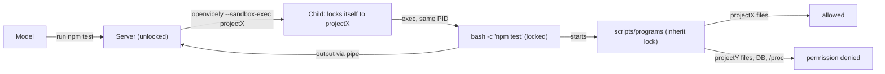

# Design: Teams, Organizations, and Shared Projects

The unreleased Phase 2 database changes are consolidated in `224_project_authorization.sql`, upgrading directly from version 223. Tests cover upgrade, rollback, and re-upgrade from that released boundary. Rollback removes the Phase 2 schema while preserving existing source records; no external-user bindings are inferred. Checkpoints below that cite migrations 218–225 predate the consolidation and all refer to this one migration.

Status: Proposal (investigation only — no code changed)
Scope: Multi-user support in a GitHub-like model: Organization → Members → Projects (private or shared) → per-project roles.

---

## 0. Summary

Today OpenVibely is a **single-principal application**. Authentication, when enabled at all, gates the entire instance with one identity (`AUTH_USERNAME`/`AUTH_PASSWORD`, or one hosted-SSO subject). Nothing in the schema records *who* did anything, and every authenticated request can read and change every project. "Project" is the only tenancy boundary. It is enforced inconsistently: some handlers check task→project ownership, but many load rows by ID alone.

To support teams we need:

1. **Identity**: real `users` rows, sessions bound to a user ID, and API tokens.
2. **Tenancy**: an `organizations` root. Projects get `org_id`, `owner_user_id`, and `visibility`. A `project_members` table holds per-project roles.
3. **One authorization chokepoint**: a `service.Authorizer` that every surface calls: HTTP, runtime tools, channels, webhooks, scheduler, workers, automations, and WebSocket subscriptions. Cross-project checks done per handler become `authz.RequireProject(ctx, principal, projectID, perm)`.
4. **Attribution**: `created_by_user_id`/`author_user_id` on tasks, thread inputs, executions, schedules, automations, alerts decisions, review comments, and usage events.
5. **Re-scoping global state**: model configs, OAuth connections, channel credentials, `app_settings`, UI preferences, global agents/skills, and worker limits currently live at instance level. Each must be explicitly assigned to user, org, or project.
6. **A kernel sandbox for agent execution**: agents execute `bash -c` on the host (`pkg/agenttools/tools.go:343`) with the server's OS privileges. Project-level ACLs do not stop an agent in project A from writing a script that edits project B's checkout or reads the SQLite DB. The fix is a Landlock launcher that locks every agent command, and every server git call, to its own project's folders (§3.5–3.6).

Two layers, both required:

- **App policy (database)** decides *who* can do *what*: which people can see a project, start tasks, change settings, or share it.
- **Kernel sandbox (Landlock)** decides *where* a running agent can reach: only its own project's folders, with no other projects, no database file, no secrets, and no localhost API.

Recommended path: ship **"one org, many users"** first. Keep a single implicit org per instance and add users, project membership, attribution, and the authorizer. Then add the Landlock sandbox before calling private projects private. Single-user mode keeps working with no visible change. Real multi-org tenancy and per-user credentials come later. On hosted, each org gets its own container, so orgs never share a disk.

---

## 1. Current-State Audit

### 1.1 Authentication and sessions

| Concern | Today | Where |
|---|---|---|
| Auth modes | `disabled`, `local`, `hosted_sso` | `internal/auth/auth.go` (`AuthMode*`), `internal/config/config.go:100-165` |
| Local login | One username/password from env (`AUTH_USERNAME`, `AUTH_PASSWORD`), constant-time compare | `auth.Config.ValidateCredentials` |
| Session | Stateless HMAC cookie `ov_session` = `username:v2:expiryNanos` signed with `AUTH_SESSION_SECRET`. No server-side session table, no revocation | `auth.Config.SignToken/VerifyToken` |
| Hosted SSO | OAuth-style PKCE against a control plane. Claims carry `sub`, `email`, `display`, `instance_id`, 1h lifetime | `internal/auth/hosted_sso.go` (`SessionClaims`, `HostedIdentity`, `VerifyHostedSession`) |
| Middleware | `Handler.AuthMiddleware` stores `*auth.User` or `*auth.SessionClaims` in `c.Set("auth_user")`. It only answers "is authenticated", never "is allowed" | `internal/handler/auth_handler.go:115` |
| Principal ID | `authPrincipalID` returns `"web:<username>"` or `"local"`. It is used only for automation chat confirmation receipts | `auth_handler.go:502`, `chat_handler.go:338`, `api_chat_handler.go:445`, `service/automation_confirmation_service.go:70` |
| Brute-force | Instance-wide in-memory failure counter, not per account | `auth_handler.go:449-490` |
| Machine auth | `Authorization: Bearer` only for hosted/docker update agent on `/api/system/*` | `handler/system_handler.go:90-101` |
| Public paths | Login/SSO, health, static, swagger, `/webhooks/inbound/*`, and OAuth callbacks for models, GitHub, and Slack | `isAuthPublicPath` |
| Disabled mode | Default for desktop and dev. Every request is anonymous and fully privileged | `AuthMiddleware` early return |

**Single-user assumptions:** the `users` concept does not exist in the DB. `auth.User` is just `{Username, Display}`. `/auth/me` returns the env username. Hosted SSO identity (`sub`) is never persisted.

### 1.2 Data scoping inventory (schema at goose version 210)

I derived this by migrating a scratch DB and listing columns. **55 tables carry `project_id`**. These tables are **instance-global**, or reach a project only through a parent row:

| Category | Table(s) | Scope today | Notes |
|---|---|---|---|
| Projects | `projects` | global list | `is_default` flag. No owner, no visibility. `ListSelectorOptions` returns all |
| Tasks / chat | `tasks` | project | Chat messages are `tasks` rows with `category='chat'` (`models.CategoryChat`). There is **one chat thread per project**: `ExecutionRepo.ListChatHistory(projectID)` and `ClearChat` delete all chat for the project |
| Executions | `executions` | via `task_id` (+ denormalized `task_project_id`, `task_category`) | No author. `prompt_sent` holds the user's message |
| Thread inputs | `thread_inputs` | project (+ `task_id`) | Has channel-identity columns (`slack_user_id`, `discord_user_id`, `email_from`, `x_user_id`…) but **no app user** |
| Schedules | `schedules`, `schedule_dispatch_admissions` | via `task_id` | `schedule_skips`, `schedule_project_pauses` have `project_id` |
| Goals, PRs, commit stats, review comments, attachments | `task_goals`, `task_pull_requests`, `task_commit_stats`, `review_comments` (`reviewed_by` free text), `task_attachments`, `chat_attachments` | via task/execution | |
| Automations | `automations` + ~25 `automation_*` tables | project | `automations.created_via` exists but no user |
| Alerts | `alerts` | project (`scope='project'` only) | `claimant` is a task ID. `decision_state` has no decider user |
| Agents | `agents` | `scope` = `global` or `project` | `created_by` is `'user'` or `'system'`, not a user ID |
| Model configs | `agent_configs` | **global** | Contains `api_key`, OAuth tokens, `max_workers` |
| OAuth connections | `oauth_connections`, `oauth_refresh_leases` | **global** | Shared provider subscriptions (`187_shared_oauth_connections.sql`) |
| Usage | `llm_usage_events` | project, task, execution | No user. `account_usage_snapshots` is global per provider account |
| Settings | `app_settings` (k/v) | **global** | Holds GitHub PAT/App private key (`service/github_service.go:36`), Slack/Discord/Email/Telegram/X secrets, `github_api_endpoint`, and **UI preferences** (`ui.theme`, `ui.selected_project_id`, `ui.pinned_project_ids`, `ui.model_favorites`: `handler/ui_preferences_handler.go:16-20`, `handler/model_favorites_handler.go:11`) |
| Workers | `worker_settings` | **global** single row | `projects.max_workers` and `agent_configs.max_workers` add caps |
| Personalities | `custom_personalities` | **global** | |
| Channel authorization | `telegram_/slack_/discord_/x_authorized_users`, `email_authorized_senders` | project (migration `180_project_scoped_channel_authorization.sql`) | `added_by` is free text |
| GitHub authorization | `github_authorized_actors` | **global** | `permission` column. `github_project_inboxes` is per project |
| Channel → project selection | `slack_user_projects`, `discord_user_projects`, `telegram_user_projects`, `x_user_projects`, `email_sender_projects` | per external identity | `SlackUserProjectRepo.SetUserProject` lets a channel identity switch to **any** project |
| Webhooks | `webhook_endpoints` | project | Path token + secret. Public route |
| Outbound targets | `channel_targets`, `channel_message_sends` | project | |
| Memory | Files in `<repo>/.openvibely/memories/` plus `knowledge_entries`, `project_memory_settings` | project (filesystem) | Memory is **in the repo**, so anyone with repo access can read it |
| Skills | Built-in, global agent skills, and project skills under the repo | mixed | `handler/agent_skills_handler.go:339 currentProjectSkillRoot` |
| Chat context | `chat_compaction_checkpoints`, `chat_context_usage` | `(scope_type, scope_id)` | scope_id = project or task |
| Worktrees | `<repo_path>/.worktrees/task_<id>` | project filesystem | `service/worktree_service.go:249`. Managed clones under `PROJECT_REPO_ROOT` |

### 1.3 How "current project" is resolved

`Handler.getCurrentProjectID` (`internal/handler/handler.go:653`) resolves in this order: `?project_id=` → `app_settings['ui.selected_project_id']` → first project. It is called about 68 times in handlers. Most routes are **unprefixed** (`/tasks/:taskId`, `/schedules/:id`, `/agents/:id`, `/alerts/:id`, `/models/:id`; 316 routes in `handler.go`). In a multi-user world this creates two problems:

- The selected-project fallback is **shared across all users**, because it is one `app_settings` row.
- ID-addressed routes often trust the ID. Example: `Handler.GetTask` (`handler/task_handler.go:1248`) calls `loadTaskDetailContentData`, which loads `taskSvc.GetByID(taskID)` with **no project or principal check**. `GetTaskExecutions` is similar. Some routes check (`requireTaskInRequestProject` in `schedule_handler.go:107`, `requireTaskGoalInRequestProject`, and `service/task_reference_resolver.go:34`), but those checks compare to the *request's* project, which is user-controlled. Once users exist, this becomes a set of IDOR vulnerabilities.

### 1.4 Runtime tools and agents

- Chat and task-thread runtime tools (`handler/chat_action_tools.go`, 1.6k lines; `service/chat_action_runtime.go`, 3.5k lines) carry `streamingResponseParams{ProjectID, PrincipalID, TaskID, IsTaskFollowup, Surface…}` (`handler/chat_processing.go:58`). Tools enforce *current-project* ownership, which is good. They do not know who the human is or what that human's role is.
- `switch_project` on channels can move a channel identity to any project.
- Agent tools run `bash -c` on the host (`pkg/agenttools/tools.go:343`) with the server's full environment. Default cwd is the worktree, but no sandbox exists (by design for single-user; see project guidance "worktree default is a convenience, not a sandbox"). Multi-user private projects change that decision (§3.5).
- The read/write/edit file tools run inside the server process. `resolvePath` (`pkg/agenttools/tools.go:53`) accepts any absolute path.
- MCP servers are started directly by the server (`pkg/mcp_client/client.go:394`).
- The server runs git in about 93 places with no shared helper (69 in `internal/service/worktree_service.go`). It never sets `core.hooksPath` or `--no-verify`, so repo hooks run on every server-side commit, merge, rebase, and checkout (`worktree_service.go:628`, `:1206`, `:1369`, `:1385`, `:1540`).

### 1.5 Background actors (no human principal)

- `SchedulerService` (`service/scheduler_service.go:121 checkDueTasks`), `WorkerService` (`service/worker_service.go`), automation reconciler and dispatcher (`server/server.go:1084-1086`), OAuth refresh, memory consolidation schedules, the Goal Agent continuation, channel pollers (Telegram, Email, X), and the GitHub Dev Inbox all act **as the instance**.

### 1.6 Realtime

- Live transport uses `/events/ws` (`internal/handler/live_websocket.go`, `LiveWebSocket`). One connection multiplexes `live` and `execution` subscriptions, each with its own subscription ID.
- `liveSubscriptionAllowed` requires an existing project and verifies that requested tasks/executions belong to it. Task/chat events use `SubscribeProject`; file events use a verified task subscription. Execution subscriptions support replay from an offset.
- The connection rechecks instance-session validity on incoming commands and every 15 seconds. This is not user/project membership authorization. Org support must authorize each subscription and stop delivery when membership, conversation visibility, or session access changes.

### 1.7 Explicit single-user / single-owner assumptions (checklist)

1. `auth.Config` holds one username/password. Sessions carry a username, not a user ID.
2. `authPrincipalID` collapses everyone to `"local"` when auth is disabled.
3. `app_settings` mixes secrets, integration config, and **per-person UI preferences**.
4. `ui.selected_project_id` is a global "current project". So are `ui.pinned_project_ids` and the desktop tab set.
5. `projects.is_default` is a single global default project.
6. One chat thread per project (`category='chat'` rows, `ClearChat` wipes for everyone).
7. Model configs and OAuth connections are global and usable from any project.
8. Channel credentials are global. Channel → project switching is unrestricted.
9. `github_authorized_actors` is global. The PAT owner is "the" approver.
10. Alerts approval and claims have no human decider identity.
11. `review_comments.reviewed_by`, `*_authorized_users.added_by`, and `agents.created_by` hold free text, not FKs.
12. Usage analytics has no user dimension.
13. Global worker limit and global model caps are shared by everyone.
14. WebSocket subscriptions check project/resource consistency, but do not yet enforce per-user project membership.
15. The project list (`ProjectRepo.ListSelectorOptions`, ordered `is_default DESC, name`) is unfiltered.
16. Agent shell runs as the server OS user, with access to every repo under `PROJECT_REPO_ROOT` and to `openvibely.db`.

---

## 2. Proposed Data Model

All new tables are added through goose migrations starting at `211_*.sql`. IDs follow the existing `repository/id.go` convention (hex text).

### 2.1 Entities

```sql
-- 211_users_orgs.sql
CREATE TABLE users (
  id            TEXT PRIMARY KEY,
  email         TEXT,                       -- unique when not null (COLLATE NOCASE)
  username      TEXT NOT NULL,              -- unique handle, @-mentionable
  display_name  TEXT NOT NULL DEFAULT '',
  avatar_url    TEXT NOT NULL DEFAULT '',
  password_hash TEXT,                       -- argon2id; NULL for SSO-only
  is_instance_admin INTEGER NOT NULL DEFAULT 0,
  disabled_at   DATETIME,
  created_at    DATETIME NOT NULL DEFAULT (datetime('now')),
  updated_at    DATETIME NOT NULL DEFAULT (datetime('now'))
);
CREATE UNIQUE INDEX idx_users_username ON users(username COLLATE NOCASE);
CREATE UNIQUE INDEX idx_users_email ON users(email COLLATE NOCASE) WHERE email IS NOT NULL;

CREATE TABLE user_identities (              -- external logins (hosted SSO, GitHub OAuth, OIDC)
  id TEXT PRIMARY KEY,
  user_id TEXT NOT NULL REFERENCES users(id) ON DELETE CASCADE,
  provider TEXT NOT NULL CHECK (provider IN ('hosted_sso','github','oidc')),
  subject  TEXT NOT NULL,                   -- e.g. hosted `sub`, GitHub numeric user id
  email TEXT, login TEXT,
  created_at DATETIME NOT NULL DEFAULT (datetime('now')),
  UNIQUE(provider, subject)
);

CREATE TABLE organizations (
  id TEXT PRIMARY KEY,
  slug TEXT NOT NULL UNIQUE,
  name TEXT NOT NULL,
  is_personal INTEGER NOT NULL DEFAULT 0,   -- reserved; see alternatives
  default_project_visibility TEXT NOT NULL DEFAULT 'private'
      CHECK (default_project_visibility IN ('private','org')),
  created_at DATETIME NOT NULL DEFAULT (datetime('now')),
  updated_at DATETIME NOT NULL DEFAULT (datetime('now'))
);

CREATE TABLE org_memberships (
  org_id  TEXT NOT NULL REFERENCES organizations(id) ON DELETE CASCADE,
  user_id TEXT NOT NULL REFERENCES users(id) ON DELETE CASCADE,
  role    TEXT NOT NULL CHECK (role IN ('owner','admin','member')),
  created_at DATETIME NOT NULL DEFAULT (datetime('now')),
  PRIMARY KEY (org_id, user_id)
);
CREATE INDEX idx_org_memberships_user ON org_memberships(user_id);
```

### 2.2 Project ownership, visibility, and shares

```sql
-- 212_project_ownership.sql (table-rebuild migration: NO TRANSACTION, FK off/on, recreate indexes)
ALTER TABLE projects ADD COLUMN org_id TEXT REFERENCES organizations(id);
ALTER TABLE projects ADD COLUMN owner_user_id TEXT REFERENCES users(id);
ALTER TABLE projects ADD COLUMN visibility TEXT NOT NULL DEFAULT 'private'
    CHECK (visibility IN ('private','shared','org'));
-- backfill, then rebuild to make org_id/owner_user_id NOT NULL
CREATE INDEX idx_projects_org_visibility ON projects(org_id, visibility, name);

CREATE TABLE project_members (
  project_id TEXT NOT NULL REFERENCES projects(id) ON DELETE CASCADE,
  user_id    TEXT NOT NULL REFERENCES users(id) ON DELETE CASCADE,
  role       TEXT NOT NULL CHECK (role IN ('owner','maintainer','editor','viewer')),
  added_by_user_id TEXT REFERENCES users(id),
  created_at DATETIME NOT NULL DEFAULT (datetime('now')),
  PRIMARY KEY (project_id, user_id)
);
CREATE INDEX idx_project_members_user ON project_members(user_id, project_id);
```

Visibility semantics:

- `private`: only `owner_user_id`, org owners and admins, and explicit `project_members`. Default.
- `shared`: same as private, plus the UI shows a "Shared" badge. This is a **derived/UX state**, effectively `private` with members ≥1. **Recommendation:** store only `private`/`org` and derive "shared" from membership count, to avoid two sources of truth. The CHECK above lists all three for discussion; the final migration should pick one.
- `org`: every org member gets an implicit `viewer` role (configurable to `editor` via `organizations.default_project_visibility`). Explicit `project_members` rows can raise a role. Org-wide visibility never *lowers* an explicit role.

**Effective project role** = max(explicit membership, owner → `owner`, org admin/owner → `owner`, org-visible → org default role).

The owner is also stored in `project_members` with role `owner`. This makes listing a single join, and `owner_user_id` is denormalized for transfers.

### 2.3 Invitations

```sql
CREATE TABLE invitations (
  id TEXT PRIMARY KEY,
  org_id TEXT NOT NULL REFERENCES organizations(id) ON DELETE CASCADE,
  project_id TEXT REFERENCES projects(id) ON DELETE CASCADE,  -- NULL = org-only invite
  email TEXT NOT NULL,
  org_role TEXT NOT NULL DEFAULT 'member' CHECK (org_role IN ('admin','member')),
  project_role TEXT CHECK (project_role IN ('maintainer','editor','viewer')),
  token_hash TEXT NOT NULL UNIQUE,          -- sha256 of single-use token; never store raw
  invited_by_user_id TEXT NOT NULL REFERENCES users(id),
  expires_at DATETIME NOT NULL,
  accepted_at DATETIME, revoked_at DATETIME,
  created_at DATETIME NOT NULL DEFAULT (datetime('now'))
);
```

Sharing a project with an existing org member writes `project_members` directly. Invites cover people who are not yet users.

### 2.4 Attribution columns (additive, nullable for legacy rows)

| Table | New column(s) | Purpose |
|---|---|---|
| `tasks` | `created_by_user_id`, `assignee_user_id` (optional, later) | Who created the task; board filtering |
| `thread_inputs` | `author_user_id` | Message author for chat/task-thread input |
| `executions` | `initiated_by_user_id` (NULL = system/schedule/automation), `initiator_kind` (`user`,`schedule`,`automation`,`goal`,`channel`,`webhook`,`system`) | Attribution of runs and cost |
| `schedules` | `created_by_user_id`, `run_as_user_id` | Background run principal (see §3.4) |
| `automations`, `automation_versions` | `created_by_user_id`, `published_by_user_id` | |
| `alerts` | `decided_by_user_id` | Approval provenance |
| `review_comments` | `author_user_id` (keep `reviewed_by` for display) | |
| `task_pull_requests` | `opened_by_user_id` | |
| `llm_usage_events` | `user_id`, `org_id` | Usage/billing |
| `*_authorized_users`, `email_authorized_senders`, `github_authorized_actors` | `added_by_user_id`, `linked_user_id` | Channel identity → app user (§4.4) |
| `agents` | `owner_user_id` (for user-scoped agents, later) | |
| `webhook_endpoints`, `channel_targets` | `created_by_user_id` | |

For chat, the first user turn of a chat "message" is currently the chat-category task's `prompt` plus the execution's `prompt_sent`. Attribution should live on `thread_inputs.author_user_id`, copied to `executions.initiated_by_user_id` at promotion (`ThreadInputRepo.ClaimQueuedForChatExecution`, `repository/thread_input_repo.go:1187`), so history rendering can show an avatar per bubble without a join through tasks.

### 2.5 Chat conversations

Today: one implicit chat per project, made of `tasks.category='chat'`, one row per turn, and history = `ListChatHistory(projectID)`. For collaboration we need:

```sql
CREATE TABLE chat_conversations (
  id TEXT PRIMARY KEY,
  project_id TEXT NOT NULL REFERENCES projects(id) ON DELETE CASCADE,
  title TEXT NOT NULL DEFAULT '',
  visibility TEXT NOT NULL DEFAULT 'project' CHECK (visibility IN ('private','project')),
  created_by_user_id TEXT REFERENCES users(id),
  is_default INTEGER NOT NULL DEFAULT 0,     -- the legacy per-project thread
  created_at DATETIME NOT NULL DEFAULT (datetime('now')),
  updated_at DATETIME NOT NULL DEFAULT (datetime('now')),
  archived_at DATETIME
);
CREATE TABLE chat_conversation_participants (
  conversation_id TEXT NOT NULL REFERENCES chat_conversations(id) ON DELETE CASCADE,
  user_id TEXT NOT NULL REFERENCES users(id) ON DELETE CASCADE,
  last_read_execution_id TEXT,
  PRIMARY KEY (conversation_id, user_id)
);
ALTER TABLE tasks ADD COLUMN conversation_id TEXT REFERENCES chat_conversations(id);
ALTER TABLE thread_inputs ADD COLUMN conversation_id TEXT REFERENCES chat_conversations(id);
ALTER TABLE executions ADD COLUMN conversation_id TEXT; -- denormalized like task_project_id
```

- The migration creates one `is_default=1, visibility='project'` conversation per project and backfills `conversation_id` on chat-category tasks, inputs, and executions.
- `chat_compaction_checkpoints` / `chat_context_usage` gain `scope_type='conversation'`, keyed by conversation ID, instead of the project.
- `ClearChat` becomes "archive conversation" for editors+. It no longer deletes history for everyone.
- `private` conversations are visible only to their creator and participants within a project they can access. They can be **shared** by flipping to `project` or by adding participants. This answers "chat should be shareable with other people".
- The queue/FIFO semantics in `thread_inputs` (per project chat today) must become per-conversation. Two people chatting in the same conversation share one ordered queue. That is the intended collaborative semantic: each message is attributed, and the agent sees `[@alice]: …` in history.
- Execution history for the LLM must include author labels when more than one human participated (prompt builder in `handler/chat_processing.go` / `service/task_creation.go BuildChatContext*`).

### 2.6 Backend-neutral persistence: implemented

The persistence prerequisite is implemented in the current checkout:

- `internal/persistence/backend.go` defines `Backend` and the `Stores` bundle. The backend owns schema version reporting, maintenance, and shutdown.
- `internal/persistence/stores.go` defines domain store interfaces; projection types, errors, and the transaction marker live in the neutral package.
- `internal/persistence/sqlite/` owns SQLite repositories, connections, migrations, and store construction. `internal/server/server.go` selects the backend at startup; SQLite is currently the only supported driver.
- Application services and handlers use the neutral interfaces. Application tests use `internal/testutil/teststores`; its boundary tests guard against backend imports in application tests and test-helper imports in production code.

Remaining teams work:

- Add backend-neutral `Principal` / `AccessScope` types and authorization-aware store operations. Existing project-scoped methods help, but methods such as `TaskStore.GetByID` and `ProjectStore.GetByID` still accept only an ID. Interfaces alone do not enforce user membership or roles.
- Add `UserStore`, `OrgStore`, `ProjectMemberStore`, `InvitationStore`, `ConversationStore`, and `AuditStore` to the neutral package and `Stores` bundle. Construct their SQLite implementations inside the backend, keeping server startup independent of concrete repositories.
- Keep membership filters, pagination, counts, and writes consistent; verify denial and revocation through the application policy and persistence tests.
- A future Postgres backend can implement the same contracts, but still needs its own queries, migrations, concurrency semantics, and tests. This refactor does not deliver Postgres or change SQLite's concurrency limits. Multiple orgs do not inherently require Postgres; choosing it should depend on measured load and deployment requirements.

This completes the persistence refactor portion of Phase 0, not the route-ownership, event-stream, authorization, or sandbox work.

---

## 3. Authorization

### 3.1 Permission matrix (project-level)

| Action | viewer | editor | maintainer | owner | org admin* |
|---|:-:|:-:|:-:|:-:|:-:|
| See project, tasks, threads, diffs, schedules, analytics | ✓ | ✓ | ✓ | ✓ | ✓ |
| Read project-visible chat conversations | ✓ | ✓ | ✓ | ✓ | ✓ |
| Post in chat / task thread (starts LLM runs, spends money) | – | ✓ | ✓ | ✓ | ✓ |
| Create/edit/move/run/cancel tasks, steer, stop | – | ✓ | ✓ | ✓ | ✓ |
| Create/edit schedules, goals | – | ✓ | ✓ | ✓ | ✓ |
| Answer `request_user_input`, approve Native alerts | – | ✓ | ✓ | ✓ | ✓ |
| Merge worktree branch / open PR / auto-merge settings | – | configurable (default ✗) | ✓ | ✓ | ✓ |
| Create/publish/pause automations, webhooks, outbound targets | – | – | ✓ | ✓ | ✓ |
| Project agents/skills/memory curation, lifecycle hooks | – | – | ✓ | ✓ | ✓ |
| Channel authorized users / GitHub inbox for project | – | – | ✓ | ✓ | ✓ |
| Project settings (repo path, default model, worker cap) | – | – | ✓ | ✓ | ✓ |
| Share project / manage members / change visibility | – | – | ✓ (≤ own role) | ✓ | ✓ |
| Transfer ownership, delete project | – | – | – | ✓ | ✓ |

\* Org owners and admins hold owner rank on every project in the org, including private projects, as GitHub org owners do for private repositories. Project owners cannot restrict them. When an org admin who is not the recorded owner deletes a project or transfers its ownership, the audit event is marked `org_admin_override`. Reads are not audited.

Org-level permissions:

| Action | member | admin | owner |
|---|:-:|:-:|:-:|
| Create projects (owned by self) | ✓ (org setting) | ✓ | ✓ |
| See org-visible projects, member directory | ✓ | ✓ | ✓ |
| Invite/remove members, change org roles (< owner) | – | ✓ | ✓ |
| Manage org-shared model configs / OAuth connections / channel credentials | – | ✓ | ✓ |
| Use org-shared models | ✓ | ✓ | ✓ |
| Global worker limits, org analytics, audit log | – | ✓ | ✓ |
| Rename/delete org, billing, transfer ownership | – | – | ✓ |

Instance-level (`users.is_instance_admin`): updates (`/api/system/*`, `internal/update`), creating orgs (multi-org mode), and the server-wide worker cap.

### 3.2 Enforcement design

Introduce `internal/service/authz`:

```go
type Principal struct {
    UserID   string        // "" for system actors
    Kind     PrincipalKind // user, schedule, automation, channel, webhook, system, api_token
    OrgID    string
    TokenScopes []string   // for API tokens
}
type Permission string // "project.view", "task.run", "task.merge", "project.share", ...

func (a *Authorizer) Require(ctx context.Context, p Principal, projectID string, perm Permission) error
func (a *Authorizer) AccessibleProjectIDs(ctx context.Context, p Principal) ([]string, error) // cached per request
func PrincipalFromContext(ctx context.Context) Principal
func WithPrincipal(ctx context.Context, p Principal) context.Context
```

- The principal travels in `context.Context`, set by `AuthMiddleware`. Services read it, so the check works identically from HTTP, runtime tools, and channels.
- In disabled-auth / single-user mode, the middleware injects the **bootstrap user** principal (see §7), so every code path exercises the same authorizer.
- The deny response for objects outside the caller's access is **404, not 403**, to avoid confirming that a project or task exists.

Where checks must go:

| Surface | Entry points | Required change |
|---|---|---|
| HTTP pages / HTMX | 316 routes in `handler/handler.go` | Replace `getCurrentProjectID` with `requireProject(c, perm)`. For ID routes (`/tasks/:taskId`, `/schedules/:id`, `/alerts/:id`, `/automations/:automationId`, `/agents/:id`, `/reviews/:id`, `/thread-inputs/:inputId`, `/chat/attachments/*`, worktree/diff routes), load the row and then `Require(row.ProjectID)`. **Fix `GetTask`/`loadTaskDetailContentData` (`task_handler.go:1205,1248`) and `GetTaskExecutions` first**. Consider an Echo route-group helper: `withTask(perm, h.X)` |
| JSON API | `/api/tasks`, `/api/chat`, `/api/projects`, `/api/analytics`, `/api/capacity` (`api_*_handler.go`) | Same, plus API-token scope checks |
| Project list/selector | `ProjectRepo.ListSelectorOptions`, `ListAPI`, breadcrumb selector, desktop project picker (`cmd/desktop/project_picker.go`) | Filter by accessible IDs |
| Runtime tools | `handler/chat_action_tools.go`, `service/chat_action_runtime.go`, `chat_merge_tool.go`, `automation_chat_actions.go` | `streamingResponseParams.PrincipalID` becomes a `Principal`. Each tool maps to a `Permission` (e.g. `create_task`→`task.create`, `merge`→`task.merge`, `schedule_task`→`schedule.edit`, `create_alert`→`alert.create`, `github_*`→`integration.github.use`). Enforce in the shared runtime, **not** in prompts. `switch_project` checks `project.view` for the human |
| Runtime tool policy | `llm/contracts/runtime_tool_policy.go` | Viewers in Chat get read-only tool policy (as in Plan mode) |
| Channels | Slack/Discord/Telegram/Email/X services and `service/channel_chat_ingress.go` | Inbound identity → linked app user (§4.4) → principal. Unlinked identities keep today's project-scoped allowlist behavior as a `channel` principal limited to that project. `switch_project` and `*_user_projects` must reject projects the linked user cannot access |
| Webhooks | `/webhooks/inbound/*` (`handler/webhook_handler.go`) | Principal is `webhook` scoped to the endpoint's project. Runs are attributed to `webhook_endpoints.created_by_user_id`. Effective permission is capped at that creator's current role, so the webhook stops working if the creator loses access |
| Scheduler | `SchedulerService.checkDueTasks` | Run as `schedules.run_as_user_id`. Before dispatch, re-check that the user still has `task.run`. If not, skip, pause, and alert the project owner |
| Workers / follow-ups | `WorkerService`, Goal Agent continuation, swarm planner | Inherit the initiating principal from `executions.initiated_by_user_id`/task creator. Re-check on admission |
| Automations | reconciler, dispatcher, `automation_*_repo.go` | Run as `published_by_user_id` with a `automation` principal kind. Re-check on dispatch. GitHub inbox → task creation is attributed to the automation publisher |
| WebSocket | `handler/live_websocket.go LiveWebSocket`, `liveSubscriptionAllowed`, `dispatchLiveFrame` | Authenticate the connection, then check `project.view` for **every subscription**, including execution replay and reconnects. Preserve task/execution ownership checks and enforce conversation visibility. On access revocation, cancel affected subscriptions and discard queued frames before delivery; session revocation closes the connection. A valid connection never authorizes every project on it |
| Attachments / files | `attachment_handler.go`, `chat_attachment_handler.go`, worktree file/diff endpoints | Check via the owning task/execution |
| Memory/skills | `agent_skills_handler.go`, `skills_handler.go`, `MemoryService` | Project scope check. Global skills edit = org admin |
| Analytics / insights / upcoming / workers | `analytics_handler.go`, `insights_handler.go`, `upcoming_handler.go`, worker capacity | Project-scoped views check `project.view`. Global dashboards aggregate only accessible projects. Org-wide totals for org admins |
| Alerts | `alert_handler.go`, `alert_repo.go` | `decision` requires `alert.decide`. Record `decided_by_user_id` |

### 3.3 Preventing cross-project and cross-org leakage

1. **Repository-level guardrails**: list/query methods gain a mandatory `AccessScope` argument (using the existing persistence interfaces). Any query on a project-scoped table without a project filter must be an explicit "system" method, named as such (`ListAllForSchedulerSystem`), and grep-audited in CI.
2. **No trust in request project IDs**: the request's `project_id` is an *input* to authorization, never proof of access.
3. **Entity → project resolution** happens server-side from the row (task, execution, schedule…), then the authorizer runs.
4. **Model-facing context**: chat context builders (`BuildChatContextWithAgentDefinitions`) must include only the current project's data. That is already true; keep it under test. Cross-project tools (e.g. global `list_tasks`) must filter by principal.
5. **Caches**: channel project-selection caches (Slack, Discord, Telegram) and any `sync.Map` keyed by project must not serve another user's selection. Key them by (external identity) and re-authorize on read.
6. **Logs**: do not log other users' message contents at info (existing rule). Add user IDs, not emails, to operational logs.
7. **Filesystem**: ACLs alone do not stop the agent; the kernel sandbox does (§3.5–3.6, §9 R1).
8. **Tests**: add a reusable `authz` contract test that walks every registered route (there is already `broad_route_coverage_test.go` / `coverage_route_contracts_test.go`) with a user who is *not* a member and asserts 404. This is the highest-leverage test in the plan.

### 3.4 Background-run principal semantics

| Initiator | Runs as | Revocation behavior |
|---|---|---|
| Human chat/task-thread send | That user | — |
| Schedule | `run_as_user_id` (creator by default; maintainers may reassign) | Skip and pause schedule, notify |
| Automation | `published_by_user_id` | Pause automation (health `blocked`), notify |
| Goal continuation | Initiator of the goal's task | Pause goal |
| Webhook | Endpoint creator | Disable endpoint |
| Channel (linked) | Linked user | Reject with a channel message |
| Channel (unlinked allowlisted) | `channel` principal capped at `editor` on the allowlisted project | Remove from allowlist |
| System (memory consolidation, OAuth refresh, cleanup) | `system` | n/a |

### 3.5 Kernel sandbox for agent execution (Landlock)

App policy (§3.1–3.4) only decides whether a person may *start* a run. Once an agent is running, it runs as the same OS user (uid `10001`, `Dockerfile:168`) that owns every project folder. It could write a script that edits project Y and run it, and Linux would allow it. Private projects are not private without a kernel-level limit.

**Choice: Landlock.** Landlock is a Linux kernel feature (5.13+). A process can restrict itself to a list of folders. The restriction can't be removed, and every program the process starts inherits it. It needs no root, no extra Linux users, no user namespaces, and no new container capabilities. Docker's default seccomp profile allows it, and hosted's `no-new-privileges` setting (`openvibely-hosted/internal/provisioner/provisioner.go`) is exactly what Landlock requires.

**How it runs.** Today `execBash` (`pkg/agenttools/tools.go:343`) starts `bash -c <command>`. With the sandbox it starts the OpenVibely binary in a launcher mode instead:

```
/app/openvibely --sandbox-exec <policy> -- bash -c "<command>"
```

The first lines of `main()` detect `--sandbox-exec`, skip all server startup, apply the Landlock rules, and `syscall.Exec` into the command. The process does not stay running beside the command; it *becomes* the command (same PID). That still means one process per bash call, as today, and output flows back through the same pipe. The server itself is never locked, so it can still show diffs and merge. Go can't safely lock a single child after `fork`, so this re-exec is the standard approach (as used by `go-landlock`).



**Policy per run:**

| Access | Paths |
|---|---|
| Read and write | The task's worktree, the project's main repo (git metadata for worktrees), a per-run temp folder |
| Read only | System tools and libraries (`/usr`, `/bin`, `/lib`, `/etc` minus secrets), language toolchains, global git config |
| None | Other projects, `/data` (SQLite DB), app config, `/proc` of other processes |
| Network | Outbound allowed by default. The app's own API on localhost is blocked (Landlock TCP rules on Linux 6.7+, or a firewall rule) |

**Gaps Landlock does not close on its own, and their fixes:**

| Path an agent could take | Fix |
|---|---|
| Read/write/edit file tools run inside the unlocked server; `resolvePath` (`pkg/agenttools/tools.go:53`) accepts any absolute path | Reject paths outside the run's allowed folders (resolve symlinks first) |
| Child gets the server's full environment, including API keys | Pass an allow-listed environment only |
| Git hooks or config programs (`core.fsmonitor`, diff/merge drivers) run later by the unlocked server | Run all server git calls through the lock (§3.6) |
| A program calls the app's API on localhost to ask the server to make an edit | Block localhost from locked processes |
| MCP servers (`pkg/mcp_client/client.go:394`) and provider-local tools | Start them through the same launcher |
| Attaching to the server process | Already blocked by Landlock (`ptrace` restriction); keep `/proc` out of the policy |

**When Landlock is unavailable** (old kernel, macOS/Windows desktop): the app refuses to create or keep *private* projects in a multi-user org, instead of quietly running unlocked. Single-user installs and the desktop app don't need the sandbox and keep today's behavior.

**Compared with per-project Linux users:** that approach also works (a Linux user per project, agents run as that user), but it needs the app to run as root or a root helper to switch users, and every worktree needs the right owner. Landlock gives the same per-project wall without root, so it is the recommended choice. A container per run is stronger but slower and hard on desktop; it stays a fallback.

**Before building:** a one-day test on a hosted server. Start a container with hosted's settings and check that a locked shell, a program it writes and runs, and a git hook can't read or edit another project or reach the localhost API.

### 3.6 Server git calls through the lock

The server runs git in about 93 places (69 in `internal/service/worktree_service.go`, the rest across about 7 files), with no shared helper and no hook protection (§1.4). An agent can write `.git/hooks/post-merge` inside its own project, and the next server-side merge runs that hook unlocked.

Fix: one helper, `runGitLocked(ctx, project, args...)`, that starts git through the Landlock launcher with that project's policy (main repo and all its worktrees read-write; network only for push/fetch). Hooks keep working for projects that rely on them (formatters, linters), but they can only reach their own project. A test fails on any direct `exec.Command("git", ...)` outside the helper. Size: about 2–3 days, mostly mechanical.

---

## 4. Authentication and Identity

### 4.1 Login options

1. **Local accounts** (self-hosted default when >1 user): argon2id password hashes in `users.password_hash`, per-account lockout (replace the instance-wide counter in `auth_handler.go:449`), and an admin-created reset link. The current `AUTH_USERNAME`/`AUTH_PASSWORD` env pair becomes a **bootstrap admin** seed. On first start the env pair is created or updated as an instance-admin user. Keep the env path working for Docker users.
2. **Hosted SSO** (existing `auth/hosted_sso.go`): persist `HostedIdentity.Subject` in `user_identities(provider='hosted_sso')`, and auto-provision users on first login when the control plane asserts org membership. The control plane should add `org_id`/`roles` claims later. Until then, treat all hosted-SSO users of an instance as members of the instance's single org, and the first user as owner.
3. **GitHub OAuth login**: natural for this product, because GitHub is already the primary integration. Reuse the GitHub App OAuth (`handler/github_auth_handler.go`) callback infrastructure. Optionally restrict sign-in to members of a GitHub org and auto-map GitHub org/team → OpenVibely org/project roles (later).
4. **Generic OIDC** (later): Google Workspace/Okta for self-hosted enterprises.

### 4.2 Sessions

- Replace stateless username cookies with **server-side sessions**: `user_sessions(id_hash, user_id, created_at, last_seen_at, expires_at, revoked_at, user_agent, ip)`. The cookie holds an opaque random token; the DB stores only its hash. This enables logout-everywhere, revocation on member removal, and an "active sessions" UI.
- Hosted SSO cookies can remain signed claims (1h). Map `sub` → `user_id` on each request (cached), so disabling a user takes effect within one request.
- Keep the `HX-Redirect` handling in `AuthMiddleware`.
- Desktop (Wails) runs on loopback. Keep auth disabled → bootstrap user (see §7).

### 4.3 API tokens

`api_tokens(id, user_id, name, token_hash, scopes_json, project_ids_json NULL, last_used_at, expires_at, revoked_at)` hold personal access tokens with scopes (`read`, `tasks:write`, `chat:write`, `admin`) and optional project restriction. Authorize them via `Authorization: Bearer ov_pat_…` in `AuthMiddleware`. The existing hosted/docker agent tokens stay separate (instance-level).

### 4.4 Channel identities → org users

Today each channel has its own allowlist (`telegram_authorized_users`, `slack_authorized_users`, `discord_authorized_users`, `x_authorized_users`, `email_authorized_senders`, global `github_authorized_actors`). Proposal:

- Add `linked_user_id` to each allowlist row (or a unified `channel_identity_links(platform, external_id, user_id, verified_at)`).
- **Self-service linking**: a user runs `/link` in Slack/Telegram/Discord, receives a one-time code, and confirms it in the web UI (or the reverse). Email is linked by verified address match. GitHub is linked through the GitHub OAuth identity in `user_identities`.
- Inbound effective permission = linked user's project role. The allowlist remains the **channel admission** gate, and the user role is the **authorization** gate.
- `github_authorized_actors` (approvers for Dev Inbox assignment) becomes per-project, or is derived: "GitHub logins linked to users with ≥ maintainer on this project". GitHub assignment-as-approval must map the assigner to a user with `task.create` on the project.
- Slack being allow-by-default (memory note) is unsafe in multi-user mode. Default it to deny when the instance has more than one user.

---

## 5. Secrets and Resources

### 5.1 Model credentials (`agent_configs`, `oauth_connections`)

Options:

| Model | Pros | Cons |
|---|---|---|
| Org-owned only (today's global, renamed) | Simple; matches company-paid API keys | Personal Claude/ChatGPT subscriptions are shared with everyone, which may violate provider ToS |
| **Hybrid (recommended)**: `owner_kind` ∈ {`org`,`user`}, plus `owner_id`, on `agent_configs` and `oauth_connections` | Company keys shared; personal OAuth subscriptions stay personal | Resolution rules needed |
| Per-project | Fine-grained cost control | Lots of duplication |

Resolution rules for the hybrid:

- A user may select org models and their own personal models.
- A project can **allow-list** models (`project_model_policies(project_id, agent_config_id)`). `projects.default_agent_config_id` must point to an org model or the owner's model.
- **Background runs** (schedules, automations) use the run-as user's or org models only. A personal model whose owner has left the project or org fails closed.
- When a collaborator continues someone else's task (follow-up), the task's model (`tasks.agent_id`) may be personal to someone else. Rule: follow-ups by a different user re-resolve to a model *the sender* can use. If the pinned model is not usable, prompt the sender to pick a model. Never silently spend another person's subscription.
- `account_usage_snapshots` (provider plan limits) attach to the credential owner.

### 5.2 Integration credentials (`app_settings`)

Move secrets out of the flat `app_settings` table into `integration_credentials(scope_kind, scope_id, provider, key, value_encrypted)`:

- GitHub App/PAT, Slack/Discord bot tokens, IMAP/SMTP, X: **org-scoped** by default, with an optional project override (e.g. different GitHub App installation per project).
- The no-persisted-tokens rule (GitHub installation tokens minted per operation) is unchanged.
- Consider at-rest encryption with an instance key (`OPENVIBELY_SECRET_KEY`) now that more than one human can reach the DB host or backups.

`app_settings` keeps instance-level settings only. **UI preferences move to `user_preferences(user_id, key, value)`**, including `ui.theme`, `ui.sidebar_collapsed`, `ui.diff_view`, `ui.selected_project_id`, `ui.pinned_project_ids`, `ui.model_favorites`, and desktop tab state.

### 5.3 Worker limits

Today: global `worker_settings.max_workers`, `projects.max_workers`, and `agent_configs.max_workers`, with atomic reservations. Add:

- `organizations.max_workers` (≤ instance cap) and optionally `org_memberships.max_workers` (per-user fair share). This prevents one user's swarm from starving teammates.
- Admission order should become fair across users (round-robin by `initiated_by_user_id`) instead of pure FIFO. This is open question Q6.

### 5.4 Usage analytics and billing

- Add `user_id` and `org_id` to `llm_usage_events` (populated from the execution's initiator), and group by user in `service/usage_analytics_service.go`.
- Attribute background-run usage to the run-as user and mark `initiator_kind`.
- Billing (hosted): meter per org via `llm_usage_events` and worker-minutes. Seat count = `org_memberships`. BYO-key orgs pay only seats; managed-key orgs pay usage. Self-hosted: no billing, analytics only.
- Budgets: `agent_cost_budgets` exists per model config. Add org- and user-level budgets later.

---

## 6. Collaboration Concerns

| Concern | Proposal |
|---|---|
| **Concurrent task edits** | Add `tasks.version INTEGER` for optimistic concurrency on title, prompt, priority, and category edits (`task_detail_property_handler.go`, kanban moves). Reject stale writes with 409 and re-render the authoritative fragment, which fits the existing "server fragments are authoritative" rule. Status transitions already go through `TaskRepo.ClaimTask` and lifecycle locks |
| **Concurrent chat/thread sends** | Already serialized via `thread_inputs` FIFO and steering. With attribution, two users queue in order. Steering/Stop require `task.run`. Show who is steering |
| **Merge conflicts on shared worktrees** | `project_merge_conflict_owners` already exists. Add `merge_requested_by_user_id`. Merge requires `task.merge` |
| **Realtime fan-out** | `events.Broadcaster` already supports project-scoped subscription. Add per-user notification subscriptions over the same WebSocket (a proposed internal `SubscribeUser(userID)` broadcaster API), and include `actor_user_id` in `TaskEvent`/`ChatEvent` so UIs can show "Alice moved X". Enforce authorization at subscribe time (§3.2) and on membership changes |
| **Notifications per user** | Alerts are project-scoped broadcasts today. Add `alert_recipients(alert_id, user_id, read_at)`, or simpler per-user read state, `alert_reads(alert_id, user_id)`, replacing the global `alerts.is_read`. Add notification types: mentioned in chat (`@username`), task assigned, review requested, run failed (your run), share invite. Delivery: in-app, plus optional email or linked Slack DM via existing `send_message` channels |
| **Audit log** | `audit_events(id, org_id, project_id, actor_user_id, actor_kind, action, target_type, target_id, metadata_json, ip, created_at)`. Write on: membership/role changes, visibility changes, shares, invites, credential changes, merges, PR opens, alert decisions, automation publish, project delete/transfer (marked when an org admin acts on a project they do not own), and login success/failure. Read view for org admins and project maintainers |
| **Presence** | Later nice-to-have: in-memory presence per project or conversation via the existing WebSocket (`presence` frames with a heartbeat). It does not need persistence |
| **Mentions** | `@user` in chat creates notifications and puts the participant into the conversation |
| **Assignment** | Optional `tasks.assignee_user_id` plus a board filter ("My tasks") |

---

## 7. Deployment Modes and Backwards Compatibility

| Mode | Today | Proposed |
|---|---|---|
| Desktop (Wails, `cmd/desktop`, `config.ModeDesktop`) | Auth disabled, loopback | **Single-user mode**: bootstrap user + personal org created at migration. All authz runs with that principal. No login UI. Teams are not offered on desktop initially, but desktop may later connect to a team server as a client |
| Self-hosted server, auth disabled | Open to anyone who can reach it | Same single-user mode. Startup warning when bound to a non-loopback address. Adding a second user requires enabling local auth |
| Self-hosted, local auth | One env user | Env user = bootstrap instance admin + org owner. Admin UI to add users and invites. Multi-user enabled |
| Hosted (`OPENVIBELY_HOSTED_SSO_ENABLED`, `buildinfo.ModeHosted`) | One instance per customer, SSO via control plane | **One instance = one org** (recommended first). The control plane provides membership; the instance trusts `instance_id`-bound claims. Multi-org-per-instance requires org isolation throughout the app and filesystem; evaluate Postgres based on load |

Single-user compatibility rules:

- With exactly one user, hide sharing and team UI chrome, except an "Invite teammates" entry point in settings.
- No URL changes are required. Optional future: `/{org}/{project}/…` prefixed routes; the current `?project_id=` scheme still works with authz.
- API behavior is unchanged for the bootstrap user.

---

## 8. Data Migration

Migration `21x_teams_backfill` (idempotent, `NO TRANSACTION` where tables are rebuilt):

1. Create `users` row **bootstrap**: username = `AUTH_USERNAME` if set, else `owner`; `is_instance_admin=1`. Because migrations cannot read env reliably, create a placeholder user in SQL. `server.Start` then reconciles it with `AUTH_USERNAME` and the hosted SSO first login on boot ("claim bootstrap user").
2. Create organization `default` (name from hostname or "My Organization"), and `org_memberships(bootstrap, owner)`.
3. `UPDATE projects SET org_id=default, owner_user_id=bootstrap, visibility='private'`. Insert `project_members(project, bootstrap, 'owner')`. Rebuild `projects` to make the columns NOT NULL.
4. Create one default `chat_conversations` row per project. Backfill `conversation_id` on `tasks WHERE category='chat'`, `thread_inputs WHERE scope='chat'`, and `executions WHERE task_category='chat'`. Re-key `chat_compaction_checkpoints`/`chat_context_usage` rows of project scope to the conversation.
5. Attribution columns stay NULL for legacy rows, rendered as "Owner (legacy)". Optionally backfill `created_by_user_id = bootstrap` for tasks, schedules, and automations so background run-as resolution works. **Recommended: backfill**, because schedules and automations need a run-as user.
6. Move `ui.*` keys from `app_settings` to `user_preferences` for the bootstrap user. Leave secrets in place until the Phase 5 credential move.
7. `agent_configs` / `oauth_connections` get `owner_kind='org', owner_id=default`, which preserves today's sharing.
8. Channel allowlist rows: `linked_user_id = NULL`; `added_by` stays as text.

Note the project rules: never touch `openvibely.db` destructively, follow the table-rebuild rules, and respect CHECK/FK constraints. Each migration needs a regression test on a populated fixture DB.

---

## 9. Risks, Open Questions, Alternatives

### 9.1 Risks

- **R1: Host-level agent execution defeats project ACLs (critical).** Agents run `bash -c` as the server user (`pkg/agenttools/tools.go:343`) and can read any repo under `PROJECT_REPO_ROOT`, other users' worktrees, `openvibely.db` (including the OAuth tokens in `agent_configs`/`oauth_connections` and the secrets in `app_settings`), and env vars. A *private* project is therefore only private from people who cannot run an agent. **Decision:** fix this with the Landlock sandbox (§3.5) and locked server git calls (§3.6) in Phase 3, before private projects ship to multi-user orgs. Supporting measures:
  1. Until Phase 3 lands, document the trust model honestly: "members of an org are trusted; private projects hide from the UI, not from agents".
  2. Pass agents an allow-listed environment, and move secrets out of the DB file into an encrypted store keyed by an env secret not passed to children (Phase 5).
  3. One container per org on hosted (Phase 6), so orgs never share a disk.
  4. Without Landlock (old kernels, desktop), private projects are not offered in multi-user orgs.
  
  This changes the current "worktree default is a convenience, not a sandbox" guidance for multi-user private projects only.
- **R2: Unscoped ID routes (IDOR).** Many handlers resolve by ID without principal checks (§1.3). A big-bang retrofit risks missing routes; the route-walking contract test is mandatory.
- **R3: Shared mutable singletons.** Global `app_settings`, `ui.selected_project_id`, channel selection caches, global worker caps, and global agents/skills create cross-user interference.
- **R4: Prompt and context leakage.** Chat history now contains multiple authors. A private conversation must never enter another conversation's context or memory extraction. `MemoryService` extraction writes to the repo's `.openvibely/memories/`, which is visible to all project members. Private chats must be excluded from memory extraction, or it must be documented as such.
- **R5: Cost attribution disputes.** Follow-ups on another user's task using their personal model (§5.1).
- **R6: SQLite write contention.** WAL mode, one writer connection, and a 1-connection reader pool (`internal/persistence/sqlite/database/database.go:17`, `:47`). Most writes come from agents (streamed output, executions, usage), and the worker limit caps them, so more people add little load. Fine for teams of about 5–20 (not load-tested). If needed: raise the reader pool (WAL allows many readers) and batch agent output writes; hosted spreads load with one container and DB per org; large orgs need Postgres.
- **R8: Sandbox coverage.** Landlock only helps if every path an agent can touch files through goes through the launcher or a path check (§3.5 gaps table). Missing one path (a new tool, a new git call) reopens R1. Mitigate with the direct-`exec` lint test and a sandbox escape test suite run in CI on Linux.
- **R7: Scope creep.** The roadmap touches nearly every handler; it needs strict phasing and feature flags per phase. This is a temporary rollout flag, not a permanent shim.

### 9.2 Open questions

1. Should org owners and admins see private projects (GitHub semantics) or not? (§3.1)
2. Keep `shared` as a stored visibility value or derive it? (Recommend derive.)
3. Can editors merge, or only maintainers? Per-project setting?
4. Do personal OAuth subscriptions (Claude Max, ChatGPT Plus) allow use by teammates? Default: never shared, for ToS reasons.
5. One instance per org (hosted) vs true multi-tenant: what is the hosted business model?
6. Fair-share worker scheduling across users: needed for MVP?
7. Should project-scoped memory files (committed in the repo) be considered public to project members? (Yes, implicitly.)
8. Should the desktop app become a client of a team server (remote project), or remain single-user only?
9. Do channel bots (one Slack app per org) route by linked user's last-selected project, or require explicit project per channel?
10. Do we need task-level permissions (private tasks inside a shared project)? Recommend **no** for v1.

### 9.3 Alternatives considered

- **Personal namespace + orgs (full GitHub model)**: every user has a personal "org" (`organizations.is_personal`). This is more flexible, but it doubles UI states. Reserved via `is_personal`; it is not in the MVP.
- **Project-only ACL, no org**: simplest, but it does not give a member directory, org-shared credentials, or billing unit. Rejected.
- **Team entities (groups) inside orgs** granting project roles to a group (`teams`, `team_members`, `project_team_grants`). Useful at more than 15 users; deferred to "Later", and the schema stays compatible.
- **Per-project Linux users** for agent isolation: works, but needs root or a root helper to switch users and correct file ownership on every worktree. Rejected in favor of Landlock (§3.5).
- **Container per agent run**: strongest isolation, but slow to start, needs Docker access from the app, and is impractical on desktop. Kept as a fallback if Landlock proves unavailable on hosted servers.
- **Turning git hooks off** (`core.hooksPath=/dev/null`) for server git calls: simple, but breaks projects that rely on hooks. Running git through the lock (§3.6) keeps hooks working safely.
- **External policy engine (OpenFGA, Cedar, Casbin)**: overkill now. The small `Authorizer` with an explicit matrix is easier to audit, and the interface leaves room to swap.
- **Row-level filtering in SQL views**: not portable across the future backends, and harder to test than explicit `AccessScope` parameters.

---

## 10. Phased Roadmap

Sizing: S ≈ ≤3 days, M ≈ 1–2 weeks, L ≈ 3–4 weeks (one engineer plus agent assistance).

### Phase 0: Groundwork (partly complete; remaining work needs sizing)
- **Project-boundary audit performed:** findings, fixes, coverage, and remaining limits are recorded in [Project access audit](project-access-audit.md). Shared task/input guards and scoped review/webhook/chat-status operations are added. This is not user authorization; legacy unscoped requests and global settings remain until the users/policy phases.
- **Complete:** backend-neutral persistence interfaces and SQLite implementation (§2.6).
- **Remaining:** `Principal` is now implemented in Phase 1; define `AccessScope` and expand the audit into a resource-wide authorization matrix, including legacy unscoped requests, before sizing the remaining work.
- **IDOR hardening:** task-route ownership is now covered by a route-walking contract test; review, webhook, queued-input, and chat-status fixes have regression tests. Extend coverage beyond these route families as described in the audit.
- Live transport now uses WebSockets with project/task ownership checks. Preserve these checks and add per-subscription principal authorization and revocation in Phase 2 (§3.2).
- Milestone: persistence boundary retained; route ownership and event-stream contract tests green.

### Phase 1: Users (implemented initial milestone)
- Implementation and operating instructions: [Organization accounts: Phase 1](organization-phase-one.md).
- Migration 217 adds users, identities, organization membership, revocable sessions, invitations, and personal preferences through `OrganizationStore`. A default owner/org is backfilled; `project_organizations` associates existing and new projects without changing the existing project schema.
- `AuthMiddleware` attaches a principal. Auth-off uses the bootstrap owner and is refused for multi-member installations. Local auth uses database accounts seeded once from the configured credentials. Hosted SSO binds the verified workspace owner and retains single-owner access.
- Organization UI: rename, member listing, role changes/removal, expiring single-use invitation links, and invitation acceptance. Owner/admin boundaries and last-owner protection apply to organization administration.
- `ui.*` settings are per-user. Logout and membership removal revoke sessions; WebSockets revalidate membership before delivering queued frames and on change notifications.
- Milestone: two local users can log in with separate preferences. Everyone still sees every project. Resource-wide roles, durable run attribution, password management UI, and hosted multi-member onboarding are not delivered by this milestone.

### Phase 2: Sharing and app policy (in progress)

**Status:** every entry point in the [Phase 2 checklist](phase-2-authorization-checklist.md) is now wired to the shared permission service, with the evidence listed per row. Delivered: role checks on HTTP/JSON routes (with a whole-router sweep test), runtime tools in every runtime, project lists/selectors, WebSocket subscription/replay/revocation, a sharing/member/ownership panel in project settings (handler and headless-Chrome tests), durable run-as identity rechecked by workers, schedules, automations, goals and webhooks, and atomic audit records. Migration keeps existing projects org-visible with editor access; auth-off runs as the bootstrap owner.

Not delivered in Phase 2: author attribution in the chat/task UI; Telegram and email identity mapping (both fail closed when authentication is on); private projects, which stay disabled until Phase 3. The permission tables are application authorization only — they do not stop an agent process from reading another project's files.

The paragraphs below are the chronological implementation log.

The policy foundation is implemented, but Phase 2 is **not shipped**. Migration 218 extends `project_organizations` with visibility and the org-wide role, adds explicit project members and a project audit log, and preserves org-wide editor access for existing projects. Project creation assigns the authenticated creator as owner in the same transaction. `ProjectAccessStore`, `service/authz.Authorizer`, and `ProjectAccessService` resolve current database membership rather than trusting role claims. Policy/member mutations recheck authorization and write their audit event atomically. Private visibility is rejected by the application service until sandboxing is available.

Server bootstrap now wraps the project store with current-role filtering for lists, API projections, selectors, capacity rows, repository roots, and individual project reads. Project edit/re-clone/delete HTTP routes authorize before side effects; settings writes and deletion also recheck membership inside their database transaction and record an audit event. WebSockets authorize subscriptions and replay, cancel revoked project subscriptions on policy changes or periodic rechecks, and recheck buffered frames before delivery while keeping unrelated subscriptions alive. Internal startup/maintenance calls without a principal retain their existing project-store behavior; this is not a substitute for background run-as authorization.

Task HTTP authorization now resolves task, schedule, execution, attachment, and queued-input IDs to their stored project. Task and swarm reads require viewer access; task mutations require editor access; worktree mutations, merger reruns, and merge-policy changes require maintainer access. Task collection reads, creation, and bulk actions also authorize their target project; omitted project context is normalized before the handler runs. Unchanged merge fields in an ordinary edit form do not require escalation. These checks apply to HTTP requests, not yet to every service/runtime entry point.

Handler-owned task and schedule runtime tools now recheck project permission per call across web/API chat, follow-ups, and supplemental lifecycle executors. Explicit task/schedule IDs must belong to the runtime's project, and merge actions or merge-policy inputs require maintainer access. Checks run before discovery-cache returns as well as direct handler calls, so revocation also denies repeated cached searches. Missing principals fail closed in local-login and hosted-SSO modes; explicitly disabled authentication supplies the default owner for local runtime calls. Tests cover the role matrix, foreign IDs, unchanged data after a denied edit, missing identity in both authenticated modes, auth-off execution, and revocation of an already-built executor.

Ordinary worker tasks now persist a run-as user independently of message authorship. Task creation records the caller in the same transaction; ordinary TaskService submissions bind the current caller with a permission check and audit event before enqueueing. Duplicate submissions do not replace a queued/running user's identity. Migration 222 preserves recorded authors and assigns pre-account tasks to the bootstrap owner. Workers reload that identity and current membership before claiming work or invoking lifecycle hooks, pass the principal through the execution context, and cancel active work when periodic project-role checks fail. Missing identities fail closed in authenticated mode; auth-off local work can use the default owner. Rejected admissions remain pending without invoking completion hooks. Tests cover identity recovery in a new worker, denied admission before claims, revoked grants, duplicate submissions, migration rollback, and auth-off behavior.

Ordinary schedules now save their creator in the schedule-creation transaction. Timing edits preserve that identity. The scheduler reloads the creator and current permissions before consuming an occurrence; the admission transaction rechecks both the saved identity and role. Each calendar admission and reserved execution saves an immutable run-as snapshot, including swarm-planner admissions. Recovery uses that snapshot rather than the task's latest submitter. Migration 222 backfills existing schedules from their persisted task run-as user, since historic schedule creators were not recorded. New schedules with missing identity fail closed in authenticated mode; auth-off schedules use the default owner. Creation and admission record audit events. Tests cover denied occurrences remaining unconsumed, stale-principal rejection inside admission, snapshot recovery after another task submitter, revocation before worker execution, auth-off compatibility, migration rollback, and atomic rollback when an audit write fails.

Webhook endpoints now persist the creating principal as their run-as user (migration 222 backfills historical endpoints from the project owner because the original creator was not recorded). Creation rechecks maintainer access and records `webhook.run_as` atomically. Inbound and test events restore this identity and require current maintainer access before creating tasks; task identities carry it into worker admission and cancellation checks. Settings updates cannot transfer this identity. Missing identities fail closed under authentication; auth-off has the default-owner fallback. Webhook management HTTP routes, including secret-bearing detail responses, require maintainer access and reject foreign endpoint IDs. Tests cover durable attribution, revocation, auth-off, migration rollback, and worker cancellation. Webhook runtime-tool coverage, identity reassignment UI, and final side-effect rechecks remain unfinished.

The shared goal service now authorizes every goal read (viewer) and mutation/evaluation (editor) using the task's actual project. Production startup enables these checks for HTTP, service-owned runtime tools, and lifecycle callers alike. Missing identities fail closed under authentication; auth-off supplies the default owner. Tests verify viewer rejection, unchanged goal state and no achieved callback on denial, access revocation, denied private-project IDs, and auth-off compatibility. Goals now also persist their creator on each replacement (migration 222 backfills the saved task user for historical goals, preserving departed IDs rather than elevating them). Identity and goal replacement are atomic with a `goal.run_as` audit event. Evaluation and status reporting recheck both the current caller and saved goal creator; achievement with auto-merge requires maintainer access. Task identity reassignment does not change the goal identity. Tests cover service restart, creator revocation despite an owner caller, deliberate goal replacement, migration rollback, and audit rollback. Handler-owned Goal Agent follow-ups now resolve the saved goal creator before queue insertion, persist that principal through the existing queue author fields, recheck active goal/current access before promotion, and carry the principal into streaming startup for another recheck. A changed goal creator cannot take over an already queued input. Tests cover pause, revocation, identity mismatch, missing authenticated identity, and auth-off compatibility. Handler-owned queued task follow-ups now restore their durable queue author as principal before promotion. Streaming startup rechecks the task's actual project and current editor/maintainer requirement; a one-second watcher cancels the shared parent context on revocation, covering both capacity waiting and active model work. Auto-merge, webhook-origin, and automation-bound runs require maintainer access. Explicit authorization denial cancels the pending row, emits its cancellation event, and attempts the next queued item; transient database failures remain retryable. Tests cover cancellation propagation, denied-row cleanup, foreign project IDs, merge-role escalation, and auth-off identity.

Handler-owned goal continuations now persist the exact goal ID on queued inputs (migration 222), retain it through promotion into streaming startup parameters, and compare it with the current evaluable goal at promotion, startup, and during running-access checks. Replacing a goal even with the same creator invalidates its older queued/running continuations. Historical rows without a provable goal ID fail closed; no current goal is guessed during migration. Ordinary queued messages are unaffected. Tests cover persisted reload, same-user replacement, and cancellation of an active continuation.

Promoting task or chat queue inputs now writes `execution_run_identities` in the execution transaction, with the saved queue author, exact goal ID, and an explicit goal-continuation marker (migration 222). The same transaction audits `execution.run_as`; an audit failure rolls back the execution, snapshot, and queue claim. Recovered workers use the snapshot rather than a later task submitter and recheck that the goal is still active with the same ID and creator at startup and during running authorization checks. Handler-owned follow-ups also check the persisted execution identity at startup and during running checks; mismatched callers are rejected even if the in-memory parameters omit goal lineage. Production startup wires this store explicitly. Existing calendar snapshots remain ordinary executions by default. Tests cover fresh-worker recovery after task reassignment, same-user goal replacement, running cancellation, cross-task rejection, and audit rollback.

This is not complete goal continuation authorization: legacy executions without snapshots still use the existing task-identity fallback; service-owned continuation producers and independent handler retry/recovery paths need an explicit snapshot policy. Dedicated queued run-as metadata, equivalent cancellation/cleanup for service-owned continuation paths, and final merge/side-effect checks remain required.

This is not complete background authorization: schedule run-as reassignment and user-facing pause/notification handling, immutable snapshots for other execution paths, non-schedule reserved admissions, distinct automation/goal run-as users, and final side-effect/merge rechecks are still required. Automation HTTP routes and handler-owned automation runtime tools now require viewer access for inspection and maintainer access for builder/model previews, publishing, execution, pause/resume, refresh, and deletion. Explicit automation IDs are checked against the authorized project before execution; missing HTTP project context is normalized to the authorized selection. Tests exercise the role matrix, foreign IDs, unchanged data after denied mutations, revocation, and auth-off management. Background dispatchers now resolve the saved execution/task identity and recheck maintainer access before claiming executions or marking work queued. Prepared workers use their execution identity when present, recheck at admission, and cancel running automation work on a maintainer-to-editor downgrade. Missing identities fail closed with auth enabled; auth-off retains the default-owner fallback. Tests cover dispatch rejection before execution creation, queued admission, role downgrade, and cancellation. This is an intermediate safeguard: these checks do not yet supply an immutable automation publisher identity to background dispatchers, and task-identity fallback must be replaced by publication/invocation snapshots.

Handler-owned alert, Pulse, and usage-analytics runtime tools now recheck project access before execution and before cached results. Alert reads require viewer access; creation, decisions, claims, linking, processing changes, deletion, and read-state changes require editor access. Explicit alert IDs are resolved within the current project before invoking the action. Tests cover the role matrix, foreign IDs, unchanged data after a viewer's denied deletion, and denial from an already-built executor after revocation. Service-owned/channel runtimes and the corresponding HTTP resource families still require separate coverage.

Alert HTTP routes now require viewer access for lists, details, and counts, and editor access for decisions, read-state changes, and deletion, including collection/bulk actions. The checked project is normalized before handler execution, explicit alert IDs are resolved within that project, and bulk stores retain all-or-nothing foreign-ID validation. Tests cover all registered alert paths, viewer/editor/maintainer/owner boundaries, revoked access, and real denied deletions leaving data intact.

The sync with main preserves its migration 218 (model overrides); the unmerged Phase 2 migrations now occupy 219–225. Upgrades from main are covered by migration tests. Development databases already using the previous unmerged numbering need explicit reconciliation or recreation; this branch does not rewrite their migration history automatically.

Pulse (`/upcoming`) and History (`/history`) HTTP pages now require current viewer access. Their AI-summary POST routes require editor access before querying activity or invoking a model; their explicit project requirement is preserved. The authorized project is normalized for downstream handlers. Tests cover the role matrix, revocation, denied requests not reaching real summary handlers, and the auth-off owner identity. Analytics HTTP pages and project aggregates now require current viewer access and normalize missing project filters to an authorized selection rather than querying global totals. This includes usage (`projection=local`), skills, dashboards, outcomes, model timings, and task activity. Account inventory, account limits, combined/unknown usage projections, and reset-credit reads/consumption require a freshly loaded, enabled org admin/owner; stale session roles cannot authorize them. Auth-off retains the bootstrap owner behavior. Boundary tests cover all registered analytics paths, foreign project IDs, project revocation, org demotion, missing identities, and rejection before provider calls. The analytics page reloads current org membership before rendering account access; non-admins see an explanation and skip account/provider/reset requests, including on refresh. Reset consumption records `usage_reset.requested` in the selected project audit before calling the provider, then `usage_reset.succeeded` or `usage_reset.failed_or_unknown`, retaining actor, account key, credit ID, and idempotency key. Failed intent persistence prevents the provider call. Outcome writes use a bounded context independent of request cancellation. External provider changes cannot be rolled back with database writes: an outcome-write failure or revocation can leave only the intent, which must be reconciled using the same idempotency key. The shared `view_usage_analytics` tool now checks current project access in the service, including service/channel callers, rejects missing identity in authenticated mode, and restores the default owner only in auth-off mode. Ordinary project viewers use the local project-only usage projection without loading account inventory; current org admins/owners retain sanitized stored account limits. Forged/stale role claims do not grant account access. Tests cover account snapshot exclusion, revoked and foreign project access, missing identity, and auth-off compatibility. An org-wide audit presentation and other service/channel tool domains remain unfinished; credential-owner access is reserved for Phase 5. These application checks do not provide filesystem isolation or enable private projects.

Basic sharing/member/ownership controls are now exposed in project settings (see the implementation checkpoint below). Remaining resource families (including chat, reviews by ID, calendar actions, and global settings), other runtime-tool domains and service-owned/channel runtimes still need comprehensive enforcement. Phase 2 is not complete until every entry point below is covered; the presence of policy tables alone is not authorization enforcement.

Remaining implementation:
- Wire the shared authorizer using the permission matrix in §3.1.
- Enforce on all HTTP routes, the JSON API, runtime tools, WebSocket subscriptions, and the project selector and desktop picker. Return 404 on deny.
- Share dialog in Project Settings (add an org member with a role; change visibility); member list; transfer ownership.
- Attribution columns on tasks, thread_inputs, executions, schedules, automations, alerts, and review_comments. UI shows the author on chat bubbles and tasks.
- Background run-as semantics for scheduler, workers, automations, goals, and webhooks (§3.4), with revocation handling.
- WebSocket tests: mixed allowed/denied projects on one connection; foreign execution replay; reconnect after revocation; membership removal during streaming, including queued frames; and session expiry/revocation. Private-conversation subscription tests follow in Phase 4.
- `audit_events`, written for membership, visibility, merge, and alert decisions.
- Milestone: authorization tests prove Alice's private project is invisible to Bob in the app (UI, API, WebSocket updates/replay, tools). Shared as editor, Bob can chat and run tasks but cannot merge or change settings. Production creation of private projects stays unavailable until Phase 3 supplies sandboxing; a warning alone does not enforce isolation.

### Phase 3: Kernel sandbox (3–4 weeks)
- Start with the **one-day Landlock test** on a hosted server (§3.5). If Landlock is unavailable there, re-plan around container-per-run.
- **Landlock launcher**: `openvibely --sandbox-exec`; each bash call is locked to its project's folders, and scripts and programs it starts inherit the lock.
- **Git through the lock**: route the ~93 server git calls through `runGitLocked` (§3.6), plus a test that fails on direct `exec.Command("git", ...)`.
- **File tools**: read/write/edit reject paths outside the run's allowed folders.
- **Environment**: allow-listed env for locked processes; no API keys or secrets.
- **Localhost**: locked processes can't reach the app's API (Landlock network rules on Linux 6.7+, or a firewall rule).
- **MCP servers and provider-local tools** start through the launcher.
- **No Landlock** (old kernel, desktop): private projects are not offered in multi-user orgs.
- Sandbox escape test suite in CI on Linux.
- Milestone: an agent on project X can't read or edit project Y, the DB, or secrets using bash, a script, a program it wrote, a git hook, the file tools, or the localhost API.

### Phase 4: Shared chat (3–4 weeks)
- `chat_conversations` + participants. Migrate the default per-project thread. Conversation list UI. Private vs project-visible conversations; share a conversation.
- Per-conversation FIFO queue, compaction checkpoints, and context usage. Author-labeled history in model prompts. Exclude private conversations from memory extraction.
- Per-user alert read state, `@mentions`, and notification subscriptions on the existing WebSocket. Derive the user ID from the authenticated principal; clients cannot subscribe as another user.
- `tasks.version` optimistic concurrency: a second concurrent save is rejected instead of overwriting. `actor_user_id` on live events.
- Milestone: two users in the same conversation see each other's messages live, with attribution. Private conversations are not visible to others.

### Phase 5: Credentials and channels (3–4 weeks)
- `agent_configs`/`oauth_connections` gain `owner_kind/owner_id`. Personal vs org models; project model allow-list; follow-up model re-resolution.
- `integration_credentials` (org scope, with optional project override). Move secrets out of `app_settings`; encrypt at rest.
- Channel identity linking (`/link` flow), linked-user authorization, `switch_project` gating, Slack deny-by-default in multi-user mode, and per-project GitHub approvers.
- Usage analytics by user. Org and user worker caps. Optional fair-share admission.
- Personal API tokens.
- Milestone: Bob's personal Claude subscription is never used for Alice's work. A Slack user linked to Bob can only reach Bob's projects.

### Phase 6: Hosted teams (2–4 weeks, in `openvibely-hosted`)
- Members list per workspace, replacing the single-owner SSO check (`internal/httpapi/sso.go:242`, `:350`).
- Invites that add someone to an existing workspace.
- Role included in the SSO response. OpenVibely's `decodeHostedIdentity` must change in the same release, because it rejects unknown fields.
- Per-seat Stripe billing.
- One container per org, so orgs never share a disk.
- Can run in parallel with Phase 4 or 5.

### Later
- GitHub OAuth login, OIDC, and GitHub-org/team → role sync.
- Teams/groups inside orgs; project grants to teams.
- Presence, task assignees, and a "My work" view.
- Multi-org instances (instance admin UI). Evaluate Postgres based on measured load; backend-neutral interfaces are already available.

### Proposed follow-up tasks

| # | Title | Phase | Size | Depends on |
|---|---|---|---|---|
| 1 | Backend-Neutral Persistence Interfaces — implemented (§2.6) | 0 | Done | — |
| 2 | Harden ID-addressed routes with project-ownership checks + route-walking contract test | 0 | M | — |
| 3 | WebSocket project/task ownership checks — implemented and audited; preserve regression coverage | 0 | Done | — |
| 4 | Add users/orgs/memberships/sessions schema + bootstrap migration | 1 | M | 1 |
| 5 | Principal-in-context auth middleware (disabled/local/hosted SSO → user) + server-side sessions | 1 | M | 4 |
| 6 | Move UI preferences to `user_preferences` | 1 | S | 5 |
| 7 | User admin UI + invitations (org-level) | 1 | M | 5 |
| 8 | Project ownership/visibility + `project_members` schema & backfill | 2 | S | 4 |
| 9 | `authz.Authorizer` service with permission matrix + unit tests | 2 | M | 8 |
| 10 | Enforce authz across HTTP/API, project pickers, and each WebSocket subscription; revoke subscriptions and discard queued frames on access loss | 2 | L | 2, 9 |
| 11 | Enforce authz in chat runtime tools and runtime tool policy (viewer = read-only) | 2 | M | 9 |
| 12 | Background principals: scheduler/worker/automation/goal/webhook run-as + revocation | 2 | M | 9 |
| 13 | Attribution columns + author display on tasks, chat, threads, reviews, alerts | 2 | M | 5 |
| 14 | Project share dialog, member management, ownership transfer | 2 | M | 10 |
| 15 | Audit log table, writers, and admin view | 2 | M | 9 |
| 16 | One-day Landlock test on a hosted server (shell, written program, git hook, localhost API) | 3 | S | — (run early) |
| 17 | Landlock launcher (`--sandbox-exec`) for bash tool calls + allow-listed env | 3 | M | 16 |
| 18 | `runGitLocked` helper; route all server git calls through it + direct-exec lint test | 3 | S | 17 |
| 19 | Path checks on read/write/edit file tools | 3 | S | — |
| 20 | Block localhost API from locked processes; launch MCP servers and provider-local tools through the launcher | 3 | M | 17 |
| 21 | Refuse private projects without Landlock + sandbox escape test suite in CI | 3 | S | 17 |
| 22 | Chat conversations (schema, migration, per-conversation queue/compaction, UI) | 4 | L | 13 |
| 23 | Per-user notifications, alert read state, @mentions, user notification subscriptions over WebSocket | 4 | M | 22 |
| 24 | Optimistic concurrency for task edits + actor on live events | 4 | S | 13 |
| 25 | Personal vs org model configs/OAuth + project model allow-list + follow-up model re-resolution | 5 | L | 9 |
| 26 | `integration_credentials` (org/project scope), encrypt at rest | 5 | M | 9 |
| 27 | Channel identity linking + linked-user authorization + `switch_project` gating | 5 | L | 9, 26 |
| 28 | Usage analytics by user/org; org & user worker caps | 5 | M | 13 |
| 29 | Personal API tokens with scopes | 5 | S | 5 |
| 30 | Hosted: workspace members, invites, role in SSO response (+ `decodeHostedIdentity` change), per-seat billing | 6 | L | 5, 9 |
| 31 | GitHub OAuth / OIDC login | Later | M | 5 |

### Totals

These are historical planning estimates, not revised remaining-work estimates. The persistence prerequisite is now implemented. Re-size Phase 0 and audit the other phases against current code before treating these totals as a delivery forecast.

| Milestone | Phases | Time |
|---|---|---|
| Private and shared projects, truly locked | 0–3 | about 3 months |
| Full teams on self-hosted | 0–5 | about 5–7 months |
| Teams on hosted | 6 | +2–4 weeks, can run in parallel with Phase 4 or 5 |

Estimates assume one engineer with agent assistance. Phase 3 depends on the one-day Landlock test.


### Phase 2 sharing controls (implementation checkpoint)

Project settings now load a Sharing and ownership section through `/projects/:id/sharing`. Current maintainers/owners can change the org-wide viewer/editor floor and add/update/remove explicit viewer/editor/maintainer grants. Removing a grant does not remove org-wide access. Current owners (including org administrators under the existing policy) can transfer ownership to an enabled org member; maintainers cannot. Both reads and writes recheck the actual project through the shared service, and writes require same-origin requests. Policy and grant mutations retain their transactional audit records and revocation notifications. The panel shows recent audit actions and inline validation errors, and handles successful transfer that removes the caller's management access.

There is no private visibility control; injected visibility fields do not change policy. Production private creation remains blocked by the service. These controls do not establish isolation while remaining HTTP/tool/background authorization surfaces and Phase 3 sandboxing are unfinished. Account/run identity gaps and the comprehensive route/tool coverage audit still need completion. Tests exercise rendered owner/maintainer controls, rejected transfers, org access changes, grant creation, audit persistence, and cross-origin rejection.

Calendar HTTP authorization now covers `/schedule`, `/schedule/calendar-state` (viewer) and `/schedule/calendar-action` (editor), normalizing the checked project before downstream reads/writes. Calendar mutations with a principal recheck the current editor-or-higher role inside the SQLite transaction and persist `schedule.calendar.<action>` with the actor and selected action; any failed mutation rolls the audit back too. Existing whole-selection validation rejects foreign schedule IDs before partial changes. Tests cover viewer reads, denied writes, current editor/maintainer access, revocation, stale-principal direct persistence calls, auth-off owner behavior, and audit attribution. Legacy internal callers without a principal still follow the existing store compatibility contract and require the remaining service/channel identity audit; they are not evidence of complete authorization.

Review-comment ID mutations (`PATCH/DELETE /reviews/:id`) now require current editor access to the normalized request project before reaching the handler. The existing project-scoped SQL mutation also joins the comment's task to that exact project, so access to another project cannot authorize a foreign comment ID. Task-based review list/add/submit routes remain under the task-resource guard. Tests cover viewer denial without mutation, foreign-project ID rejection despite editor access there, successful edits, revoked editor deletion, and auth-off owner deletion. Transactional comment audit and the remaining service-level review execution paths still need review; this is not a claim of complete Phase 2 coverage.

Scoped review-comment edits/deletes now resolve the comment's actual project and recheck an identified caller's editor-or-higher role inside the same SQLite transaction as the mutation. `review.comment.updated` / `review.comment.deleted` audit events record actor and comment ID without copying review text. Audit failure rolls back the edit or deletion. Tests inject audit failure, verify unchanged text/rows, reject stale role claims and revoked grants, and check audit attribution. Anonymous legacy persistence callers retain their existing compatibility behavior; review creation, bulk clearing/submission, and internal caller identity coverage remain separate unfinished audit surfaces.

Review creation and task-wide clearing now also recheck an identified caller's current editor-or-higher role inside the mutation transaction, resolving the task's actual project. Audit events `review.comment.created` and `review.comments.cleared` retain actor and target IDs without comment text. Failure rolls back both data and audit; a failed insert does not publish a new comment ID to its caller. Tests inject audit failure for creation/clearing, verify original comments survive, deny revoked users, and verify successful event attribution. Review submission admission and comment clearing remain separate operations, and legacy unscoped internal mutation methods still require the broader caller audit. Phase 2 is not complete.

The shared Upcoming service now enforces viewer access before generating Pulse/History and editor access before AI-summary model lookup. Production startup enables the checks, so `view_pulse` service/channel calls use the same guard as HTTP paths. Missing authenticated identity fails closed; only configured auth-off mode restores the bootstrap owner. Tests cover allowed viewer reads, denied model work, foreign projects, missing identity, revocation using an existing caller context, and auth-off. This does not complete the other service/channel runtime domains or durable background identity work.

Handler-owned Settings, Models, and Personality runtime domains now require current enabled org admin/owner membership, not merely a project grant or a role copied into the request context. The shared handler and pre-cache executor guards perform this check on every call. Project-view permission remains required as well. Managed `memory_view` also receives the project-view guard in addition to its existing selected-memory handle restrictions. Tests cover all registered global-domain tools, project-maintainer denial, forged/stale role claims, promotion/demotion using already-created handlers, authenticated missing identities, auth-off owner access, and the memory role matrix. Service/channel implementations of the global domains, global HTTP settings routes, and mutation audit records remain unfinished; these guards do not imply complete authorization.

### Phase 2 checkpoint: service/channel global utility authorization

The shared channel utility builder now guards settings/channel inventory, model
inventory, and personality reads/writes using the production worker's configured
organization and project authorization stores. Each invocation reloads the user:
project maintainer access does not imply organization administration, and stale
admin claims do not survive demotion. The actual project must remain readable.
Missing authenticated identities are rejected; auth-off calls explicitly use the
bootstrap owner. Existing embedded runtimes without configured authorization
stores retain their legacy behavior, matching worker configuration semantics.
Slack, Discord, Telegram, and task-service runtimes already pass their worker to
this builder. Task runtimes also configure their separately constructed usage
analytics service with the same authorization stores, rather than leaving it in
legacy mode.

Tests cover forged role claims, promotion/demotion on existing handlers, denial
before real handlers reach data dependencies, foreign projects, and auth-off.
This is not completion of Phase 2: other service/channel domains, global HTTP
routes, immutable automation publisher identities, recovery paths, review
submission coordination, and remaining audit coverage still need verification
and implementation. Production private visibility remains disabled pending
Phase 3 sandboxing; these application checks do not isolate agent processes.

### Phase 2 checkpoint: shared agent management

Agent definitions are instance-wide. The handler runtime and shared
service/channel utility runtime now require current org admin/owner access for
`list_agents`, `create_agent`, and `update_agent`, in addition to access to the
runtime's project. The HTTP `/agents` family is also restricted to current org
admins/owners, including plugin installation, agent-owned skills, and lifecycle
hook configuration. Project maintainer grants cannot authorize changes to shared
executable configuration. Role claims are reloaded for every request/call;
auth-off explicitly uses the bootstrap owner.

Tests exercise forged owner claims, project maintainers, promotion/demotion of
an existing caller, missing identity, auth-off access, and denial before the
plugin installation handler. These checks do not yet complete global settings
and standalone skill-route coverage, mutation audit records for agent management,
or the remaining background publisher/recovery work. Private project creation
remains unavailable pending Phase 3; agent configuration authorization is not a
process sandbox.

### Phase 2 checkpoint: standalone skill and personality HTTP routes

The shared-definition HTTP guard now also covers `/skills` and `/personality`
and every registered child route. Current org admin/owner membership is required
for listing/details, creating/importing/editing/deleting skills, toggling skill
execution flags, dependency previews, and personality reads/writes. A project
maintainer cannot modify these instance-wide definitions. Auth-off keeps the
bootstrap owner's access; authenticated missing identities and stale elevated
role claims are rejected before the handler performs filesystem or settings work.

Coverage includes promotion/demotion on the same caller, auth-off across the
route matrix, and actual import/create/preview/save handlers receiving denied
requests. Agent/skill/personality mutation audit records, permission-aware
management-page messaging, other global routes and tool domains, automation
publisher snapshots, and recovery/submission coordination remain incomplete.
Private project creation remains disabled until Phase 3 sandboxing.

### Phase 2 checkpoint: model-account management HTTP routes

The shared-definition guard now covers `/models` and its management children:
model inventory/edit details, provider discovery, create/update/delete/default
selection, OAuth connection rename/reassignment/removal, OAuth setup/status,
initiation, disconnect, and manual completion require current org admin/owner
access. The guard reloads membership per request and preserves auth-off owner
behavior. Tests include all management route patterns, stale role claims and
actual create/setup/manual-completion handlers denied before side effects.

The public `/callback`, `/auth/callback`, and `/models/oauth/callback` endpoints
retain the existing single-use OAuth-state validation. They must not require a
browser session since loopback/public provider callbacks can arrive without one.
Persisting the initiating actor on flows and rechecking that actor at callback
completion is still unfinished, along with model mutation auditing and management
UI permission messaging. Thus this checkpoint does not establish full credential
lifecycle authorization or Phase 2 completion. Private projects remain disabled
until Phase 3 sandboxing.

### Phase 2 checkpoint: OAuth callback actor checks

Standard and custom OAuth pending flows now capture the initiating user ID after
checking current org administration. Auth-off initiation captures the bootstrap
owner explicitly. Public and loopback callbacks use that saved identity, not a
browser cookie or a replacement owner. Both token exchange and credential-save
boundaries reload the actor's membership; revoked or missing actors fail closed.
Failed callbacks consume their single-use state, so retrying it cannot gain
permission after a later role change. Pending flows remain short-lived in-memory
objects and are discarded on restart, rather than recovered without identity.

The focused test revokes an administrator during token exchange and verifies
rejection before persistence, rejection before later provider requests, consumed
state, missing actors, and denial in custom-provider exchange. The final check
and credential write are still separate operations: transaction-level membership
fencing, OAuth intent/outcome audit records, and pending setup ownership binding
remain to be completed. This is partial Phase 2 progress, not completion. Private
projects remain unavailable pending Phase 3 sandboxing.

### Phase 2 checkpoint: OAuth setup ownership

Pending model OAuth setups now retain their initiating user, in addition to the
handler instance and target model. Status, discovery, model attachment and
cancellation require that same user and current org administration. Another
administrator cannot borrow a setup capability to inspect or attach credentials
or cancel it. Flow completion checks setup ownership against the saved flow actor;
updating pending credentials also rechecks the setup creator. Auth-off initiation
records the bootstrap owner explicitly. Unowned legacy pending setups fail closed
when authorization is configured; these in-memory sessions expire on restart.

Tests cover two different administrators, missing request identity, rejected
cancellation preserving the original session, demotion, and rejected completion
preserving pending credentials. Final persisted credential writes still need
transactional role fencing and audit records. This checkpoint does not complete
Phase 2 or the remaining background/runtime audit. Private projects remain
unavailable until Phase 3 sandboxing.

### Phase 2 checkpoint: existing OAuth credential write transactions

Standard, linked-profile, and custom OAuth connection replacement now reload an
identified actor's org membership inside the same SQLite write transaction as
credential replacement. Callback persistence carries the captured actor through
its background context. A demotion committed before the transaction cannot be
bypassed by an earlier handler check or forged role claim. Revision guards remain
in place. Provider refresh/legacy internal callers without an initiating principal
retain their prior behavior; production interactive callbacks check for a missing
actor before reaching persistence.

Tests cover stale admin claims against all three replacement methods, unchanged
tokens after denial, and successful replacement after promotion. This covers
existing-model callback writes, not the new-model creation transaction, other
credential mutation methods, or token refresh authorization policy. Credential
intent/outcome and transactional audit records remain unfinished. Other Phase 2
runtime/background gaps remain; private projects stay disabled until Phase 3.

### Phase 2 checkpoint: model create/update transaction checks

Model configuration Create and Update now validate an identified actor's current
org administration inside their existing immediate transactions, before default
changes, pending OAuth connection adoption, or model writes. This closes the
handler-check-to-write gap for saving a newly connected OAuth setup as a model,
and for ordinary configuration edits. Auth-off HTTP requests retain their
explicit bootstrap identity. Unidentified legacy/internal persistence calls keep
the existing compatibility behavior; production interactive routes must supply
an authenticated or bootstrap principal.

Tests verify denied creation leaves neither a model nor an OAuth connection,
denied edits preserve saved credentials and configuration, stale elevated claims
are rejected, and promotion permits writes. Credential mutation audit records,
other model mutation methods, and remaining runtime/background authorization are
still unfinished. This is not Phase 2 completion; private project creation stays
unavailable pending Phase 3 sandboxing.

### Phase 2 checkpoint: worker capacity and global worktree settings

Worker settings pages and writes, global/model capacity projections, global/model
worker statistics, and global worktree settings require current org admin/owner
access. Project worker-limit changes require maintainer access to the URL's actual
project; individual project capacity requires viewer access. Project collection
projections retain their existing filtered-list behavior. Tests cover viewer,
editor, maintainer, foreign IDs, revoked grants, stale org-role claims, auth-off
owner access, and denial before the real limit handler parses or mutates data.

This route guard does not yet add transactional audit records to worker-limit
or global-setting writes. Global configuration permission messaging and remaining
channel/runtime/background authorization still need work. Phase 2 remains
incomplete and private project creation stays disabled pending Phase 3.

### Phase 2 checkpoint: project worker-limit audit detail

Project settings persistence already checked current maintainer access and saved
`project.settings` in the update transaction. Worker-limit changes now additionally
record `project.worker_limit` with the previous and new limit (null means no
project limit), actor, and target project. Unchanged limits do not emit duplicate
limit-change events. Audit failures roll back the entire settings update.

Tests cover maintainer changes, revoked grants despite stale owner claims,
audit-write failure leaving the old limit intact, removal of a limit by the
bootstrap owner, and no extra event on an unchanged limit. Global worker settings
and credential audit records remain outstanding, along with other documented
Phase 2 authorization/background gaps. Private project creation remains disabled
pending Phase 3 sandboxing.

### Phase 2 checkpoint: worker admission before identity binding

`SubmitAs` now checks the full execution policy before binding a task's durable
run-as identity or adding it to the queue. Auto-merge, goal-auto-merge, webhook,
and automation-context work use the same maintainer requirement as startup;
ordinary work still requires editor access. The existing transactional BindTask
check and startup/running rechecks remain in place. Tests verify that denied
merge/webhook submissions neither queue work nor replace the prior saved user,
and that revocation is honored after a temporary maintainer grant.

This admission check does not replace immutable automation publisher snapshots,
complete execution recovery coverage, or final external-side-effect checks.
Those and other documented Phase 2 audit/authorization gaps remain outstanding.
Auth-off bootstrap behavior is preserved; private projects remain disabled until
Phase 3 sandboxing.

### Phase 2 checkpoint: automation graph publication transaction

SaveCurrentGraph now rechecks an identified publisher's current project
maintainer/owner role inside the graph write transaction, before consuming a
confirmation or writing resources. Successful publication records the publisher,
automation ID and exact graph ID as `automation.published` in that transaction.
An audit failure rolls back graph/resources and publication changes. Tests cover
stale owner claims, revoked maintainers, successful actor attribution, and audit
failure rollback. Unidentified legacy/internal registration paths retain their
existing compatibility behavior and still require separate production review.

The audit is not a run-as identity: immutable publisher snapshots for invocation,
outbox and recovery remain unfinished. This checkpoint does not complete Phase 2.
Private-project creation remains disabled until Phase 3 sandboxing.

### Phase 2 checkpoint: generated automation schedule identities

Automation graph publication now saves the identified publisher as the run-as
user for newly created schedules, in the same transaction as the graph, tasks,
schedules and publication audit. Generated tasks already saved that identity.
Reconciliation of an existing schedule preserves its saved creator rather than
silently replacing it with a later publisher. The existing scheduler admission
and worker recovery paths can now resolve newly generated schedules through the
normal durable schedule identity store and recheck current access.

Tests cover transaction rollback, reading both task/schedule identities through a
fresh repository, and republishing under another administrator without retagging
the schedule. Unidentified legacy registrations and immutable per-version,
invocation/outbox publisher snapshots remain unfinished. This is partial Phase 2
progress; private projects remain unavailable until Phase 3 sandboxing.

### Phase 2 checkpoint: recovered automation permission strength

Workers now recognize the durable compiler-generated automation origin when
selecting the required role, even without an in-memory AutomationContext. Such
runs require maintainer access at admission, recovery, startup and periodic
running checks; retaining org-wide editor access after a downgrade is insufficient.
Publication's compact runnable-task projection retains that origin too. Ordinary
calendar claims also inspect persisted automation/webhook origins inside their
permission transaction rather than applying only the auto-merge distinction.

Tests cover denied automation admission preserving the prior identity/queue and
recovered runs cancelling after a maintainer-to-editor downgrade without runtime
metadata. This does not cover shared tasks lacking compiler origin or replace
immutable version/invocation publisher snapshots, which remain unfinished.
Phase 2 remains incomplete; private projects remain disabled pending Phase 3.

### Task identity binding transaction checkpoint

Binding a task's run-as user now reads the persisted merge flags and webhook or
compiler-generated automation origin inside the same write transaction as the
current-role check, identity update, and audit record. These tasks require
maintainer access; ordinary tasks retain editor access. This closes the gap
between worker submission's preliminary check and durable identity binding.
Tests cover stale role claims, revoked maintainer grants, unchanged identity and
audit counts after rejection, and ordinary editor compatibility.

This does not supply immutable publisher snapshots for shared automation tasks
or complete legacy recovery and remaining authorization coverage. Phase 2 remains
incomplete; production private-project creation stays disabled pending Phase 3.

### Legacy execution ownership checkpoint

Recovery now verifies that an execution exists and belongs to the requested task
before resolving its run-as identity, including legacy executions without an
execution identity snapshot. Correctly associated legacy runs retain the existing
task-user fallback and current-role checks; missing and foreign execution IDs are
rejected in both authenticated and auth-off mode. Exact goal snapshot checks still
apply when present. Regression coverage includes legacy webhook recovery and
existing goal replacement and webhook downgrade cancellation tests.

Legacy user fallback is not an immutable invocation snapshot. Automation publisher
snapshots and other remaining enforcement/audit work still prevent declaring
Phase 2 complete. Private-project creation remains disabled pending Phase 3.

### Identified execution admission checkpoint

Ordinary execution creation and caller-owned execution transactions now save the
admitting principal in `execution_run_identities`. The task's current project role
and persisted merge/webhook/compiler-automation policy are checked inside that
transaction. Execution, identity snapshot, and `execution.run_as` audit event
commit together; audit failure rolls them all back. Later task identity binding
does not rewrite an admitted execution's user. Queue promotion and calendar
admission retain their specialized goal/schedule snapshots.

Tests cover unchanged execution counts on audit failure, independent recovery of
the saved user, stale role claims, and webhook maintainer revocation. Unidentified
legacy callers retain their existing behavior; production callers still need to
supply an authenticated principal. This is not complete coverage of channel
identity mapping, direct follow-up admission, or immutable automation publisher
versions. Phase 2 remains incomplete, and private-project creation stays disabled
until Phase 3 sandboxing.

### Direct follow-up admission checkpoint

Direct follow-up admission now rechecks current project permissions before either
reactivating the task or appending to its busy queue. Immediate executions use the
same transactional identity and audit write as ordinary identified executions.
Goal continuations additionally validate the exact active goal and creator inside
the transaction and persist that goal ID on the execution snapshot. A replaced
goal is rejected even when the creator remains the same. Audit-write failures roll
back task reactivation and execution creation together.

Tests cover both idle and busy viewer rejection without state changes, goal
replacement, audit rollback, and message-author versus executor attribution.
Legacy unidentified callers remain compatible; immutable automation publisher
snapshots and other remaining authorization work are still outstanding. Phase 2
is incomplete; private-project creation stays unavailable pending Phase 3.

### Execution startup transaction checkpoint

`MarkRunning` now checks the saved execution user against current project access
inside the status-change transaction. Persisted webhook/compiler-automation and
merge policies require maintainer access. Identified callers cannot borrow another
execution's identity. Recovery without request identity still checks the saved
user, and goal executions must match the exact active goal and creator before
transitioning to running. Rejection leaves the execution queued.

Regression tests cover webhook maintainer downgrade, another caller attempting
startup, permitted recovery after access restoration, and goal replacement before
startup. This does not complete immutable automation version snapshots or all
other authorization/audit paths. Phase 2 remains incomplete and private-project
creation remains disabled pending Phase 3 sandboxing.

### Automation dispatch execution identity checkpoint

Identified automation dispatch claims now require current maintainer access inside
the claim transaction and persist the execution's run-as user and audit event
alongside the task/execution/outbox changes. An audit failure rolls back the claim.
Reusing an execution rechecks its saved user's current maintainer access, including
recovery without caller context; a different identified caller cannot replace that
user. Tests cover editor rejection, rollback, saved identity, and downgrade denial.

This records identity at execution admission, not at automation publication or
invocation creation. Immutable version/invocation publisher snapshots remain
unfinished, as does elimination of unidentified legacy callers. Phase 2 remains
incomplete and production private-project creation stays disabled pending Phase 3.

### Scheduled automation recovery authorization checkpoint

Scheduled automation admission now reads the persisted schedule user and current
project role inside the occurrence transaction, before new admission or recovery
of an existing occurrence. Maintainer access is required even for tasks without a
compiler origin. An identified caller cannot substitute another user for the saved
scheduler; recovery without a request principal still checks the saved user.
Denied admission does not advance the schedule or create an invocation.

Tests cover editor denial, unchanged next-run/invocation state, another owner's
rejected identity substitution, and downgrade rejection when recovering an already
claimed occurrence. Historical unidentified schedules retain their compatibility
path. Per-version/invocation publisher snapshots and other enforcement gaps remain;
Phase 2 is incomplete and private projects remain disabled pending Phase 3.

### Manual automation admission checkpoint

Manual automation runs now recheck the identified caller's current maintainer role
inside the admission transaction. Each admitted invocation records an
`automation.invocation.manual` audit event with the initiating user, automation,
and version. Audit failure rolls back invocation, dispatch, and reservation writes.
Tests cover forged role claims, revoked maintainer grants, rollback, and audit
attribution. Legacy unidentified callers retain compatibility.

The audit event is not used as a run-as snapshot. Immutable invocation/publisher
identity storage and propagation remain outstanding, along with other identified
authorization gaps. Phase 2 is incomplete. Private-project creation remains
unavailable pending Phase 3 sandboxing.

### Persisted automation publisher checkpoint

Migration 222 adds a publisher record keyed by automation version. Identified
publication saves it in the same transaction as the graph and publication audit.
New invocation admission, scheduled occurrence recovery, and dispatch claims check
the publisher's current maintainer access, independently of the caller. Execution
snapshot validation also checks the linked version publisher, covering recovery
and running-worker checks that use saved execution contexts. Revoking a publisher
cannot be bypassed by having a different owner claim the dispatch.

Tests cover publication storage, downgrade denial before admission/dispatch and
on existing execution validation, plus migration upgrade/rollback. Historical
versions have no fabricated publisher; their existing checks remain in effect.
This is a version publisher record, not a complete immutable initiating-user
snapshot for every invocation/channel path. Remaining runtime/HTTP/audit coverage
still prevents Phase 2 completion. Private creation remains disabled until Phase 3.

### Automation initiating-user snapshot checkpoint

Migration 222 adds immutable invocation user records. Manual admission saves the
identified caller; scheduled admission takes the durable schedule identity. Both
validate current maintainer access and save identity/audit data in the admission
transaction. Existing scheduled-occurrence recovery checks the original initiating
user as well as the current schedule/publisher policy. Dispatch validates that
user and copies it to execution identity rather than borrowing the latest task
submitter or dispatch caller. Subsequent execution checks use that saved user.

Tests cover task reassignment, revoked initiators, recovery/reuse, identity rollback
with audit failure, and migration upgrade/rollback without invented legacy users.
Legacy unidentified invocations remain compatible. Other invocation-producing
paths, service/channel identity propagation, and remaining authorization/audit
coverage still require review; this checkpoint does not complete Phase 2.
Private-project creation remains unavailable until Phase 3 sandboxing.

### Automation execution identity consistency checkpoint

Repository search confirms the sole production invocation INSERT currently flows
through the shared manual/scheduled admission helper. Execution validation now
checks both the linked version publisher and invocation initiator, requires the
execution user to match the saved initiator, and retains maintainer requirements
for shared tasks lacking compiler origin. `MarkRunning` applies these checks in
its status-write transaction; periodic execution validation uses the same helper.

Tests cover publisher revocation keeping startup queued, initiator downgrade on a
shared task, and inconsistent execution identity rejection. Remaining service and
channel propagation, legacy unidentified paths, and broad entry-point/audit review
still prevent declaring Phase 2 complete. Private-project creation remains
disabled until Phase 3 sandboxing.

### Dispatcher and prepared-worker propagation checkpoint

Dispatch envelopes now project the persisted invocation user. Before an execution
exists, dispatcher admission and prepared-worker capacity admission resolve this
user instead of the task's mutable run-as value. Current membership and maintainer
access are rechecked. Once the claim creates an execution, the worker switches to
its persisted execution snapshot and starts snapshot-aware revocation monitoring
before lifecycle hooks/model work. Legacy envelopes retain the existing fallback.

The regression test changes task ownership after invocation admission and verifies
that the resolved principal remains the initiator; revoking that user's grant
blocks the prepared path even with an owner caller. Remaining channel identity
mapping, legacy paths and entry-point/audit coverage still require completion.
Phase 2 remains incomplete; private-project creation remains disabled for Phase 3.

### Pending steering sender-revocation checkpoint

Steering preparation now checks each recorded sender's current project role inside
the preparation transaction. Inputs from users without editor access are cancelled
and audited as `steering.access_revoked`, rather than sent to the active run.
Other allowed inputs remain eligible. Audit failures roll the cancellation and
preparation back together. Historical inputs without recorded authors retain
legacy behavior; auth-off owner-attributed inputs remain allowed.

Tests cover membership removal after enqueue, atomic audit-failure rollback,
allowed owner instructions in the same batch, and the existing steering pipeline.
This checks preparation, not revocation after a provider has already received an
instruction. Further provider-delivery/commit boundaries and other entry-point
coverage remain under review. Phase 2 remains incomplete, and private-project
creation remains unavailable pending Phase 3.

### Local steering commit authorization checkpoint

Local steering commit now rechecks every recorded sender's current editor access
inside the transaction that marks inputs applied and writes replay history.
Revocation after preparation rejects the whole commit, leaving both input status
and replay history unchanged. The existing missing-input error contract and
legacy anonymous-input compatibility are preserved.

The new test removes one sender after preparing a mixed batch and verifies all
writes roll back. Provider delivery acknowledgements are separate records of
external side effects; these checks cannot retract instructions already delivered.
Provider handoff/revocation behavior and other entry-point coverage remain under
review. Phase 2 is incomplete; private-project creation remains disabled pending
Phase 3 sandboxing.

### Structured steering provider handoff verification

The Responses client already invokes the local steering commit before sending a
continuation request, both after a response and after tool execution. New HTTP
provider regression tests reject that commit and verify that only the original
request reaches the provider. They also verify that the authorization error is
preserved and the commit receives the proposed steering history. These tests pass
with the race detector; steering client and adapter regressions also pass.

This verifies the structured Responses handoff, not every provider: legacy text
callbacks, provider-native delivery, and revocation after a successful commit
still require separate review. An instruction already sent cannot be retracted.
No production behavior changed in this checkpoint. Phase 2 remains incomplete;
private-project creation stays unavailable until Phase 3 sandboxing.

### Privileged steering role checkpoint

Steering preparation (including legacy text callbacks) and local commit now
resolve the actual execution task and apply its required role to the sender.
Webhook, compiler-generated automation, and either auto-merge mode require
maintainer access; ordinary tasks still accept editors. The input's project must
match the actual task project. Checks happen within the preparation/commit
transaction. Failed preparation cancels and audits denied inputs; failed commit
leaves inputs and replay history unchanged. Existing anonymous-input compatibility
is unchanged; authenticated identity admission still needs comprehensive review.

A matrix of tests downgrades a maintainer to editor before structured preparation,
text preparation, or commit for each task type. Authorized maintainer preparation
and ordinary editor behavior are covered as well. Focused race tests, steering
persistence/handler regressions, and the server suite pass.

This does not retract instructions already sent. Provider-native delivery,
shared-task automation steering, legacy anonymous recovery, other authorization
entry points, and remaining audit coverage still need review. Phase 2 is not
complete. Production private-project creation remains unavailable pending Phase
3 sandboxing.

### Shared automation steering checkpoint

Steering now checks the execution's persisted dispatch linkage as well as task
origin. Shared tasks running an automation require a maintainer sender, even when
the task itself otherwise allows editors. The linked invocation must belong to
the actual task project. Preparation and local commit also recheck the immutable
publisher and invocation initiator via the existing execution validator, rejecting
revoked actors and mismatched saved execution identities. Missing dispatch linkage
fails closed rather than silently treating the execution as ordinary work.

New tests create a real manual invocation and dispatched shared-task execution,
then revoke the sender, publisher, or initiator independently. Both structured and
text preparation cancel rejected instructions; failed commits preserve pending
inputs and leave replay history unchanged. Authorized preparation before revocation
is covered. Focused race tests, steering persistence/handler regressions, and the
server suite pass. No schema or auth-off identity behavior changed.

This closes shared-task steering validation for identified senders. It does not
retract delivered instructions or complete the broader review of legacy anonymous
paths, channel identity propagation, provider-native delivery, review submission
coordination, global/credential audit coverage, and remaining route/tool surfaces.
Phase 2 remains incomplete; private-project creation stays disabled pending Phase
3 sandboxing. Application permission tables do not isolate agent filesystem access.

### Identified steering admission checkpoint

Steering admission now calls the execution-aware sender authorizer inside the
insert transaction, before queue-position allocation or any input mutation.
Identified callers cannot submit instructions to privileged runs with editor
access, substitute another project ID, or rely on a stale role claim. Shared
automation execution linkage and saved publisher/initiator checks apply here too.
A denied request inserts no input and sends no provider wakeup. Preparation and
commit retain their independent current-permission rechecks.

The admission regression covers denied webhook steering, cross-project requests,
maintainer acceptance, and rejection after downgrade, including unchanged queue
state and no wakeup on denial. Legacy context-free input compatibility is unchanged;
this is not proof that every production entry point supplies an identity. Phase 2
remains incomplete pending that broader audit and the outstanding channel,
provider-native, review-coordination, and global credential audit requirements.
Private projects remain unavailable until Phase 3 sandboxing.

### Queued-to-steering conversion checkpoint

Conversion now checks the current caller and the queued input's original sender
inside its transaction, using the execution-aware steering authorizer. An owner
cannot lend privileges to a revoked sender, and conversion preserves authorship.
Identified conversions record `steering.converted` without message content. Audit
failure rolls back the mode change and emits no provider wakeup. Existing turn
and pending-input guards remain intact; legacy context-free compatibility remains.

The new regression covers an editor with a forged owner claim, sender downgrade,
owner substitution, successful maintainer conversion, and audit-failure rollback.
Phase 2 remains incomplete: legacy identities, native provider delivery, channel
propagation, review submission coordination, global credential audit coverage,
and the full route/tool inventory still need verification. Private projects stay
unavailable until Phase 3 sandboxing; application policy is not filesystem isolation.

### System update mutation authorization checkpoint

The registered system update apply/cancel routes now require a current org admin
or owner before invoking the coordinator. A project maintainer role or stale
owner claim does not authorize instance-wide draining, restart, or cancellation.
Auth-off mode retains bootstrap-owner access. Read-only update status remains
available under the existing session rules.

The boundary test covers project maintainers, missing authenticated identities,
admin promotion/demotion, the bootstrap owner, auth-off access, and unchanged
read-only status behavior. Denied calls never reach the coordinator handler.
Update controls still need permission-aware UI and durable audit coverage; this
checkpoint does not establish completion of the global route inventory or Phase
2. Production private projects remain disabled pending Phase 3 sandboxing.

### System update audit checkpoint

Apply/cancel now recheck current org-admin access and record intent before calling
the update coordinator. Intent-write failure blocks the operation. Completion or
failure/uncertainty is recorded with a bounded context that survives request
cancellation. Records use the initiating project audit stream, identify the
instance as target, and omit credentials or coordinator error text. An outcome
write failure cannot undo an already accepted update; both errors are preserved.

Tests cover both actions, intent ordering, actor attribution, blocked side effects
on audit failure, and outcome recording after request cancellation. Permission-aware
update controls and the remaining route/tool and background audit inventory are
still outstanding. Phase 2 remains incomplete. Private projects remain disabled
pending Phase 3 sandboxing.

### Update controls permission UI checkpoint

Update status responses now carry an uncached, per-request
`X-OpenVibely-Can-Manage-Updates` header derived from current org membership.
The browser defaults to no management access until that response arrives. Alert
cards hide and disable apply/cancel for non-admins and explain the restriction;
action functions also decline mutation requests. Update toasts navigate non-admins
to the status page instead of applying updates. Shared WebSocket status snapshots
do not supply or overwrite this per-user permission. The server still rechecks
all mutation requests, including clicks from tabs with stale permissions.

Handler tests verify the header after promotion/demotion, and browser coverage
checks non-admin controls, explanation, and absence of apply/cancel requests.
This closes the update-control UI gap, not the remaining Phase 2 inventory.
Private-project creation stays disabled until Phase 3 sandboxing.

### Sharing transfer eligibility UI checkpoint

The sharing panel disables the recipient selector and transfer button when no
other active organization member is available, and explains how to enable the
action. Disabled users and the current owner are not transfer candidates.
Maintainers still receive no ownership-transfer controls. Server-side ownership
checks remain authoritative if membership changes after rendering.

Rendered-DOM tests cover a sole owner, disabled recipients, an eligible member,
and a maintainer, including disabled controls and the absence of private visibility.
Phase 2 remains incomplete: this improves sharing UX but does not establish the
full route/tool/background inventory, provider-native delivery, channel mapping,
or remaining audit coverage. Private projects stay disabled until Phase 3.

### Insights HTTP authorization checkpoint

Insights pages, filtered lists, and reports now require current project viewer
access through the shared route boundary. Analysis, knowledge extraction, health
checks, idea grading, insight status changes/deletion, and knowledge deletion
require editor access before handlers invoke services or model work. Mutation
requests retain the explicit project-ID requirement; selected projects are
normalized for read routes. Existing project-scoped service mutations continue to
reject foreign insight/knowledge IDs.

The activity permission matrix now includes every registered Insights route and
idea grading, covering viewer/editor/maintainer/owner and revoked grants. Existing
Insights regressions cover foreign-resource mutation and scoped rendering.
Shared-service/runtime Insights entry points and transactional mutation audits
still need separate review. Phase 2 is incomplete, and production private projects
remain unavailable until Phase 3 sandboxing.

### Shared Insights service authorization checkpoint

Production startup now configures project authorization on InsightsService. All
exported project reads require viewer access; analysis, knowledge extraction,
health checks, idea grading, acceptance, status changes, and deletions require
editor access before repository or model operations. Authenticated callers without
an identity fail closed; auth-off callers resolve to the bootstrap owner. Current
roles are read on each call, rather than trusting session role claims.

The service regression checks viewer reads, denial of every mutation/model entry
point, editor deletion, revoked reads/writes, foreign projects, missing identities,
and auth-off access. Long-running analysis still needs checks at persistence and
provider boundaries; transactional audits and the remaining entry-point inventory
remain outstanding. Phase 2 is incomplete. Private projects remain unavailable
until Phase 3 sandboxing; policy checks do not isolate agent commands or files.

### Insights generated-result write checkpoint

Identified Insights result writes (insights, reports, knowledge entries, health
checks, and idea grades) now resolve the actor's current project role inside an
immediate write transaction. Losing membership or being downgraded to viewer
while model work is in flight prevents the result from being saved. Each result
and its actor/action/target audit event commit together; audit failure rolls back
the result. Generated content is not copied into audit details. Legacy anonymous
repository calls remain supported; production shared-service entry points reject
missing authenticated identities and supply the bootstrap owner for auth-off.

Persistence tests cover revoked membership, stale role claims, viewer downgrade,
audit rollback, and successful editor attribution for all five result types.
This does not yet add transactional checks to every Insights update/delete path
or cancel provider work already in flight. Phase 2's complete entry-point and
background-identity audit remains unfinished. Private-project creation remains
disabled pending Phase 3 sandboxing; application policy is not filesystem or
command isolation.

### Insights mutation transaction checkpoint

Insight status changes, task linking, insight deletion, and knowledge deletion
now use the same current-role write transaction as generated results. Identified
callers require editor-or-higher access; each successful mutation records its
actor, action and target atomically. Audit failures roll back the change, and
missing or foreign resource IDs produce no mutation audit. Task linking also
requires the target task to belong to the insight's project, even for owners who
can access both projects. Anonymous repository compatibility remains; production
service entry points enforce authenticated identity and auth-off owner mapping.

Tests cover stale role claims, viewer downgrade, membership removal, audit-write
rollback, successful mutation attribution, and cross-project task links. This
closes the previously documented Insights update/delete transaction gap, but
accepting an insight still coordinates task creation and linking as separate
operations. Provider work already in flight is not cancelled by these writes.
The wider Phase 2 entry-point audit remains incomplete; private-project creation
remains disabled until Phase 3 sandboxing, and policies alone do not isolate
commands or files.

### Channel credential HTTP checkpoint

Instance-wide channel configuration, connection initiation, disconnection,
removal, credential tests, Telegram response toggles, and channel bulk deletion
now require a current org admin/owner at the HTTP boundary. A project maintainer
grant or stale admin claim does not grant access; disabled admins are rejected.
Auth-off retains bootstrap-owner behavior. Project webhook management continues
to use its separate maintainer policy rather than this global credential guard.

Boundary tests enumerate the guarded actions and cover promotion, demotion,
disabled users, missing authenticated identities, auth-off, and denied requests
to real credential handlers. Channel OAuth callbacks, project trust/outbound
settings, channel page visibility, atomic credential persistence and credential
audit coverage still need separate review. This checkpoint does not establish
Phase 2 completion. Private projects remain unavailable pending Phase 3 command
and filesystem sandboxing.

### Channel connection callback identity checkpoint

GitHub installation and Slack OAuth initiation now bind callback state to the
initiating current org admin/owner. GitHub receives a cryptographically random
state; Slack retains its service-generated state. The bounded pending-flow map
is process-local, expires after ten minutes, and consumes state once, including
on denied attempts. Restart requires a new connection attempt. Callback browser
identity cannot replace the initiating actor. Callback entry rechecks current
membership/admin status and propagates that actor before provider work.

Tests cover initiating-actor propagation, demotion with a different owner browser,
removed admins, replay, expiry, missing state, provider mismatch and auth-off
bootstrap ownership. Existing unconfigured test/service embeddings retain their
legacy behavior. This protects callback admission, not atomic credential writes:
revocation during network exchange, direct service callers, credential audit
records, and the broader Phase 2 surface remain outstanding. Private-project
creation remains unavailable pending Phase 3 sandboxing; application permissions
do not isolate commands or filesystem access.

### GitHub/Slack credential persistence checkpoint

Identified GitHub/Slack credential and connection-metadata writes through
Settings.Set/SetMany now check current org admin/owner membership within the
SQLite write transaction. Their `channel.credentials_changed` audit event is
committed with the settings, in the default project's audit stream with target
`instance`. It contains sorted setting names only, never credential values.
Audit failure rolls back the batch. GitHub installation callbacks now fetch
metadata before saving one coherent connection batch, rather than saving the
installation and auth mode in separate transactions. Slack already saves its
OAuth result as one batch.

Persistence tests cover demotion, disabled users, single and batch writes,
rollback on audit failure, and secret-free audit attribution. A real Slack HTTP
exchange test demotes the initiating admin before the provider returns and
verifies that all original credentials and state remain unchanged. Legacy
anonymous background contexts retain compatibility; direct service missing-user
rejection, other providers, conditional/bulk settings APIs, and atomicity across
multi-call configuration handlers still need review. No schema change is needed.
Phase 2 remains incomplete. Private-project creation remains disabled pending
Phase 3 sandboxing; policy checks do not isolate commands or files.

### Conditional and bulk channel settings checkpoint

CompareAndSet and CompareAndSetMany now apply the GitHub/Slack credential actor
check before reading comparison guards, then audit successful writes in the same
transaction. Failed comparisons create no audit records. Failed audit or commit
returns `updated=false`; callers must not interpret rolled-back writes as saved.
Bulk channel removal rechecks current org admin access for global settings and
Discord authorization removal, and current project maintainer access for webhook
removal. Its combined audit contains credential key names and webhook IDs, not
values, and failure rolls back all changes.

Focused tests cover forged/stale claims, denied comparisons with matching and
nonmatching values, no-op comparisons, successful audit attribution and rollback
across all three APIs. Anonymous repository compatibility is retained. Other
provider credential key classification, service-level missing-identity handling,
and the full authorization/UI inventory remain unfinished. Phase 2 is not yet
complete; private-project creation remains disabled pending Phase 3 sandboxing.

### Remaining channel configuration key checkpoint

Telegram, Discord, X, and email credential/configuration keys now use the same
identified-actor transactional admin check and secret-free audit as GitHub and
Slack, through Set, SetMany and conditional writes. This includes email server
addresses (which control credential destinations), X configuration identity,
response toggles, and connection metadata. Operational mention cursors remain
outside configuration authorization; a mixed cursor/credential batch still checks
admin access before changing anything.

Tests cover revoked/downgraded actors, disabled users, audit rollback, secret-free
attribution across providers, and mixed cursor/credential rejection. Existing
anonymous runtime bookkeeping remains compatible. Multi-call configuration
handlers are not yet atomic across their entire request; service/channel missing
identity handling and the wider Phase 2 inventory still require completion.
Private projects remain unavailable pending Phase 3 sandboxing, and permission
tables do not isolate commands or filesystem access.

### Slack configuration request atomicity checkpoint

Slack configuration now reads a coherent settings snapshot and writes client
credentials, app token, token mode, optional manual token, and response preference
in one conditional transaction. The existing persistence boundary rechecks the
initiating actor and audits the batch atomically. A concurrent configuration edit
returns HTTP 409 without overwriting it; revocation before persistence returns
403; read/write errors do not reload the running service. Existing blank-secret
preservation and optional response-preference semantics are retained.

Handler tests exercise successful all-field updates, persistence failure,
concurrent edits and demotion immediately before persistence, checking every
saved field and service reload count. Other provider configuration handlers,
direct missing-identity callers, and the complete Phase 2 authorization inventory
remain unfinished. Private-project creation remains unavailable until Phase 3
sandboxing; these checks do not provide command or filesystem isolation.

### Telegram configuration request atomicity checkpoint

Telegram token and rich-message preference now save through a single settings
transaction, with the current-admin recheck and audit performed by persistence.
Missing persistence, revoked access, or failed writes stop before bot creation or
token replacement. Handler tests verify both fields remain unchanged and the
runtime update is not called on failure or revocation, and both update together
on success. Bot startup failure after a successful commit remains a distinct
runtime error; it does not roll back already committed configuration. Other
configuration handlers and missing-identity entry points remain unfinished.
Phase 2 is incomplete, and private projects remain disabled pending Phase 3
sandboxing rather than relying on policy tables for execution isolation.

### Discord and email configuration request checkpoint

Discord saves token and response preference together using a coherent snapshot
and conditional transaction. Email saves credentials, server addresses, ports,
and preferences in one conditional transaction, rejecting a changed password
since its initial read rather than overwriting a concurrent credential rotation.
Both reuse the persistence actor recheck and atomic audit. Errors, revocation,
and comparison conflicts stop before service reload; blank stored-credential
fallbacks and existing preference semantics remain supported.

Handler coverage verifies persistence failure, demotion just before the write,
concurrent credential replacement, and successful complete saves, including email
server/address fields and runtime reload counts. Email's comparison guards the
password rather than every non-secret preference. Other configuration handlers,
missing-identity paths and the full Phase 2 inventory remain unfinished. Private
project creation stays disabled pending Phase 3 execution/filesystem sandboxing.

### GitHub configuration request checkpoint

GitHub PAT and App configuration now read a coherent snapshot and commit through
one conditional settings transaction, including endpoint, auth mode, credentials,
and affected connection metadata. App replacement clears the previous
installation/account metadata in that same transaction rather than calling a
separate multi-write disconnect. Blank credential fallback remains supported.
Concurrent edits return 409; revoked admins return 403; failed persistence/audit
cannot leave a changed endpoint paired with old credentials.

Handler tests exercise PAT and App success, failure, demotion at persistence,
and concurrent credential replacement, verifying old credentials, endpoint,
auth mode and installation identity. X configuration was inspected and already
uses SetMany; no X changes were made in this checkpoint. Missing-identity entry
points, individual disconnect/remove flows and the complete Phase 2 inventory
remain unfinished. Private-project creation remains disabled until Phase 3
sandboxing; policies alone do not isolate execution or filesystem access.

### Channel disconnect persistence checkpoint

GitHub PAT/App disconnects now clear their connection fields with SetMany rather
than separate writes. Slack and Discord disconnects also persist one batch,
propagate persistence/permission errors, and stop their runtime only after the
batch commits. Missing settings storage fails closed for Slack/Discord rather
than stopping an unpersisted connection. Identified calls inherit current-admin
checks and atomic credential audits from SettingsRepo.

Service tests cover PAT, App, Slack and Discord: failed persistence and demotion
preserve saved configuration and do not cancel running services; successful
admin calls clear credentials and stop runtimes. This does not yet fix every
handler-level removal path that calls Disconnect or Stop separately, nor require
identities for all direct background callers. Phase 2 remains incomplete.
Private-project creation stays disabled until Phase 3 sandboxing; policy tables
alone do not isolate commands and files.

### Channel removal ordering checkpoint

The shared channel reset helper now saves all reset keys in one audited settings
transaction. Telegram/email stopping and Slack/Discord disconnect calls occur
only after persistence succeeds. GitHub removal resets installation/account
metadata alongside credentials, avoiding a separate preliminary disconnect.
Discord authorization cleanup no longer runs when the credential reset fails.

Handler tests exercise failed storage and revocation immediately before reset,
checking unchanged provider settings and zero disconnect/stop calls. Success
lifecycle regressions now expect GitHub's atomic reset without a second write.
Discord authorization deletion and post-commit runtime errors still need stronger
coordination; this checkpoint does not make external/runtime effects part of the
SQLite transaction. Missing-identity paths and the wider Phase 2 inventory remain
unfinished. Private-project creation remains disabled pending Phase 3 sandboxing.

### Discord removal coordination checkpoint

Individual Discord removal now uses the shared atomic channel-removal persistence
implementation: credential reset, removal of the selected project’s Discord
allowlist, current identified-actor admin authorization, and the removal audit
commit together. Cleanup or audit failures leave credentials and authorization
rows intact. Other projects’ allowlists remain intact, preserving the individual-removal
route’s existing behavior; bulk removal retains its instance-wide cleanup.
The service disconnect runs only after commit, and a disconnect failure returns
an error rather than a success redirect. Such a runtime failure does not roll
back an already committed removal.

Focused tests cover cleanup/audit rollback, revoked-actor admission, and reported
post-commit disconnect failure. Missing-identity service paths and the overall
Phase 2 authorization inventory remain unfinished. Production private-project
creation remains disabled pending Phase 3 sandboxing; these checks do not provide
filesystem or process isolation.

### Slack credential missing-identity checkpoint

Slack's shared service now resolves a current administrator before generating
OAuth state, performing a callback exchange, or disconnecting. When the worker's
production authorization stores are configured, authenticated calls without a
user fail before reading credentials, provider work, or runtime changes. A stale
admin principal is reloaded from membership storage. Auth-off calls resolve the
bootstrap owner; an explicitly identified member is not elevated. Identified
credential writes still perform the transactional role recheck and audit.

Tests exercise missing identities, stale admin membership, unchanged token/state
and runtime on denial, and auth-off disconnect. Embedded services without the
production authorization stores retain compatibility. Other channel service
entry points and the full Phase 2 inventory remain unfinished. Private-project
creation remains disabled pending Phase 3 filesystem/process sandboxing.

### Connection-test identity checkpoint

Discord's shared disconnect and connection-test methods, and Slack's shared
connection-test method, now resolve a current administrator through the worker's
configured authorization stores before reading credentials or contacting the
provider. Missing authenticated identities and stale admin claims fail closed;
auth-off resolves the bootstrap owner. Discord reports errors saving the bot ID
after a successful provider test, including transactional revocation failures,
rather than reporting an unqualified success.

Tests verify rejection before credential reads and runtime cancellation, saved
credential preservation, and auth-off disconnect/normal validation. Services
without configured authorization stores retain embedded compatibility. Other
channel service methods and the complete Phase 2 entry-point inventory remain
unfinished. Private-project creation remains disabled until Phase 3 sandboxing;
application permissions do not isolate processes or filesystems.

### GitHub credential identity checkpoint

Production startup now enables administrator identity enforcement on GitHub's
shared connection lifecycle service. ConnectURL, installation callbacks, and
disconnect resolve the initiating user from current organization membership
before reading configuration, contacting providers, or modifying credentials.
Authenticated calls without an identity and stale admin principals are rejected.
Auth-off resolves the bootstrap owner; an explicitly identified non-admin is not
elevated. Credential persistence retains its transactional recheck and audit.

Focused tests cover rejection before credential reads, unchanged PAT credentials,
and auth-off disconnect. Unconfigured embedded service instances retain legacy
compatibility. This checkpoint does not authorize all GitHub repository operations
or complete the remaining channel identity and Phase 2 entry-point inventory.
Private-project creation remains disabled pending Phase 3 sandboxing; policy
checks do not provide filesystem/process isolation.

### Email connection identity checkpoint

The shared email connection test now resolves a current administrator before
loading account credentials or opening IMAP. Production already supplies its
worker authorization stores. Missing authenticated identities, demoted admins,
and removed organization members are rejected before credential reads. Auth-off
calls resolve the bootstrap owner and reach normal configuration validation.
The shared connection regression also covers removed membership for Slack and
Discord. Embedded services without authorization stores retain compatibility.

Remaining channel audit finding: X PrepareConnection is used both by interactive
configuration and process startup. Separating request authorization from durable
startup ownership is still required; this checkpoint does not claim those paths
are covered. The wider Phase 2 inventory remains unfinished. Production private
projects remain unavailable until Phase 3 sandboxing, and application permission
checks do not isolate filesystem or process access.

### X request and restart identity checkpoint

X connection preparation now distinguishes interactive callers from restart
ownership. Production startup and replacement services enable authorization;
interactive preparation/testing requires a current administrator. Configuration
saves the initiating user in `x_run_as_user_id` in the same settings transaction
as the credentials and generation. This key is protected and audited as channel
configuration, and removal clears it.

Restart resolves that saved installer rather than an incoming caller. Activation
rechecks the installer after provider verification, and every poll checks current
membership before provider work. A demoted installer cannot borrow an owner's
request identity. Authenticated legacy configurations without a saved installer
fail closed and require reconfiguration; auth-off legacy configurations resolve
the bootstrap owner. There is no invented historical installer migration.

Focused tests cover missing identities, fresh-instance identity recovery,
demotion between verification and activation, polling rejection, identity
substitution, and auth-off behavior. X, protected-settings, and server regressions
cover compatibility. In-flight provider cancellation and per-message identity
propagation remain part of the unfinished channel/background audit; a poll-entry
check does not make remote requests atomic with revocation. Phase 2 remains
incomplete. Production private projects remain disabled pending Phase 3 sandboxing.

### X in-flight poll revocation checkpoint

Each X poll now retains its admitted installer identity and checks current admin
membership before page requests, after page responses, before each mention
handoff, and before cursor persistence. A one-second authorization watcher
cancels the poll context on revocation or authorization lookup failure, including
blocked provider requests that honor context cancellation. The watcher exits
when the poll ends and never substitutes a newer configuration's installer.

Tests demote the installer during a provider call: blocked requests are cancelled,
and returned pages are rejected before another page request or mention processing.
Neither path advances the saved cursor or pagination state. Per-message initiating
identity and transaction-level handoff checks remain unfinished; these boundaries
do not make remote effects atomic with membership changes or revoke already sent
requests. Phase 2 remains incomplete, and production private-project creation
remains disabled pending Phase 3 sandboxing.

### X transactional handoff checkpoint

Identified X receipt handoffs now recheck current organization admin membership,
match the saved installer, and require editor-or-higher access to the receipt's
actual project inside the immediate transaction. Checks precede both new handoff
writes and the completed-receipt short circuit in CompleteWithHandoff. Another
administrator cannot substitute for the installer. Successful completion writes
an `x.message_handed_off` audit event with the tweet ID and no message text;
audit failure rolls back callback writes and receipt completion together.

Tests cover demotion, removed membership on completed-handoff reuse, owner
substitution, and audit-failure rollback. Existing X persistence/race and
service/handler regressions remain covered. Anonymous embedded repository calls
retain compatibility; production polls provide the checked installer identity.
This does not finish external-sender-to-application-user mapping, all early receipt
claim paths, or authorization for every channel action. Phase 2 remains incomplete.
Private-project creation remains disabled pending Phase 3 sandboxing; the policy
and audit records do not establish filesystem or process isolation.

### X per-message application identity checkpoint

Migration 222 adds application-user and verifying-admin fields to X allowlist
entries. Existing entries remain unbound: no identity is inferred from a username,
installer, or historical display name. A current organization administrator may
attest a mapping from the immutable numeric X ID to an enabled application user
with editor-or-higher access to that project. The binding and its audit event are
atomic. This is an administrator-attested mapping, not a provider OAuth ownership
challenge; administrators must verify account ownership before submitting it.
The settings form exposes this binding and displays unbound legacy entries.

Authenticated X ingress rejects unbound/mismatched senders before receipt claim.
It resolves the bound application user and current project permission, then
propagates that principal into message handoff and execution persistence. The
installer stays separate in internal ingress metadata. Receipt transactions
recheck the exact binding, sender role, installer identity and current admin
membership; handoff audits name the sender rather than the installer. Completed
receipt reuse cannot restore a removed sender. Auth-off retains the historical
owner-backed allowlist path; unconfigured embedded services retain compatibility.

Tests cover migration upgrade/rollback, persistent binding resolution, non-admin
binding rejection, foreign-project lookup, forged owner substitution, removed
sender reuse, and unmapped/mismatched ingress. X persistence race, service/handler,
migration, and server suites pass. Other channel sender mappings, channel action
paths outside this handoff, broader UI coverage, and the complete Phase 2 inventory
remain unfinished. Private-project creation remains unavailable until Phase 3
sandboxing; these application checks do not establish filesystem/process isolation.

### X sender-management authorization checkpoint

Both X allowlist/mapping mutation routes now require current organization admin
access at the HTTP boundary. Identified repository callers are rechecked inside
create/delete transactions, including legacy unbound allowlist entries. Deletes
retain exact project scoping. Creation and removal audits commit atomically with
the mutation; a failed audit leaves the existing binding unchanged and prevents
new entries. Auth-off HTTP calls carry the bootstrap owner into persistence.
Anonymous embedded repository callers retain their existing compatibility path.

Focused tests cover forged role claims, demotion/removal, auth-off routes,
foreign-project deletion, and create/delete audit rollback. X repository,
service, handler, and server regressions pass. Other channel sender mappings and
the full Phase 2 route/tool/background/UI inventory remain incomplete. Private
project creation stays unavailable until Phase 3 sandboxing; these policy checks
do not isolate filesystem or process execution.

### Remaining channel trust-list HTTP checkpoint

Telegram, Slack, Discord, and email allowlist HTTP reads now require project
viewer access; add/remove operations require maintainer access. The boundary
checks the exact form/query project used by the CRUD handler rather than a saved
selection. Existing deletion scope checks still reject IDs from other projects.
The request principal is retained for downstream work, and auth-off uses the
bootstrap owner. X application-user bindings remain organization-admin managed.

The route matrix tests viewer/editor/maintainer boundaries across all four
providers, nonexistent-project rejection, membership removal, missing identity,
and auth-off compatibility. Existing authorized-user/sender handler regressions
and server tests pass. These route guards do not complete transactional trust-list
auditing or application-user mappings for these four channels; both remain part
of the unfinished Phase 2 inventory. Private-project creation stays disabled
pending Phase 3 sandboxing, which application policy tables cannot replace.

### Channel allowlist transaction and scope correction

Repository inspection established that Telegram, Slack, Discord, and email
allowlists are consulted across the installation, despite project-owned rows.
This supersedes the previous maintainer-write HTTP checkpoint: mutations now
require current organization admin access, while scoped reads retain viewer
checks. Project maintainership alone cannot grant installation-wide ingress.

Identified creates, duplicate-entry updates, and deletes now recheck the current
admin inside an immediate transaction and commit an audit with the mutation.
Added-by attribution uses the checked actor. Discord project clearing is also
transactional and audited. Foreign-project deletes cannot remove another row,
and audit failures roll back inserts, updates, and removals. Audit metadata
records the allowlist table and row identifier without copying sender addresses,
handles, or display names.

Tests cover all four providers, stale roles, project scope, duplicate-update and
delete rollback, HTTP role boundaries, and auth-off behavior; focused race,
repository/handler regressions, and server suites pass. Anonymous embedded store
calls retain compatibility. Verified application-user mappings, historical
Telegram username resolution, and missing-identity service paths remain unfinished;
this is not Phase 2 completion. Private-project creation remains unavailable until
Phase 3 sandboxing; policy tables alone do not isolate filesystems or processes.

### Channel allowlist handler identity boundary

The shared Telegram, Slack, Discord, and email allowlist CRUD handlers now run
current-access checks themselves, in addition to registered route middleware.
Reads require project viewer access; mutations require a current organization
administrator because these legacy lists authorize installation-wide ingress.
Missing authenticated identities and removed members are rejected before any
list lookup or mutation. Auth-off calls explicitly resolve the default owner;
an explicitly supplied revoked user does not inherit that fallback. Existing
unconfigured embedded handlers retain compatibility.

Direct-handler tests (without route middleware) cover all four providers and
read/create/delete rejection, plus successful auth-off creation and reads.
Transactional permission checks and audits remain in the repositories. This
closes a handler-boundary bypass, not anonymous repository compatibility or
verified sender mapping for these four channels. Those paths and the wider
Phase 2 surface inventory remain unfinished. Production private-project creation
remains disabled until Phase 3 execution/filesystem sandboxing; access-policy
records alone do not establish isolation.

### Slack workspace sender identities

Migration 222 adds administrator-attested Slack sender mappings, keyed by the
existing allowlist row and the immutable Slack workspace ID. Upgrade preserves
legacy allowlists without inventing user mappings; downgrade removes only the
mapping table. Deleting an allowlist entry cascades to its bindings. The channel
settings list now offers a workspace/application-user binding action, requiring
current org-admin access, a target user with project editor access, and an atomic
audit record. This is administrator attestation, not an OAuth ownership proof.

With production authentication enabled, Slack ingress resolves the exact
workspace/user/project binding before deduplication and work admission, replaces
any inherited connection principal with that application user, and rechecks the
user's current project editor access. Unbound legacy senders fail closed until an
admin configures their mapping. Re-resolution cannot silently replace a captured
identity. Auth-off retains the default owner; unconfigured embedded runtimes
retain compatibility.

Durable Slack receipt handoffs recheck the binding and user role inside their
transaction, including receipt reuse, and audit successful handoffs atomically.
Revocation, binding deletion, or a mismatched principal blocks admission; audit
failure rolls back work and receipt writes. Tests cover workspace/project mismatch,
owner impersonation, downgrade/removal, deletion, audit rollback, direct binding
handlers, migration preservation, and rendered binding controls.

Still incomplete: transactional binding checks on non-receipt action paths,
in-flight cancellation specifically on binding removal, complete installer
lifecycle checks, binding inventory/status UX, and Telegram/Discord/email sender
mappings. The broader Phase 2 entry-point audit remains open. Private-project
creation remains disabled pending Phase 3 process/filesystem sandboxing; these
policy tables do not provide execution isolation.

### Slack streaming identity propagation and revocation

Channel first-turn and task-follow-up bridges now retain context values when
starting detached work, rather than replacing the admission context with an
empty background context. The handler explicitly carries the initiating
principal into streaming parameters. Detachment still prevents a completed
Socket Mode request from cancelling already-admitted work.

Slack streaming runs (including first-turn Chat) now check the persisted
execution user, current project permission, and exact workspace/user/project
binding before startup. The same checks run on the existing one-second
revocation watcher during capacity waits and execution. Removing a binding,
rebinding to a different application user, or downgrading project access cancels
the active context. Slack task follow-ups check access before worktree and goal
side effects as well. Missing workspace/user metadata fails closed in authenticated
mode; auth-off retains its default-owner compatibility behavior.

Tests cover principal propagation across the detached service/handler bridge,
completed ingress cancellation not cancelling the durable run, foreign workspace
and substituted principal rejection, and active cancellation after deletion,
rebinding, or downgrade against a saved execution identity. This does not make
remote provider effects reversible or atomic with revocation. Non-receipt action
paths, a complete recovery/sender-binding inventory, other channel mappings, and
the wider Phase 2 audit remain unfinished. Production private-project creation
remains unavailable until Phase 3 sandboxing.

### Slack runtime action binding rechecks

Every Slack runtime action now rechecks the exact workspace/user/project binding
against the executing application principal before invoking its handler. This
includes read-only actions and domains with cached responses. Fresh project editor
access is required for the running channel conversation; global actions retain
their separate org-admin requirement. A missing caller, substituted principal,
removed/rebound binding, or downgraded user is rejected immediately instead of
waiting for the streaming cancellation ticker. Project switching additionally
checks a destination binding for the same principal before saving the selection;
the installation-wide external-user allowlist alone is insufficient.

Focused tests exercise every registered handler with missing/substituted callers
and revoked bindings, plus downgrade/rebinding, rejected destination switching
without changing the selected project, successful mapped switching, and auth-off
compatibility. These are invocation-boundary checks, not atomic binding checks in
every downstream mutation transaction or cancellation of a remote request already
sent. Those gaps, other channel sender mappings, and the full Phase 2 inventory
remain open. Private-project creation remains disabled pending Phase 3 sandboxing.

### Transactional Slack project selection

Slack action dispatch now carries internal sender-binding metadata into downstream
persistence. Project selection rechecks the captured source binding and the exact
destination workspace/user binding inside its write transaction, verifies current
project editor access, and writes `slack.project_selected` atomically. Identified
auth-off callers retain current-role checks and audits without requiring a sender
mapping; legacy anonymous embedded callers remain compatible.

The persistence tests cover target rebinding, project downgrade, source removal,
foreign workspace IDs, and audit-write rollback. A service test revokes the target
binding after the tool guard but immediately before the write, proving that both
the selected-project cache and persisted selection remain unchanged. Focused race,
Slack persistence/service/handler regressions, and server tests pass.

This closes one non-receipt action transaction; it does not establish transactional
sender-binding checks for every task, schedule, goal, or global-settings mutation.
Those integrations and other channel mappings remain part of unfinished Phase 2.
Private-project creation stays disabled until Phase 3 sandboxing.

### Slack task-creation transaction boundary

Task persistence now rechecks captured Slack sender metadata before allocating a
task ID or writing the task. The exact source project and workspace/user mapping
must still match the application principal, with current editor access (maintainer
for merge-enabled, webhook-origin, or generated automation tasks). The shared
executor path covers ordinary creation, caller-owned transactions, and task-plus-
goal/callback creation. Task/run-as writes and `slack.task_created` auditing commit
atomically; audit failures prevent goal/callback processing and roll back the task.

Focused persistence tests cover foreign project attempts, rebinding, downgrade,
editor/maintainer boundaries, binding deletion, preserved run-as attribution, and
audit rollback. Slack service/handler, task-creation, goal-identity regressions and
server tests pass. Anonymous/auth-off compatibility outside captured Slack
contexts remains unchanged.

This is another non-receipt mutation boundary, not completion of Phase 2. Updates,
scheduling, other downstream writes, and other channel mappings still require
inventory/enforcement. Previously added active-run binding cancellation remains
in effect; remote effects already sent cannot be rolled back by revocation.
Production private-project creation remains disabled pending Phase 3 sandboxing.

### Slack schedule mutation transaction boundaries

Schedule creation and the runtime schedule-edit, context-reset, enable/disable,
and delete persistence methods now recheck captured Slack sender bindings inside
the write transaction. Checks resolve the schedule's actual task and project,
require the current sender binding and editor access, and require maintainer access
for merge-enabled, webhook-origin, and generated automation tasks. Creation keeps
its existing run-as audit; the other mutations write secret-free schedule audit
records in the same transaction.

Focused race tests cover binding removal between admission and persistence,
mismatched task IDs, and audit failure across all five mutation operations.
Rejected writes preserve schedules; successful mutations produce audit events.
Schedule/Slack persistence, service, and handler regressions and server tests pass.
Calls without captured Slack metadata retain existing compatibility behavior.

These guarantees apply to individual persistence operations, not an entire
multi-write schedule-edit request. Other task mutations, other channel sender
mappings, legacy paths, and the full authorization inventory remain unfinished.
Previously implemented active Slack runs recheck bindings periodically; revocation
cannot undo remote effects already sent. Phase 2 is not complete. Production
private-project creation remains unavailable until Phase 3 sandboxing; policy
checks alone do not isolate filesystem or execution access.

### Slack task-update transaction boundary

The general task-update persistence method now rechecks captured Slack sender
bindings and current project access in the same transaction as the write. It
resolves the persisted task's project and privileged execution flags, rejects
mismatched project metadata, and also requires maintainer access when the proposed
update enables automatic merging. Removing privileged flags does not bypass the
current task's stronger role requirement. Successful updates write a secret-free
`slack.task_updated` audit event atomically; failed audits roll back the update.
Non-Slack calls retain the existing persistence path.

Focused tests exercise editor attempts to enable automatic merging, foreign project
metadata, binding substitution/removal, membership downgrade, and audit rollback.
This closes the general update method used by non-receipt channel actions, not all
specialized task mutation methods or multi-write requests. Those methods, remaining
channel mappings, and the full route/tool/replay authorization inventory remain
unfinished. Active Slack-run cancellation remains periodic and cannot retract
already delivered remote effects. Phase 2 remains incomplete, and production
private-project creation stays disabled pending Phase 3 execution sandboxing.

### Slack goal mutation transaction boundaries

Goal replacement and goal status mutations now validate captured Slack sender
bindings inside the write transaction. Validation uses the persisted task's project
and execution privilege requirements, so a removed/rebound sender or an editor of
a merge-enabled task cannot replace, pause/resume, complete, clear, or delete the
goal after tool admission. The shared task-plus-goal identity audit path also checks
the captured binding. Goal replacement retains its existing run-as audit; status,
clear, and delete operations write secret-free Slack goal audit events atomically.
A stale goal ID returns no changed goal and creates no status-update audit.

Focused persistence tests cover workspace-user rebinding, removal, foreign project
metadata, downgrade, privileged task boundaries, stale goal IDs, and audit failure
rollback. Existing calls without Slack ingress metadata retain their identity and
permission behavior; no migration or historical identity backfill is introduced.

This closes another non-receipt write boundary, not the complete Phase 2 goal.
Specialized task mutations, other channel sender mappings, durable propagation of
channel provenance through all deferred/recovery paths, and the full authorization
inventory remain unfinished. Active Slack streaming checks remain periodic and
cannot undo already-delivered effects. Private-project creation remains disabled
until Phase 3 sandboxing; authorization tables do not isolate execution or files.

Validation checkpoint: focused goal identity/binding race tests, SQLite goal/Slack
regressions, service goal/Slack regressions, and server tests pass. The broader
handler goal/Slack run fails
`TestGoalAgentAutomationImplementationContinuationProjectsRunningNode`: execution
startup reports `project not found` after queue promotion. The same isolated test
fails with the unchanged HEAD goal repository, so it is a pre-existing open
continuation issue, not evidence that the complete goal lifecycle is verified.

### Automation goal-continuation integration fixture corrected

The previously recorded continuation regression was caused by incomplete test
wiring: the handler had no project authorization service, so it bypassed exact-goal
resolution and queued an empty snapshot that persistence correctly rejected at
startup. Production startup already wires the project-access, goal authorization,
and run-identity services. The integration fixture now uses that wiring in both
local-auth and auth-off modes, without weakening execution startup checks.

The test asserts the goal creator and exact goal ID survive queue admission,
checks the promoted execution's saved user and goal, and verifies recovery rejects
that execution after the same user replaces the goal. The continuation reaches the
model, retains its Automation projection, and completes in both modes. The broad
handler/service/SQLite goal-and-Slack regression run passes again; this supersedes
the preceding checkpoint's unresolved test-fixture failure, not the remaining
Phase 2 gaps. Other channel mappings, deferred channel provenance, specialized
mutations, and the full authorization inventory still need completion. Private
projects remain unavailable pending Phase 3 sandboxing.

### Slack specialized automatic-merge settings boundary

The specialized automatic-merge setters now revalidate captured Slack sender
bindings and require current maintainer/owner access inside their write transaction.
Both enabling and disabling merge settings, including branch-only changes, require
that role. Changes and a secret-free `slack.task_merge_settings_updated` audit event
commit together. The legacy setter continues to preserve the independent
merge-on-goal-achievement flag, and callers without Slack metadata keep the existing
persistence path.

Focused tests cover editor rejection, rebinding, binding deletion, audit rollback,
maintainer success, and preservation of the independent goal-merge setting. This
closes another specialized non-receipt mutation path; it does not complete the
remaining channel mappings, deferred channel provenance, specialized mutation
inventory, or complete Phase 2 verification. Previously implemented active-run
revocation cannot retract remote effects already delivered. Production private
projects remain disabled pending Phase 3 sandboxing.

### Slack task deletion and runtime-cleanup authorization

Direct deletion and cleanup-manifest deletion now recheck captured Slack sender
bindings and the persisted task's current permission requirements in the write
transaction. Manifest deletion checks the task before reading cleanup data and
checks each affected swarm child before invoking runtime cleanup. A secret-free
`slack.task_deleted` audit is inserted before the cleanup callback, then commits
with deletion. Binding removal, a foreign project context, or an audit failure
cannot invoke the cleanup callback. Callback failure rolls back persisted deletion
and auditing. Category/observed-state guards retain their existing behavior.

Tests exercise direct, manifest, category, and observed-state deletion entry points,
foreign project metadata, removed bindings, audit rollback, callback failure, and
successful audited deletion. Non-Slack persistence paths retain existing behavior.
The callback can still perform external cancellation before database commit; a
later commit failure cannot undo that external effect. This is not a distributed
transaction or proof that all cancellation/deferred channel paths are covered.

Other specialized mutations, channel mappings, durable deferred channel provenance,
and the complete authorization inventory remain unfinished. Phase 2 is incomplete;
production private projects remain unavailable until Phase 3 sandboxing.

### Slack run-as binding and execution admission

Task run-as binding now rechecks captured Slack sender metadata before changing the
saved user. The shared execution-actor authorization helper also validates the
captured binding in its caller's transaction, covering identified execution
creation and startup paths that carry that metadata. A revoked or rebound sender
cannot replace the task's user or admit an execution through these boundaries;
startup with a removed binding leaves the execution queued. Existing identity and
audit writes remain atomic.

Focused tests check rebinding, foreign project metadata, deletion, unchanged task
identity/audit state after rejection, successful saved execution attribution, and
removal between creation and startup. This does not persist Slack provenance into
all execution records: deferred/recovered work that has lost channel metadata
still needs dedicated coverage and durable provenance. The active Slack streaming
watcher separately checks sender bindings periodically. Phase 2 remains incomplete,
including other channel mappings and the wider authorization inventory. Production
private projects remain unavailable pending Phase 3 sandboxing.

### Durable Slack provenance for identified executions

Migration 222 adds execution-scoped Slack provenance: workspace, external user,
project, and application user. Identified execution creation writes it alongside
run-as identity and audit in the same transaction. Supplying Slack metadata without
an application principal is rejected. Provenance is not linked by a cascading FK
to the sender binding: deleting that binding must leave evidence that recovery
still needs to validate it. The execution itself owns the provenance row.

Execution startup and the shared recovery/periodic execution check now validate
saved Slack provenance even without request metadata. They verify the execution's
saved user matches the provenance, resolve the exact current binding, and check
current task/project permissions. A different admin cannot substitute for a
rebound sender. Tests cover context-free recovery after rebinding/deletion,
startup rejection, missing principals, and audit-failure rollback of provenance.
Migration upgrade/rollback preserves historical executions without inventing
sender provenance.

This covers executions created through the identified creation path. It does not
yet persist channel provenance on pending thread inputs, tasks awaiting their first
execution, or schedules; those deferred admission paths remain unfinished, as do
other channel mappings and the full authorization inventory. Historical executions
without provenance retain existing compatibility checks, not inferred Slack
identity. Phase 2 remains incomplete. Production private projects stay disabled
until Phase 3 sandboxing; policy tables alone do not isolate execution or files.

Validation: focused execution provenance race tests and the full migration suite
pass, as do Slack/goal-continuation service and handler regressions. Server tests
passed during this change. A missing-principal test caught the ordinary creation
fast path bypassing checked admission; Slack metadata now routes through that
admission path even when the principal is absent, and the regression passes.

### Durable Slack provenance for queued inputs

Migration 222 adds immutable sender provenance for inputs admitted through shared
queued-input persistence. Admission validates the captured application user,
project, exact workspace/user binding, and task permissions where applicable, then
stores provenance and a secret-free admission audit with the input and authorship.
The record survives allowlist deletion. Queue-to-execution promotion revalidates
that saved identity inside the claim transaction and copies its provenance into
the execution snapshot, including on context-free recovery. Rejected promotion
rolls back execution creation and input claim; execution audit failure also rolls
back copied provenance.

Focused task-queue tests cover admission audit rollback, binding removal before
context-free promotion, promotion audit rollback, successful provenance transfer,
and removal before subsequent execution recovery/startup. Upgrade/rollback tests
preserve legacy queued inputs and do not infer historical sender identities.
Both task and chat promotion use the shared snapshot helper; full chat-ingress UI
and action coverage remains part of the outstanding inventory.

This does not cover tasks/schedules awaiting their first execution, direct steering
admission, or every specialized queued-input conversion/dispatch path. Their durable
provenance and checks remain unfinished, along with other channel mappings and the
broader authorization audit. Phase 2 remains incomplete. Production private-project
creation remains unavailable until Phase 3 sandboxing; policy tables alone cannot
provide execution or filesystem isolation.

Validation: queue provenance race tests, the full migration suite, queued-input and
Slack service/handler regressions, and server tests pass. The migration test fixture
explicitly supplies the legacy required queue position; upgrade/down leaves that
queued row intact.

### Durable Slack steering validation

Direct steering admission now stores the same sender provenance as queued inputs,
with admission authorization and audit in its transaction. Preparation rechecks
saved bindings even without a request principal and uses the existing audited
cancellation behavior for revoked inputs. Local provider-boundary commits recheck
bindings before consuming any input or replacing replay history. Queued-to-steering
conversion also checks the original saved binding, so another administrator cannot
lend permission after its removal.

Focused tests remove bindings before preparation and after preparation, verify
context-free cancellation or commit rejection, preserve replay history, reject
late admission, and reject conversion with an owner caller. Existing non-Slack and
auth-off input behavior remains unchanged. Provider acknowledgements still record
already-delivered facts; these checks cannot retract a remote instruction already
sent. Pre-execution task/schedule provenance, other channel identities, and the full
Phase 2 inventory remain unfinished. Private-project creation remains disabled
pending Phase 3 sandboxing.

### Durable Slack provenance before task execution

Migration 222 stores task-level Slack sender provenance with task creation and
explicit run-as binding. Worker identity resolution now rechecks the current saved
binding and task permissions before returning that user. Identified execution
creation inherits this provenance when its context lacks channel metadata, then
saves an independent execution snapshot. Anonymous execution creation for a task
with Slack provenance is rejected rather than bypassing inheritance.

An authorized explicit non-channel submission replaces task provenance atomically
with its new run-as identity and audit. Failed audit writes retain the previous
provenance. Already-created executions keep their own snapshots, so resubmitting a
task cannot lend permission to a revoked earlier execution. Tests cover context-free
identity recovery, missing-principal admission, inherited execution revocation,
rebind audit rollback, and successful explicit re-submission without changing the
old execution's authorization. Migration upgrade/rollback does not invent sender
identities for legacy tasks.

Schedules still require independent immutable provenance, and specialized execution
creation paths need a complete propagation inventory. Other channels and the wider
Phase 2 authorization/UI audit remain unfinished. Existing non-channel auth-off
behavior remains; production private projects stay disabled pending Phase 3
sandboxing. These policy checks do not provide filesystem or process isolation.

### Independent Slack schedule provenance

Migration 222 stores schedule-level Slack provenance alongside the saved schedule
user at creation. Editing or explicitly resubmitting the task does not replace
that schedule provenance. Schedule identity recovery revalidates the original
binding and current task permissions. Ordinary calendar admission performs the
same validation in its transaction, rejects missing/substituted principals, and
copies provenance into the admitted execution alongside its identity and dispatch
audit. Revocation therefore blocks schedule advancement or later execution startup
without relying on the scheduler's original request metadata.

Focused tests cover task resubmission, missing-principal admission, removed binding
recovery, unchanged occurrence state on denial, dispatch-audit rollback of copied
provenance, and post-admission execution revocation. Migration tests preserve legacy
schedules through upgrade/down without inventing channel identities.

Compiler-generated automation schedules and invocation paths require separate
provenance propagation; swarm admission without an execution row also needs its
own review. Other channel identities and the complete Phase 2 surface inventory
remain unfinished. Historical unbound schedules retain existing behavior.
Production private-project creation stays disabled pending Phase 3 sandboxing;
authorization records alone do not provide execution isolation.

### Slack bindings at scheduled automation admission

Automation publication now validates captured Slack metadata and records independent
sender provenance for newly generated schedules in its publication transaction.
Existing schedule identities/provenance remain preserved on subsequent edits.
Scheduled automation admission rechecks saved schedule provenance before both new
occurrence creation and existing-occurrence recovery, even without request context.
It retains the scheduler's existing current maintainer/owner role check.

The new race test deletes a schedule's sender binding before admission and verifies
no invocation is created and next-run timing is unchanged. It then admits one
occurrence with a valid binding, removes the binding again, and verifies recovery
rejects reuse without duplicating the invocation.

This is an admission boundary, not immutable channel provenance for automation
invocations. Revocation after an occurrence is admitted still requires invocation
and dispatch provenance independent of mutable/deleted schedules. Manual automation
runs, swarm-specialized dispatch, other channel mappings, and the full Phase 2
inventory remain unfinished. Production private-project creation remains disabled
pending Phase 3 sandboxing; policy checks alone do not isolate execution.

### Slack provenance across automation invocations and dispatch

Automation invocations now retain an independent Slack workspace/sender/project/application-user snapshot (migration 222). Scheduled admission propagates the saved schedule context; manual admission captures its caller context. The snapshot is checked against the invocation's immutable initiating user and current maintainer/owner access. Dispatch checks it before creating or reusing an execution, and the linked invocation is revalidated during execution startup/recovery checks. Removing a schedule's provenance cannot erase an invocation's check. Historical invocations are not assigned inferred sender identities.

Focused tests cover removed bindings before dispatch (no execution written), active-execution validation, and reuse after removal. Phase 2 is still incomplete: publisher channel provenance, specialized dispatch/queued-worker cancellation coverage, other channel mappings, and the full route/tool/UI/audit inventory remain to be verified. Production private-project creation remains disabled pending Phase 3 sandboxing; application authorization does not isolate files or processes.

### Slack invocation revocation at worker boundaries

Dispatch envelope loading now validates the invocation's saved Slack binding, covering dispatcher and reconciler recovery. Authorization-enabled workers reload that envelope after capacity waits, reject task/project/user mismatches, and recheck the binding before execution admission. Production already supplies both the automation repository and run-identity stores. Execution startup and the active worker's periodic permission watcher continue to validate the immutable invocation snapshot.

The service regression creates a real Slack-bound manual invocation, removes its binding after caching the envelope, and verifies admission/recovery denial. It then starts an execution with a restored binding and verifies cancellation after removal, plus denial of recovery even under an owner caller context. This is cooperative cancellation (periodic checks), not reversal of provider requests or external effects already sent. Other channels, publisher channel provenance, specialized dispatch paths, and the complete Phase 2 surface inventory remain unfinished. Private projects remain unavailable until Phase 3 sandboxing.

### Slack publisher provenance

Migration 222 adds independent Slack provenance to published automation versions. Graph publication validates and saves the captured workspace/sender/project/application-user binding in the graph transaction, alongside the immutable publisher identity and publication audit. Missing principals, revoked bindings, and snapshot failures roll back publication. Historical versions receive no inferred provenance.

Publisher authorization now rechecks this binding for admission, dispatch claims, startup, and execution recovery/periodic checks. Dispatch envelope loading also validates the publisher, so queued workers and reconcilers cannot bypass a removed publisher binding by using a different invocation caller. Tests cover publication rollback and missing identity, revocation before admission and dispatch, and rejection of recovered execution startup without changing queued status. These are application checks, not execution isolation. Phase 2 remains incomplete: specialized dispatch paths, other channel mappings, and the broader route/tool/selector/WebSocket/UI/audit inventory remain open. Production private-project creation stays unavailable pending Phase 3 sandboxing.

### Automation continuations outside dispatch IDs

Queued automation follow-ups use thread-input bindings and activity resources rather than an execution `dispatch_id`. These paths now validate version/project/automation/invocation consistency and current publisher and initiating-user authority at binding admission and queue promotion. Execution startup and periodic/recovery checks also validate persisted activity bindings, including their actual task project, so dropping request context does not drop Slack publisher or invocation checks. Historical identities remain unknown rather than inferred; recorded identities are rechecked against current grants.

The regression covers foreign automation IDs, publisher binding deletion before admission and promotion (with the input remaining pending and no execution written), and deletion after promotion blocking recovery/startup. Phase 2 remains incomplete: other specialized launch paths, channel mappings, and the full HTTP/tool/selector/WebSocket/UI/audit review remain open. Private-project creation remains disabled until Phase 3 sandboxing; these checks do not isolate filesystem or process access.

Validation for this continuation checkpoint: focused SQLite race tests pass, including initiator role rejection; the sequential SQLite automation/Slack/goal regression passes; handler automation/Slack/goal regressions and the server suite pass. The broader service regression could not build on retry (`no space left on device` while writing Go link/vet files). The initial parallel run also encountered SQLite disk-I/O failures; those SQLite tests passed sequentially. Service regression remains unverified for this checkpoint until disk capacity is available.

### Continuation author and executor role boundaries

Automation-bound queued inputs now require current maintainer/owner access for their recorded author, independently of publisher and invocation permissions. Binding admission and promotion resolve the saved author's current role rather than trusting the caller's role claim. Activity-linked execution startup/recovery also checks the saved executor's current automation permission. A privileged caller cannot substitute for a downgraded author; rejected promotion leaves the input pending and creates no execution. Legacy unattributed inputs retain existing compatibility and remain part of the unfinished legacy-identity audit.

Tests cover editor admission denial despite a forged owner claim, maintainer admission, downgrade before promotion under an owner caller, and downgrade after promotion blocking recovery/startup. This does not complete Phase 2 or provide filesystem/process isolation; private-project creation remains disabled pending Phase 3 sandboxing.

Validation update: removing a bounded 2.01 GiB of regenerable Go cache data older than one day resolved the disk-space build blocker. Focused continuation race tests, sequential persistence/service/handler automation–Slack–goal regressions, and the server suite now pass on this checkpoint. This supersedes the previous service-regression disk-space limitation; the broader Phase 2 gaps remain open.

### External automation-action reservation authorization

External activity reservation now validates project/version/automation/invocation consistency, the node's project/version, current publisher and initiating-user permissions, and recorded Slack provenance inside its write transaction. Identified callers must independently retain maintainer/owner access; captured Slack caller metadata is checked too. These checks run before both new reservation creation and completed-resource reuse. A conflicting activity key cannot substitute another invocation/node. Identified new reservations record `automation.external_reserved` atomically; audit failure leaves no reservation.

Focused coverage includes forged role claims, revoked invocation sender bindings before new and completed-resource reuse, and audit rollback. This reserves an external action; it does not make a remote provider request atomic with authorization or undo an already-sent request. Release/cleanup paths, anonymous legacy callers, other external-action mechanisms, other channels, and the broader Phase 2 surface review remain unfinished. Production private-project creation remains disabled pending Phase 3 sandboxing.

Validation: reservation race tests and sequential persistence/service/handler automation–Slack–goal regressions, plus server tests, pass. Conflicting reservation reuse retains the existing reconciliation-required error contract, preventing a duplicate provider mutation rather than exposing a raw missing-row error.

### External reservation release authorization

Reservation release now shares reservation admission's current publisher, initiator, caller, Slack-binding, and scope checks inside an immediate transaction. Successful identified releases atomically record `automation.external_released`; audit failure restores the pending reservation. No-op release does not create a mutation audit, and reservations with attached provider resources remain protected from deletion. Revoked callers cannot clear a reservation to permit a duplicate attempt.

The regression covers editor/forged-role and foreign-project denial, revoked invocation bindings, audit rollback, successful/idempotent release, and preservation of resource-bearing reservations. Anonymous legacy callers and other external mutation mechanisms remain unfinished audit items. Phase 2 is not complete. Private-project creation remains disabled pending Phase 3 process/filesystem sandboxing.

Validation: focused external-reservation race tests, sequential persistence/service/handler automation–Slack–goal regressions, and server tests pass. Disk exhaustion recurred before validation; a bounded 4.04 GiB of regenerable Go cache files older than one day was removed to restore build capacity.

### GitHub issue deduplication dispatch authorization

Deduplication lease acquisition now checks the supplied automation bindings; completed-issue reuse also rechecks the original saved projection source. The reserved-to-dispatched transition loads that durable source and validates current publisher/initiator authority, Slack provenance, caller permission, and binding scope within its write transaction. Identified dispatches record `automation.github_issue_dispatched` atomically. Revocation or audit failure leaves the lease reserved, preventing admission of the next provider mutation.

Focused tests cover editor denial despite an owner role claim, revocation between reservation and dispatch, audit rollback, successful dispatch/completion, and denied completed-result reuse after revocation. Completion recording remains distinct because it records an external effect that may already have occurred. Lease release, legacy anonymous paths, full execution-source validation, other external mutation mechanisms, and the remaining Phase 2 inventory still require work. Private-project creation remains unavailable until Phase 3 sandboxing; these checks do not undo remote effects or isolate processes/files.

Validation limitation: focused dedup dispatch race tests, persistence regressions, handler regressions, and server tests pass. The service suite fails `TestAutomationGitHubIssueCreationReusesCompletedClaimAfterGraphReplacement` and `TestAutomationGitHubIssueCreationUsesLaunchAuthorizationAfterGraphReplacement`: saved launch bindings reference graph rows no longer present, and current binding validation fails closed with `sql: no rows in result set`. Durable authorization evidence must survive graph replacement before these paths can be considered complete. No permissive missing-row fallback was added. This checkpoint must not be treated as a fully passing service regression or Phase 2 completion.

### Authorization evidence across graph replacement

Migration 222 adds a database-owned launch-authority archive. Graph replacement copies the old invocation/node scope, publisher and initiator IDs, and their Slack workspace/sender provenance before deleting obsolete versions, in the same transaction. GitHub deduplication admission, completed-result reuse, and dispatch can validate an exact archived project/automation/version/invocation/node binding when its live version has been deleted. Current user roles, account status, and Slack mappings are still rechecked; the archive is identity evidence, not a cached permission grant. Unknown bindings and graphs deleted before this migration have no inferred authority and remain denied.

Tests cover missing/foreign bindings, binding removal, disabled users, and rollback of the archive when graph deletion fails. The two previously failing graph-replacement service tests now pass, as do the broader persistence/service/handler automation–Slack–goal regressions and server tests. This supersedes the preceding service-regression limitation. Migration upgrade/downgrade coverage checks that historical authority is not invented and unrelated tasks survive.

This change covers GitHub issue deduplication launch authorization. Other deleted-graph consumers, channel mappings, legacy anonymous paths, external action mechanisms, and the full Phase 2 entry-point inventory remain unfinished. Phase 2 is not complete. Private-project creation remains disabled pending Phase 3 process/filesystem sandboxing; authorization checks neither isolate files/processes nor reverse provider effects already sent.

### GitHub deduplication lease release

Reserved lease release now loads the durable launch source and rechecks current publisher, initiator, caller, and Slack binding authority inside the deletion transaction, including archived launch evidence after graph replacement. Identified releases record `automation.github_issue_released` atomically. Audit failure or revoked authority preserves the reservation. Wrong project/token, repeated release, and dispatched/completed leases retain the non-releasable error contract. Provider outcome recording remains separate from permission to admit another action.

Coverage includes forged owner claims by editors, cross-project and token mismatch, revoked sender bindings, audit rollback, exactly one successful release audit, and preservation of dispatched/completed leases. The [Phase 2 verification checklist](phase-2-authorization-checklist.md) now tracks every required surface and outstanding work explicitly. None of its broad surfaces is claimed complete by this narrow change. Other channel mappings, specialized action paths, legacy identities and the full route/tool/WebSocket/UI audit remain open. Private-project creation remains disabled pending Phase 3 sandboxing.

Both GitHub lease cleanup call sites now detach cancellation with `context.WithoutCancel` while retaining caller identity and channel provenance, rather than constructing an anonymous background context. Validation: focused release race tests, persistence/service/handler automation–Slack–goal regressions, server tests, and the final GitHub automation service rerun pass. The other detached external-activity cleanup helper still needs its own caller-context audit.

### Detached external-activity cleanup identity

The remaining GitHub external-activity reservation cleanup helper now takes the originating context at all six call sites and detaches only cancellation, with a bounded cleanup timeout. Caller identity and Slack sender provenance reach the transactional release checks and audit writes. A cancelled request therefore cannot turn an editor or a revoked sender into an anonymous cleanup caller. Authorized cancelled cleanup remains supported.

A real-store service test covers cancelled owner cleanup and audit attribution, an editor supplying a forged owner role, and sender-binding deletion before detached cleanup; denied attempts preserve the reservation. This closes the specific detached-cleanup gap recorded above. Post-provider completion and projection repair remain separate outcome-recording audit items; other channel identity mappings and the full Phase 2 checklist remain incomplete. Private-project creation stays disabled pending Phase 3 process/filesystem sandboxing.

Validation: the focused service race test (including persisted audit attribution), broader automation/Slack/goal service and handler regressions, and server suite pass. No migration or private-project policy change was made in this checkpoint.

### GitHub provider outcome audit

GitHub deduplication completion now updates the dispatched lease and records `automation.github_issue_completed` in one transaction. The audit includes the saved execution target, repository and issue number, but no lease token. Identical completion retries are no-ops; conflicting issue numbers, wrong project/token and reserved leases are rejected. Audit failure preserves the dispatched state for reconciliation and retry.

The service retains caller context while detaching cancellation for completion persistence. This boundary records an already-dispatched provider effect and deliberately does not reauthorize a new provider action: revoking a binding after dispatch must not hide a successfully created issue. Later reuse and dispatch still require current authorization. Unattributed legacy calls use an empty audit actor rather than inventing an owner. Full execution/source validation, projection repair, other channels and the overall Phase 2 inventory remain open. Private-project creation remains unavailable pending Phase 3 sandboxing.

Focused tests cover audit rollback, caller attribution, idempotence, conflicting/wrong-scope completion, pre-dispatch denial and recording a dispatched outcome after binding removal. No migration or sandbox boundary changes are included.

Validation: focused completion/rollback race coverage, persistence/service/handler automation–Slack–goal regressions, and the server suite pass. The checklist now explicitly records Telegram's installation-wide allowlist/username backfill as distinct from a verified application-user mapping; that ingress work is still outstanding.

### Telegram unmapped identity boundary

The Telegram audit confirmed that `checkAuthorization` uses installation-wide `IsAuthorizedAnywhere` and username-based numeric-ID backfill. Neither establishes an application-user identity or project permission. Unlike Slack, Telegram has no verified sender binding resolver or durable channel provenance yet. Production initializes its shared worker authorization before constructing Telegram.

Until those mappings are implemented, authorization-enabled Telegram ingress fails closed. Guards cover the transport allowlist entry, direct chat handoff, `/start`, explicit and natural-language project selectors, selection persistence, and every runtime action. Supplying an owner principal does not bypass the guard. Denied chat input is consumed without a durable-handoff callback, task persistence, attachment retrieval or model work. Runtime guards execute per action, not only when tools are constructed. The transport response explains that authenticated Telegram access is unavailable and directs users to the web interface.

Auth-off and unconfigured embedded services retain existing allowlist behavior; this is an explicit compatibility boundary, not inferred sender ownership. This checkpoint intentionally makes authenticated Telegram unavailable rather than granting installation-owner authority to an unmapped sender. It does not implement verified mappings, authorize historical Telegram tasks, cancel already-running work, or finish Phase 2. Those items remain in the checklist, together with Discord/email mappings and the broader entry-point inventory. Production private-project creation remains disabled pending Phase 3 process/filesystem sandboxing.

Validation: the focused real-store identity-boundary race test, Telegram service/handler regressions and server suite pass. Tests cover foreign project selection, forged owner context, direct handoff, all generated runtime actions, missing allowlists and auth-off compatibility. The mapping and deferred/running-work gaps remain unresolved.

### GitHub label mutation admission

Automation issue creation previously provisioned repository labels before acquiring a checked external-action reservation and deduplication lease. Provisioning now follows those durable authorization checks. A downgrade during provisioning is caught by the dispatch transition before issue creation. Provisioning failure attempts bounded, identity-preserving reservation cleanup rather than leaving an unnoticed new claim.

Completed-issue reuse now rechecks its saved source through deduplication admission after reading the issue and immediately before adding missing labels. Revocation during the provider read therefore cannot authorize the following label mutation. These checks do not make remote calls atomic with local permissions or undo already-sent changes. Tests exercise denial before provisioning, downgrade during provisioning and downgrade during reused-issue reads, with provider call counts to verify the affected boundaries.

Other provider action paths, projection repair, channel identity mappings and the remaining Phase 2 checklist stay open. Production private-project creation remains disabled until Phase 3 sandboxing.

Validation: the final real-store provider-boundary race test, broader automation/Slack/goal service and handler regressions, and server tests pass. Test fixtures include both the configured project URL and the provider's canonical repository URL so denial assertions exercise authorization rather than failing repository resolution.

### Shared GitHub runtime project guard

Both production LLM GitHub runtime builders now pass the worker's configured authorization stores into their shared handler factory. Each handler resolves the caller's current user record and project role before decoding requests or calling a provider. Missing, disabled or removed identities cannot borrow a stale role claim. Auth-off calls without a principal explicitly resolve the bootstrap owner; unconfigured embedded runtimes retain compatibility.

Pure issue/inbox/authorization/existing-report reads require viewer access. Mutations, PR feedback forwarding and assigned-issue lists that record automation activity require maintainer/owner access. Checks run on every invocation, including runtimes created before a downgrade. This guard complements saved automation/execution identity checks; it does not make provider calls atomic with authorization, complete channel sender mapping, or replace authorization at downstream persistence and network boundaries.

The real-store regression covers viewer/editor/maintainer/owner behavior, missing identities across every handler, forged role claims, late downgrade, removed membership, a missing project, denied calls avoiding provider work, and auth-off compatibility. Other specialized provider actions, external repository scope, durable channel provenance and the full Phase 2 inventory remain under review. Private-project creation remains unavailable pending Phase 3 process/filesystem sandboxing.

Validation: focused current-project authorization race coverage, broader GitHub/automation/Slack/goal service and handler regressions, and the server suite pass. No migration or private-project availability changes were made.

### GitHub runtime execution provenance

Production task GitHub runtimes now pin the task and execution supplied at construction; specialized automation runtimes pin their current task/execution context. Before each provider action, the shared guard checks the task's actual project, compares the persisted execution user with the current caller, and invokes the saved execution/goal/provenance validator. Conflicting call-time execution context cannot replace the pinned identity. Authenticated missing execution snapshots fail closed; legacy snapshot absence remains compatible only in auth-off mode, with task ownership and existing provenance still checked.

This makes binding removal observable at the next tool boundary without waiting for the worker's cooperative cancellation timer. Tests exercise recovery without request metadata, Slack binding removal, foreign project substitution, execution substitution and a different administrator attempting to borrow the saved run. Provider calls already in flight still require their own boundary handling; this guard cannot undo remote effects. Other channel mappings and the broader Phase 2 checklist remain incomplete. Private-project creation remains disabled pending Phase 3 sandboxing.

Validation: focused provenance/role race tests, including authenticated denial and auth-off allowance for legacy snapshot absence, pass. Broader GitHub/automation/Slack/goal service and handler regressions and server tests also pass. No migration or private-project policy change was made.


### WebSocket session checks at delivery and idle expiry

Every application frame now checks the current session immediately before writing, including connection-wide update status, reconciliation and denial frames. Buffered subscription frames no longer skip session validation when the organization service is absent. Idle sockets validate sessions on each one-second tick instead of waiting for the fifteen-second ping interval. A denied write cancels the connection and its subscriptions. Existing per-project delivery checks still independently discard revoked subscriptions.

Real-socket regressions cover logout before the first connection-wide status frame and legacy signed-cookie expiry without organization notifications or subsequent client commands. These checks do not retract bytes already handed to the socket, nor make session validation atomic with network delivery. Other channel mappings and the full Phase 2 surface inventory remain unfinished. Production private-project creation remains disabled pending Phase 3 process/filesystem sandboxing; no isolation is provided by these application checks.

Validation: focused idle-session and membership-removal race tests pass, along with WebSocket replay/transport, organization logout, sharing, buffered-project-revocation and server regressions. No migration, auth-off policy or private-project availability changes were made.


### GitHub runtime provider mutation boundaries

Production GitHub runtime construction now wraps provider mutations with the same current-user/project and saved task/execution checks used at tool admission. Comments, labels, closure, issue creation, branch publication and pull-request creation therefore recheck authorization after intervening repository resolution or other provider reads. Optional pull-request body updates and branch replacement retain their original capability availability and receive the same guard. Unconfigured embedded runtimes retain compatibility; auth-off uses the existing owner resolution and provenance rules.

Real-store tests downgrade a maintainer during repository resolution and verify that comments, labels and closure never reach the provider mutation. Another test removes the saved execution's Slack binding during resolution and denies the subsequent comment without original ingress metadata. Optional-capability tests check supported and unsupported combinations, missing identity denial and authorized forwarding. These checks cannot make a remote mutation atomic with local revocation, retract an in-flight request, or substitute for missing channel mappings and provider outcome audits. The broader Phase 2 checklist remains incomplete; production private-project creation stays disabled pending Phase 3 sandboxing.

Validation: focused GitHub runtime/provider race tests and broader GitHub/automation/Slack/goal service and handler regressions pass; server tests pass. No schema, migration or private-project policy changes were made.


### Assigned GitHub issue discovery authorization

Assigned-issue list processing now rechecks current project and saved execution authorization after the provider read, before returning discovery results or recording automation projections. The discovery projection transaction separately checks the exact project/version/node, current publisher and initiator authority and saved Slack bindings, plus the identified caller's maintainer access. Identified discovery writes include an atomic audit record. A failed audit rolls back the work item and activity; reusing a discovery still requires current authority.

This targets new-work discovery, not post-provider outcome receipts: recording an already-dispatched remote effect must not be silently discarded merely because its author was subsequently revoked. Tests exercise a downgrade during the provider read, forged owner claims, foreign projects, saved initiator binding removal, reuse and audit rollback. Other projection types, channel mappings and the complete Phase 2 inventory remain unfinished. Auth-off/legacy unconfigured compatibility is preserved; private-project creation remains unavailable until Phase 3 process/filesystem sandboxing.

Validation: focused discovery persistence/service race tests, broader automation/GitHub/Slack/goal persistence/service/handler regressions, and server tests pass. No migration or private-project policy changes were made.


### GitHub pull-request feedback handoff transaction

Feedback queue admission now verifies that the input task/project, feedback task and persisted pull request refer to the same task and PR number. Identified callers require current maintainer/owner access inside the write transaction, including duplicate requests; stale role claims cannot authorize admission. The feedback deduplication row, queued instruction and identified handoff audit commit together. Audit failure rolls back the record and queue; duplicate success does not add another handoff audit.

Tests cover mismatched projects/tasks/PR numbers, forged role claims, downgrade before duplicate reuse and audit-failure rollback/retry. This is a persistence boundary improvement, not complete feedback authorization: verified external reviewer identity, fresh external allowlist decisions across a fetch, saved execution provenance throughout forwarding, and legacy missing-identity entry points still require audit. Existing anonymous embedded compatibility is retained. Phase 2 remains incomplete, and private-project creation remains disabled pending Phase 3 process/filesystem sandboxing.

Validation: focused feedback scope/role and audit-rollback race tests, broader GitHub/automation/Slack/goal persistence/service/handler regressions, and server tests pass. No schema or private-project policy changes were made.


### Feedback forwarding saved-execution rechecks

Production GitHub runtimes now supply the feedback forwarder with their pinned task/execution authorization validator. It runs before provider identity lookup, before each feedback fetch and immediately before each durable queue handoff. The check reloads current project access and validates saved executor, goal, Slack and automation provenance; it does not rely on the original ingress context or wait for the worker cancellation timer.

A real-store runtime regression removes a saved Slack binding during the feedback provider response and verifies denial with no queued input, deduplication marker or wakeup. The authorized control verifies actual queueing and wakeup. Embedded forwarders without production runtime wiring retain existing behavior. These service checks are not atomic with the subsequent queue transaction's saved-execution provenance, and external reviewer mappings/current allowlist decisions remain unfinished; those gaps remain on the Phase 2 audit. Private-project creation remains disabled pending Phase 3 process/filesystem sandboxing.

Validation: focused forwarding/provenance/runtime race tests, broader GitHub/automation/Slack/goal service and handler regressions, and server tests pass. No migration or private-project availability change was made.


### Transactional forwarding execution authorization

Production feedback forwarding now passes internal pinned source-execution metadata through to queue persistence. Within the same immediate transaction as deduplication, input creation and audit, admission checks the source execution's actual task/project, matches its saved user to the current actor, and reuses the exact-goal, Slack and automation provenance validators. Authenticated source executions must have a saved identity. Auth-off legacy snapshot absence retains compatibility; existing snapshots and provenance are still enforced.

The runtime integration test removes the saved Slack binding after the service authorization callback and immediately before repository admission, verifying that no instruction, deduplication record or wakeup is produced. Persistence tests also reject missing/substituted executions and authenticated legacy identity absence, with audit rollback/retry under a valid source execution. This closes the service-to-transaction source check gap for this production runtime path. Persisting forwarding provenance onto the queued instruction for later recovery, reviewer identity mappings, fresh external allowlist checks, and other non-runtime callers remain audit items. Phase 2 remains incomplete; private-project creation remains unavailable pending Phase 3 sandboxing.

Validation: focused queue-transaction/runtime race tests and the auth-off compatibility race check pass, along with broader GitHub/automation/Slack/goal persistence, service, handler and server regressions. No schema or private-project availability changes were made.


### Queued feedback Slack provenance

When a forwarding execution has saved Slack provenance, feedback admission now loads that evidence from the database within the queue transaction and uses it to create the input's independent sender snapshot. A supplied channel context that conflicts with the saved binding is rejected. The snapshot and existing Slack admission audit commit with the feedback record, queued instruction and handoff audit. Source execution cleanup does not erase queued sender evidence.

The regression covers source execution deletion, revoked binding rejection before promotion without request metadata, successful promotion after authorized rebinding, and rejection of the resulting execution after subsequent removal. Audit failure leaves neither feedback nor sender snapshot behind. This copies Slack sender authority, not a verified GitHub reviewer's application identity. Reviewer mappings, fresh external allowlist checks and durable non-Slack/automation/goal forwarding provenance remain audit items. Phase 2 remains incomplete, and private-project creation remains unavailable pending Phase 3 process/filesystem sandboxing.

Validation: focused feedback provenance/audit race tests and broader GitHub/automation/Slack/goal persistence, service, handler and server regressions pass. No schema, migration or private-project policy changes were made.


### Feedback reviewer trust at queue admission

Feedback persistence now rechecks the normalized external author against the current GitHub authorized-actor list within the queue transaction, including duplicate requests. A cached preliminary lookup cannot authorize a handoff after reviewer removal. Empty/missing trust denies for both identified and legacy callers, matching the existing ingress allowlist policy. Direct repository test fixtures now explicitly establish reviewer trust.

The integration race removes the reviewer after service authorization and immediately before queue admission; no instruction, deduplication marker or wakeup is produced. The lookup-count regression and benchmark now expect one preliminary service lookup plus one transactional recheck per new item. This is an external trust check, not a verified reviewer-to-application-user mapping. Reviewer mappings and revocation of already-admitted reviewer instructions remain unfinished, as does non-Slack forwarding provenance. Private-project creation remains disabled pending Phase 3 sandboxing; Phase 2 is not complete.

Validation: focused reviewer-revocation, deduplication and cache/concurrency race tests pass. Broader persistence, service, handler and server regressions pass after updating the expected lookup counts for transactional checks. No schema or private-project policy changes were made.

### Queued GitHub reviewer revocation checkpoint

Feedback consumption now checks the saved feedback author against the current GitHub allowlist inside the promotion, steering conversion, preparation and commit transactions. Removed reviewers leave queued inputs pending with no execution created; preparation cancels revoked steering, while commit rejects an already-prepared batch without changing replay history. The check also applies to legacy anonymous inputs and does not borrow the forwarding user’s permissions. Focused tests cover identified and anonymous instructions at all four boundaries.

This uses the linked feedback record and does not yet provide independent reviewer provenance after PR/feedback deletion, verified reviewer-to-application-user mappings, or reviewer-removal cancellation after an execution starts. Those remain Phase 2 gaps. Auth-off retains its existing allowlist trust model. Private-project creation remains unavailable until Phase 3 sandboxing; application authorization does not isolate processes or filesystems.

### Independent reviewer execution provenance

Migration 222 adds independent reviewer snapshots for inputs and executions. New feedback admission saves the normalized reviewer with the queue transaction; promotion and local steering commit copy it into execution evidence in the consuming transaction. PR/feedback cleanup cannot erase queued evidence, and input cleanup cannot erase execution evidence. Existing linked feedback is backfilled; only applied or provider-accepted inputs contribute to historical execution snapshots. Historical evidence already deleted cannot be reconstructed.

Execution startup and recovery now recheck the saved reviewers against the current external allowlist, as does the existing worker authorization watcher. A real-store worker test verifies cancellation after reviewer removal and rejects recovery even under an owner session. Identified and anonymous persistence tests verify PR/input cleanup, local steering snapshot rollback, and current-reviewer enforcement. The migration test covers backfill, ordinary inputs without invented evidence, pending-versus-applied distinctions, downgrade/upgrade, and source cleanup.

This remains external-login trust, not a verified GitHub-reviewer/application-user mapping. Re-adding a login restores allowlist trust under the existing policy. Native-provider acceptance/consumption paths and specialized execution copies still need a complete provenance audit. Cancellation is cooperative and cannot retract instructions or remote effects already accepted. Phase 2 remains incomplete; private projects stay unavailable pending Phase 3 process/filesystem sandboxing.

Validation: focused persistence and active-worker revocation tests pass with the race detector; broader feedback/steering/worker persistence, service and handler regressions pass. The complete database migration suite and server suite pass.

### Native-provider reviewer consumption checkpoint

Native steering acceptance now snapshots the reviewers onto the saved execution for all three acceptance states (pending, ambiguous, confirmed), atomically with the delivery record. The legacy MarkApplied outcome callback snapshots the same evidence and validates the actual input/execution task and project scope, including on repeated confirmed callbacks. Snapshot failures roll back status and provider records. Once saved, PR/input/provider-record cleanup cannot remove execution provenance. Revoked reviewers therefore fail the existing execution recovery/startup and watcher checks after acceptance as well as after local commit.

These callbacks describe effects the provider may already have accepted. They intentionally record outcomes even if reviewer trust was removed during the remote call; they do not authorize a new provider call or undo a completed one. Tests cover revocation between preparation and acceptance, every delivery state and the legacy callback, transaction rollback, unrelated execution substitution, and cleanup followed by recovery denial. Migration 222 backfills known pending/ambiguous/confirmed native acceptances from existing delivery records; unsent inputs do not attach reviewers to executions.

Verified reviewer-to-application-user mappings and the complete pre-send/native-consumer audit remain unfinished. Phase 2 is not complete. Auth-off's existing allowlist policy and org-wide editor migration behavior are unchanged. Private-project creation remains disabled pending Phase 3 sandboxing; policy records do not provide process/filesystem isolation.

Validation: native-acceptance and legacy-callback race tests pass, as do the broader thread-input, service and handler steering/feedback regressions, complete database migration suite, and server suite.

### Agentic pre-send authorization checkpoint

Production worker and chat contexts now supply a read-only steering-delivery check. Inside one transaction it checks the actual execution task, saved executor access, goal/channel/automation/reviewer provenance and each prepared input's execution, status, original author and ingress evidence. A continuation with no newly prepared inputs still checks the saved execution. Denial does not consume inputs or modify replay.

OpenAI agentic HTTP request builders and websocket stream openings invoke the callback after tool filtering and request preparation; Anthropic agentic HTTP request builders invoke it too, including rebuilt requests. Provider tests revoke access during filtering and verify that no HTTP/websocket transport request is made. Persistence tests cover reviewer removal after preparation, foreign/missing input scope, and consumed reviewer evidence with an empty prepared batch. Embedded clients with no callback retain existing behavior.

These checks do not make authorization atomic with remote acceptance, and websocket reconnect internals and other providers still require audit. Verified reviewer/application-user mappings remain open. Phase 2 remains incomplete; private projects remain disabled pending Phase 3 process/filesystem sandboxing, with auth-off and migration access policies unchanged.

Validation: focused provider and persistence tests pass with the race detector; broader service, handler, OpenAI and Anthropic steering/feedback regressions and server tests pass.

### Compatible-provider and websocket pre-send checkpoint

OpenAI-compatible chat-completion request builders now run the shared execution/input authorization callback before custom request authentication and again after finalization. Rebuilt requests repeat these checks, so removal during a failed stream cannot authorize its retry, and removal during authentication finalization blocks the first send. Responses HTTP fallback builders also invoke the guard. Responses websocket transport rechecks before connection setup and immediately before frame transmission, covering revocation during handshake and reused connections. Denial closes the connection and retains the authorization error rather than classifying it as a retryable transport failure.

Tests verify zero requests for initial/finalizer denial, one request with no retry after stream-time revocation, and a real websocket handshake followed by revocation with zero instruction frames and released connection state. These are local transport checks, not atomic remote authorization or retraction of accepted work. Verified reviewer/application-user mappings and the full remaining surface inventory are still unfinished. No project visibility, migration access, or auth-off policy changed; private-project creation remains unavailable pending Phase 3 process/filesystem sandboxing.

Validation: focused compatible-provider and websocket revocation race tests pass, along with broader completions/websocket/steering provider, adapter, service and handler regressions and the server suite.

### GitHub reviewer trust management checkpoint

GitHub authorized-reviewer create/update/delete routes and their direct handler entry points now use the same current-admin policy as the other installation-wide channel trust lists. Settings reads validate the requested project's visibility. Auth-off resolves the default owner through the existing handler policy; missing or revoked authenticated identities fail before repository access.

Identified upserts and removals repeat the org-admin/owner check inside the write transaction. Upsert lookup and mutation now share that transaction, including duplicate entries. Successful writes record `github.reviewer_saved` or `github.reviewer_removed` atomically in the default project's installation-settings audit scope; added-by attribution comes from the actual principal. Audit failure rolls back insertion, update or deletion. Tests cover forged role claims, demotion, disabled admins, attribution, duplicate identity preservation, rollback, direct-handler missing identities, role boundaries and auth-off behavior.

Unconfigured embedded repository callers without a principal retain the existing legacy contract. This change does not implement reviewer-to-application-user mappings, and project inbox mutations and missing-identity repository callers still need audit. Phase 2 remains incomplete; private projects remain disabled until Phase 3 sandboxing. No process/filesystem isolation is provided by these policies.

Validation: reviewer-management persistence and channel-trust handler tests pass with race detection; broader GitHub persistence, service and handler regressions and server tests pass.

### GitHub reviewer application bindings (migration 222)

Added project-scoped, administrator-attested GitHub reviewer bindings keyed by host and numeric provider ID. Settings expose explicit binding/attestation controls and display saved bindings. Handler and persistence checks require a current admin; binding and audit records commit together. Duplicate external identities within a project are rejected. No existing login is silently associated with an application account.

Production authenticated feedback forwarding now carries the provider's numeric reviewer ID. Queue admission requires the exact attested binding, validates the persisted PR host, and checks the reviewer's current task role independently of the forwarding executor. Queued and execution snapshots preserve that binding through recovery, steering, and source cleanup. Changing the binding or revoking the mapped user's access blocks subsequent work; active workers use the same checks. Auth-off forwarding keeps the prior allowlist behavior.

Targeted coverage includes absent/forged admin identities, explicit form attestation, invalid host/numeric identity, wrong project, unbound admission, binding/audit rollback, rebinding after provider reads and queue admission, execution-snapshot failure rollback, membership removal after promotion, active-worker cancellation, parser ID preservation, and migration without invented identities. Historical instructions lacking immutable identity evidence still require an auth-mode-aware recovery policy; their prior login-trust checks remain. Other channel mappings and the full Phase 2 checklist are not complete. Production private projects remain unavailable pending Phase 3 process/filesystem sandboxing.

### GitHub project inbox configuration authorization

Project inbox updates now require current project maintainer/owner authority at the direct HTTP handler and again in the persistence transaction. This includes disabling an inbox by submitting an empty login. The transaction saves the configuration and an identified `github.inbox_updated` audit together; permission or audit failures leave the existing settings unchanged. Auth-off uses the existing owner resolution, and unconfigured anonymous repository callers preserve compatibility.

Focused tests exercise viewer/editor/maintainer boundaries, forged owner claims, removed membership, missing identity, foreign-project attempts, disable behavior, audit rollback, and auth-off compatibility. This is configuration authorization only: it does not establish a reviewer identity or verify the whole scheduled scanning pipeline. Phase 2 remains incomplete, and production private projects remain disabled until Phase 3 process/filesystem sandboxing.

Validation for this checkpoint: focused SQLite and handler race tests, GitHub/channel-trust persistence/service/handler regressions, and the server suite pass. An initial run hit disk exhaustion during compilation and test database migration; after clearing approximately 3 GiB of regenerable build-cache files, the affected service/handler suites passed on retry.

### Auth-mode-aware historical reviewer recovery

Workers configured with authenticated run authorization now mark execution contexts as requiring captured reviewer identity. Persistence rejects known reviewer input/execution evidence that has no matching application-identity snapshot. Recovery cannot infer an old instruction's author from a newly attested binding. The marker persists into provider checks; active watcher ticks and GitHub runtime entry points also apply the configured policy afresh. Auth-off preserves historical allowlist-based recovery without weakening an inherited stricter context.

Integration coverage exercises historical queue denial without consumption, auth-off promotion, authenticated recovery and startup denial, history-only provider sends, a fresh-owner GitHub runtime attempt, and active-run cancellation. Existing mapped reviewer revocation tests continue in authenticated mode; the legacy allowlist cancellation test explicitly uses auth-off. Standalone chat/follow-up propagation, unrecoverable missing historical evidence, specialized consumers and the full Phase 2 inventory remain outstanding. No schema migration or private-project availability change is included; Phase 3 process/filesystem sandboxing is still required.

### Standalone follow-up reviewer policy propagation

Standalone streaming and restored follow-up contexts now carry the same server-owned reviewer identity policy as authenticated workers. Direct access checks and watcher ticks also apply it afresh, preventing a fresh caller context from bypassing historical reviewer checks. Tests use the production run-identity store wiring and verify that historical instructions are denied before promotion, remain compatible in auth-off mode, and cannot run or reach history-only provider delivery in authenticated mode. A later binding does not supply missing admission-time evidence.

The audit also found that legacy executions without a saved executor skipped scope/provenance validation. They now receive those checks in auth-off mode, while authenticated follow-ups reject missing executors. Missing run-identity wiring fails closed when project authorization is configured. Cross-task legacy execution tests cover this boundary. Remaining Phase 2 gaps include other channels, specialized consumers and the full surface inventory; private projects remain disabled until Phase 3 sandboxing.

### Discord unmapped authenticated ingress

Discord's installation-wide allowlist does not identify an application user or establish project permission. Authenticated production Discord now fails closed at gateway and direct ingress, project selection reads/writes, and every runtime action. Checks precede cached/fallback selection, allowlist lookup, chat persistence and handoff, and cannot borrow a supplied owner principal. Runtime checks run on invocation. Production startup already passes the authorization-configured worker; auth-off preserves the existing allowlist and configured chat flow.

Focused race tests and Discord/channel-trust service/handler regressions plus server tests pass. Coverage includes gateway hooks, every action handler, cached selections, unchanged persisted selections, and direct chat execution under both modes. Verified sender mappings, deferred/running-work provenance and revocation, and outbound authorization remain unfinished; this mitigation does not complete Discord support or Phase 2. Production private projects remain disabled pending Phase 3 sandboxing.

### Email unmapped authenticated ingress

Authenticated email now rejects polling and mailbox side effects, direct message admission (including custom handoff hooks), project selection and runtime actions until a verified application-user sender mapping is available. An installation-wide email allowlist or supplied owner principal cannot establish project authority. The checks use the production worker's configured authentication mode; auth-off preserves existing allowlist-based chat behavior.

The real-store boundary test verifies zero mailbox connections and chat handoffs in authenticated mode, unchanged persisted project selection, denial across email runtime actions, and successful configured chat handoff in auth-off mode. This closes an immediate unmapped-ingress path, not email sharing support: verified sender identity, deferred/running-work checks, outbound paths and the full Phase 2 matrix remain open. Production private projects remain disabled pending Phase 3 sandboxing.

Validation: focused email identity-boundary race coverage, email/channel-trust service and handler regressions, and the server suite pass.

## Unmapped channel recovery containment

Authenticated workers now reject task origins Telegram, Discord and email before admission or recovered execution authorization. A saved application owner does not substitute for a verified sender. The shared check also runs on active-worker watcher ticks. Standalone follow-ups reject these persisted origins and channel reply sources before execution access and through their watcher; a browser task cannot supply authority for an unmapped channel reply. Auth-off retains legacy recovery.

This is origin-based containment, not durable sender mapping. It does not reconstruct missing historical origins, establish identities for channel instructions on unrelated tasks, or finish every direct runtime/provider path. Verified mappings and complete task/input/execution provenance remain required, alongside the remaining Phase 2 checklist. Private-project creation remains disabled pending Phase 3 sandboxing; no process/filesystem isolation is claimed.

Pinned GitHub runtime calls also reload the task and reject these origins before provider actions in authenticated mode, without waiting for watcher cancellation. Auth-off keeps the existing execution/provenance checks and permits these legacy origins.

Validation: focused worker/follow-up recovery and cancellation tests pass with race detection for all three origins; GitHub runtime, worker, follow-up and channel service/handler regressions and the server suite pass. Auth-off recovery and runtime access are explicitly covered.

## Discord binding persistence foundation (migration 222)

The Discord authorization store now supports explicit application-user binding of an existing project-scoped numeric Discord user ID. Binding requires a current organization administrator inside the transaction; role claims, missing callers and foreign-project allowlist IDs cannot authorize it. The target must currently have editor, maintainer or owner project access. The binding and `discord.sender_bound` audit (including both identities) commit atomically. Resolution joins the exact project and external ID and rechecks current membership/disabled state and editing access in the same database transaction. Removing the allowlist entry removes its live binding.

The migration creates no bindings for existing entries, preserves allowlists on downgrade, and does not change inherited org-wide editor access. Tests exercise explicit attestation authorization, wrong project/ID, mutable or noncanonical external IDs, persistent resolution, audit-failure rollback, downgrade, disabled users and removed memberships. This is a persistence foundation only: administration UI/HTTP controls, ingress handoff checks, immutable queued/execution snapshots and active binding-revocation handling remain unimplemented for Discord. Authenticated Discord containment stays enabled; this change does not enable ingress or private projects. Phase 2 remains incomplete and Phase 3 sandboxing remains required.

Validation: Discord binding persistence race tests, legacy-preserving migration round-trip and full database migration suite, Discord/channel-trust service and handler regressions, and server tests pass.

## Discord identity administration controls

Discord settings now display each entry's saved application user (or unbound state) and provide an explicit attestation checkbox and binding action. The new POST route and direct handler require current organization-admin authority and access to the exact form project; missing attestation or user ID is rejected. Persistence retains its transactional administrator, target-role and audit checks. Project list rendering loads binding status in one additional scoped query. Auth-off resolves the default owner through the existing shared handler policy.

Tests cover missing caller/attestation, foreign project IDs, saved binding display, stale admin claims after demotion/removal, auth-off binding, and HTMX target/include controls. Authenticated ingress deliberately remains disabled: bindings are not yet carried through Discord admission, queued/execution snapshots or active revocation checks. The UI states this limitation. This checkpoint adds no migration and does not change private-project availability or provide process/filesystem isolation.

Validation: handler/persistence binding race tests, Discord/channel-trust service and handler regressions, rendered settings/HTMX tests, and server tests pass. Initial linking failed due to disk exhaustion; reruns passed after bounded removal of approximately 3 GiB of old regenerable Go cache files.

## Discord task admission provenance (migration 222)

Trusted Discord ingress metadata now has a typed context carrier. Shared task creation validates its exact project/external-user/application-user binding and current project permissions inside the task transaction. Missing/substituted principals and foreign projects fail closed; auto-merge and privileged origins require maintainer/owner access. Task creation saves an independent Discord sender snapshot alongside the run-as identity and `discord.task_created` audit atomically. Audit failure rolls back all admission writes.

Task-user recovery rechecks that snapshot without request metadata. A changed or deleted live binding denies recovery, and the denial evidence survives allowlist deletion. Explicit run-as rebinding cannot replace the saved sender or erase its provenance. Migration 222 preserves historical tasks without inventing sender evidence.

This is not end-to-end Discord admission: the production service remains blocked in authenticated mode. Queued inputs, execution snapshots, schedules, steering, downstream mutations and active binding-revocation checks still need wiring before that block can be removed. Existing origin-based containment remains in place. Auth-off tasks without these new snapshots keep their legacy path; production private projects remain disabled pending Phase 3 sandboxing.

Validation: Discord task admission/recovery race coverage, migration round-trip/full database suite, Discord/run-identity/task-admission persistence/service/handler regressions and server tests pass. Tests include captured-context rebinding, owner substitution, missing identity, foreign project, privileged task denial, audit rollback and source-deletion recovery denial.

## Discord execution provenance (migration 222)

Ordinary identified execution admission now validates captured Discord identity or inherits and rechecks the task's saved binding, without relying on ingress request context. Missing principals cannot take the legacy execution path for bound tasks. Admission saves an independent execution sender snapshot in the same transaction as execution identity and its existing audit. Snapshot-write failure rolls back execution creation.

Shared execution recovery checks and MarkRunning validate the saved executor, current exact binding, project scope and task permission requirements. Execution evidence survives removal of task provenance and the live allowlist. The existing active-worker watcher uses these checks; a real-store test confirms binding deletion cancels a running execution even on a task without a channel origin, and a fresh owner cannot recover it. Historical executions receive no invented evidence on migration.

Authenticated Discord ingress remains disabled. Queued/deferred inputs, steering, schedules, specialized execution admission and downstream mutation paths remain unverified/unwired for Discord; this checkpoint does not close those paths or the overall Phase 2 inventory. Auth-off legacy executions without binding snapshots retain their existing behavior. Production private-project creation remains disabled pending Phase 3 sandboxing.

Validation: execution admission/recovery/rollback and active-worker cancellation tests pass with race detection; legacy no-provenance execution and worker auth-off tests pass. Discord/run-identity persistence/service/handler regressions, full migration suite and server suite pass.

## Discord queued-input provenance (migration 222)

Input admission with trusted Discord context now requires the exact project/sender/application-user binding, current task permissions and matching input author. It saves an independent sender snapshot and `discord.input_admitted` audit in the input transaction. Shared input-provenance validation rechecks the saved binding without request metadata. Queued promotion transfers it to the execution snapshot after establishing the executor identity, in the same transaction; revocation or audit failure leaves the input pending and creates no execution.

The queue test starts from a task without Discord task provenance, proving that the input carries independent evidence. It covers missing principal, foreign project, mismatched external ID, admission-audit rollback, removal before promotion, promotion-audit rollback, successful recovery without ingress context, and removal after promotion blocking startup/recovery. Migration 222 preserves historical inputs without inferring bindings.

Authenticated Discord ingress remains disabled. Steering acceptance/consumption must still copy durable Discord evidence into already-running executions; schedules, specialized dispatch, downstream mutations and the complete channel ingress/service wiring remain open. These changes do not enable private-project creation or establish process/filesystem isolation. Phase 2 remains incomplete.

Validation: focused queued-input race tests, full database migration suite, Discord/thread-input/steering persistence/service/handler regressions, and server tests pass.


## Discord consumed-steering provenance (migration 222)

Local steering commit now copies each consumed Discord sender into an independent execution evidence table, atomically with consumption and its audit. Current input authorization is rechecked before local consumption. Native-provider pending, ambiguous and confirmed acceptance, and the legacy applied callback, preserve the same evidence when recording already-sent instructions, including outcomes recorded after binding revocation. A callback cannot attach the evidence to another execution of the same task.

Shared execution authorization and startup checks validate every consumed sender's current binding and task permissions independently of the executor's identity. Evidence survives input cleanup. Migration leaves Discord sender evidence empty: no verified Discord identity existed before this feature. Auth-off inputs without captured Discord provenance keep their prior path.

Verified: steering race tests cover late local revocation, outcome recording after revocation, audit rollback, wrong-execution callbacks, and recovery/startup rejection after input deletion. Full database migrations, Discord/steering/thread-input persistence/service/handler regressions and server tests pass. Active watcher use of the shared execution check is existing wiring; this checkpoint does not add a separate consumed-steering watcher integration test.

Phase 2 remains incomplete. Discord schedules, specialized dispatch, downstream mutations and complete ingress/runtime wiring remain open; authenticated Discord ingress stays disabled. Production private-project creation remains unavailable pending Phase 3 sandboxing. These authorization records do not provide process/filesystem isolation.


## Discord ordinary schedule provenance (migration 222)

Ordinary schedule creation with captured Discord identity now validates the exact sender binding and current task permissions and saves an independent schedule snapshot in the same transaction as the run-as identity and existing `schedule.run_as` audit. Missing principals cannot use anonymous creation with captured sender metadata. Recovery validates the saved schedule user and binding without ingress context; rebinding the task does not replace the schedule evidence.

Ordinary calendar admission rechecks the schedule snapshot transactionally and copies it into the execution snapshot, including the calendar path that creates executions directly. Binding removal leaves an occurrence unclaimed; dispatch audit failure rolls back the occurrence and execution snapshot. After dispatch, startup and recovery use the execution evidence.

Coverage includes creation-audit rollback, missing principal at creation/admission, independent schedule identity on a task without Discord provenance, task resubmission, revocation before and after dispatch, and dispatch-audit rollback. Migration leaves historical schedules unbound and preserves their configuration across downgrade/reupgrade.

Still open: automation-generated schedule publication/admission, swarm planner dispatch, remaining specialized paths and downstream mutations, and end-to-end Discord ingress/runtime wiring. This checkpoint does not complete Phase 2 or enable authenticated Discord ingress. Auth-off schedules without sender provenance retain the existing path. Production private-project creation stays disabled until Phase 3 sandboxing; permission tables do not provide process/filesystem isolation.

Validation: focused Discord schedule race tests, full database migration suite, Discord/schedule/calendar persistence/service/handler regressions, and server tests pass.


## Discord automation schedule/invocation provenance (migration 222)

Automation publication with captured Discord identity now validates its current binding and maintainer/owner access before graph writes, including denial when a principal is missing. Newly generated schedules retain the publisher's Discord schedule snapshot in the publication transaction; publication audit failure rolls it back. Republishing an existing schedule does not replace its original sender identity.

Scheduled admission rechecks that saved binding before new or reused occurrences. Manual and scheduled invocation admission save independent Discord sender provenance with the invocation identity and existing admission audit. Dispatch leasing consumers, durable envelope recovery, execution authorization, continuation checks and source-bound automation actions recheck this invocation evidence. Schedule-provenance cleanup cannot erase the invocation's checks. Graph replacement archives the Discord initiator sender alongside existing launch authority so current binding and user checks continue after the live graph is deleted.

Targeted tests cover publication and invocation-snapshot rollback, anonymous captured metadata, occurrence preservation after revocation, dispatch denial before execution creation, recovered execution/reuse denial, archived scope and graph-deletion rollback, and cached envelope identity substitution. A real worker test checks binding removal after MarkRunning and cancellation by the authorization watcher. Migration does not infer identities for historical invocations.

Remaining Discord work includes publisher-version provenance independent of invocation identity, swarm planner dispatch, downstream mutations, complete ingress/runtime wiring, and the rest of the Phase 2 surface inventory. Authenticated Discord ingress remains disabled. Existing auth-off calls without captured channel identity keep the legacy path. Production private-project creation remains disabled pending Phase 3 sandboxing; application policy does not provide process/filesystem isolation.

Validation: focused persistence and active-worker race tests, full database migration suite, automation/Discord/schedule/goal persistence/service/handler regressions, and server tests pass.


## Discord publisher-version provenance (migration 222)

`SaveCurrentGraph` now saves a Discord publisher snapshot in the same transaction as the version, publisher run-as identity and publication audit. The snapshot is independent of any later invocation sender. Shared publisher authorization checks the saved application user, exact project/sender binding and current maintainer/owner access before admission, dispatch, continuation and execution recovery. A forwarding owner cannot replace a downgraded or rebound publisher.

Graph replacement archives the publisher's Discord sender alongside launch authority before cascading live version deletion. Archived provider-action authorization rechecks the original publisher binding and current permissions; initiator evidence is preserved separately. Existing historical versions and archives receive no inferred Discord identity.

Tests cover snapshot failure rollback, missing principal, publisher downgrade and rebinding, denial before occurrence/dispatch creation, recovered execution/startup rejection, and archived scope/revocation checks after graph deletion. Archive failure rolls back both graph deletion and the new evidence. Migration tests cover upgrade/downgrade/reupgrade without inventing identities. No new publisher-specific active-watcher integration test is claimed here; the shared execution validator is the existing watcher integration.

Phase 2 remains incomplete. Discord swarm dispatch, alternate registration/publication paths, downstream mutations and complete ingress/runtime wiring still require verification, along with the remaining full checklist. Authenticated Discord ingress stays disabled. Calls without captured Discord provenance retain their existing auth-off path. Production private-project creation remains disabled until Phase 3 sandboxing; policy tables do not provide process/filesystem isolation.

Validation: focused publisher/publication/archive race tests, full database migration suite, automation/Discord/schedule/goal persistence/service/handler regressions, and server tests pass.


## Registered automation publication authorization

`PublishRegistered`, the alternate registration publication path, now checks identified callers' current maintainer/owner access inside its immediate transaction. Captured Slack/Discord identities are validated before graph reads or writes; missing matching principals and foreign Discord project metadata are denied. New versions save publisher run-as identity and channel provenance atomically with an `automation.registered` audit. Existing-version reuse rechecks the saved publisher and writes `automation.registration_reused` with normalization/cleanup; it does not substitute the new caller for the original publisher. Both graph-cleanup branches archive launch authority before deleting old versions.

Focused tests cover forged owner claims on an editor, maintainer registration, missing principal, foreign project, publication audit rollback (including schedule enablement), reuse-audit rollback of graph normalization, publisher retention on owner reuse, downgrade and binding removal. Legacy anonymous registered-publication tests continue to exercise bootstrap/auth-off compatibility. This repository has no auth-mode configuration: anonymous calls without captured channel metadata remain the legacy internal path, so production entry-point identity enforcement must still be verified rather than inferred from this change.

This supersedes the outstanding `PublishRegistered` persistence gap in the previous checkpoint, not the whole publication/service inventory. Discord swarm dispatch, downstream mutations, complete authenticated ingress/runtime wiring, and the broader Phase 2 requirements remain open. Authenticated Discord ingress stays disabled. Production private projects remain disabled until Phase 3 sandboxing; no process/filesystem isolation is provided by these policy tables.

Validation: focused registered-publication role/provenance/rollback race tests and legacy registration tests, automation/Discord/schedule/goal persistence/service/handler regressions, and server tests pass.


## Scheduled swarm planner admission

`ReserveCalendarPlanner` now reloads the calendar admission's saved user and schedule ID under the write lock, rejects a substituted caller, and checks the admitted user's current parent-task permissions before planner preparation. Saved Slack/Discord schedule bindings are revalidated without request context. Planner callbacks must return a child in the parent project with the correct parent and planner role; existing planners are also checked for project scope.

The planner execution now uses identified admission, saving run-as identity and independent channel provenance. A `schedule.planner_admitted` audit commits with the execution, planner creation/state changes, parent blocking and admission transfer. Tests cover binding removal before the preparation callback, substituted caller, foreign-project planner callback, full rollback on audit failure, and execution startup/recovery denial after schedule-provenance cleanup and binding removal. Legacy anonymous calendar planner admission remains compatible and has an explicit test.

This closes the scheduled calendar-to-planner handoff only. Manual swarm starts, subsequent worker/reviewer/merger dispatch and provenance inheritance, downstream mutations, and other original Phase 2 surfaces still need end-to-end verification. No dedicated active-watcher test for this new planner handoff is claimed; execution provenance uses the existing shared validator. Authenticated Discord ingress stays disabled. Production private-project creation stays disabled pending Phase 3 sandboxing; application authorization does not establish process/filesystem isolation.

Validation: focused calendar planner authorization/rollback/legacy-compatibility race tests, swarm/schedule/calendar/Discord persistence/service/handler regressions, and server tests pass.


## Discord swarm child inheritance and manual planner preflight

Task creation for planner/worker/reviewer/merger children now reloads a bound parent's database-owned Discord identity under the task write transaction. It requires matching parent/child project scope, parent run-as user, current binding and task permissions; supplied caller or sender metadata cannot substitute another identity. New child tasks retain independent snapshots and existing `discord.task_created` audits. Child creation with a goal uses the same recovered principal for the goal identity. Parents without Discord evidence retain their existing legacy path.

Production manual planner startup now resolves and checks the parent's saved run-as identity through worker authorization before clearing cancellation or changing parent category/status. Child execution admission subsequently uses the persisted child evidence. Focused tests cover each child role, missing request context recovery, foreign project and identity substitution, binding removal before creation, audit rollback, child-goal identity, parent-snapshot cleanup, and revoked child execution recovery/startup. A service test verifies that an owner cannot start a revoked parent's planner and that parent state remains unchanged.

Remaining work: existing unbound children, all child reuse/rerun/dispatch variants, transaction boundaries around manual-start state changes after preflight, non-Discord provenance inheritance, downstream mutations, and the full original Phase 2 checklist. These tests do not claim atomicity across all service-level swarm operations. Authenticated Discord ingress stays disabled; production private-project creation stays disabled pending Phase 3 sandboxing. Policy tables do not establish process/filesystem isolation.

Validation: focused four-role child inheritance and manual planner preflight race tests, swarm/Discord/schedule/goal persistence/service/handler regressions (including existing legacy swarm behavior), and server tests pass.


## Swarm child reuse and rerun preflight

Existing planner reuse now checks the child’s saved run-as identity before parent cancellation/category/status changes. Reviewer and merger reruns independently validate parent and child identities before state changes. Ready-worker dispatch verifies parent/child project and relationship scope and both saved identities before submission; runnable-child submission also rechecks the child before category/status writes. A valid parent or owner caller cannot substitute for a revoked child's sender binding.

Focused race tests cover planner, worker, reviewer and merger children with independently revoked Discord bindings under a still-authorized parent, unchanged persisted parent/child state on denial, and foreign-project child rejection. Swarm/Discord/schedule/goal persistence, service and handler regressions (including legacy swarm behavior), and the server suite pass.

These are service preflight checks, not an atomic transaction spanning swarm state changes and submission. Revocation between preflight and downstream writes, other completion/callback dispatch variants, historical children without provenance, non-Discord inheritance and the full remaining Phase 2 inventory still require verification. Authenticated Discord ingress remains disabled. Production private-project creation remains disabled pending Phase 3 sandboxing; application policy does not provide process/filesystem isolation.


## Guarded swarm reuse/rerun state writes

Configured planner reuse and reviewer/merger rerun admission now pin both parent and child task IDs, projects and saved users in a server-owned context. Category, status and swarm-field repositories recheck every pinned task's current run-as identity, role and saved Slack/Discord provenance inside each write transaction. A revoked child blocks a parent write as well as its own write. Successful guarded writes record `swarm.category_updated`, `swarm.status_updated` or `swarm.fields_updated` atomically; audit failure rolls back the affected write. Explicit auth-off legacy owner fallback remains subject to project scope and current permission checks.

Tests cover revocation after service preflight, independently revoked children under valid parents, unchanged task state after denial, audit rollback for all three write types, foreign scope, missing saved identity denial and auth-off owner compatibility. These guards apply to the configured reuse/rerun context; they do not make the entire multi-write rerun atomic. Other callbacks, manual new-planner state changes, cancellation flags, unguarded repository callers, historical missing provenance and the broader Phase 2 inventory remain open. Authenticated Discord ingress remains disabled. Production private-project creation remains disabled pending Phase 3 sandboxing; policy tables do not establish process/filesystem isolation.

Validation: focused persistence and service integration race tests, swarm/Discord/schedule/goal persistence/service/handler regressions, and server tests pass.


## Completion-triggered reviewer and merger dispatch

Worker/reviewer completion callbacks now validate the saved identities of the parent, completed source child and successor before preparing reviewer/merger work. The combined identity guard follows category/status/swarm-field writes, so each transaction checks the source as well as the destination and audits successful guarded changes. Previously these callbacks ignored write errors and could submit the successor anyway; they now return the error and do not submit. Both source and successor are rechecked again before submission. Recording a completed or cancelled outcome remains separate from authorizing new work.

Real-store callback tests cover reviewer and merger successors, independently revoked source and successor bindings, and revocation injected between service admission and the first persistence write. Denial preserves successor state and produces no worker submission. This does not make the entire callback atomic: later failures can leave earlier committed state changes. Whole-transition atomicity, other callback/planner paths, historical unbound tasks and the remaining original Phase 2 surface inventory remain open. Authenticated Discord ingress remains disabled. Production private-project creation remains disabled pending Phase 3 sandboxing; application policy does not provide process/filesystem isolation.

Validation: focused completion/reuse race tests, swarm/Discord/schedule/goal persistence/service/handler regressions, and server tests pass.


## Atomic completion-successor preparation

Reviewer/merger dispatch now uses `PrepareSwarmSuccessor` instead of separate swarm-field, category and status updates. Its write transaction reloads the parent, completed source and destination, checks project/parent/role scope and destination status/category, rejects active executions and stale duplicate callbacks, and validates the pinned identities and provenance. Readiness, configuration, board order, pending status, completion timestamp reset and `swarm.successor_prepared` audit commit together. Category/status events publish only after commit. Service submission still follows fresh source and destination authorization checks.

Tests cover reviewer, merger and legacy integrator roles, complete task-state rollback on audit failure, scope rejection, successful atomic preparation and stale duplicate rejection. The existing source/destination revocation tests now inject removal immediately before this transaction and verify no successor state change or submission. Existing legacy swarm regressions remain compatible.

This supersedes the partial-successor-write limitation above, not whole-swarm atomicity. Source completion records remain separate from authorizing future work. Manual multi-task reruns, planner generation transitions, post-commit submission/recovery and the remaining Phase 2 inventory require further verification. Authenticated Discord ingress remains disabled; production private-project creation remains disabled pending Phase 3 sandboxing. These application checks do not establish process/filesystem isolation.

Validation: atomic-preparation and callback revocation race tests, swarm/Discord/schedule/goal persistence/service/handler regressions, and server tests pass.


## Atomic manual reviewer/merger rerun preparation

Manual reviewer, merger and legacy integrator reruns now use one `PrepareSwarmRerun` transaction for parent generation/configuration, parent running/active state, child rerun configuration, child pending/active state, board order and completion timestamps. It rechecks both pinned identities and channel provenance, reloads relationship/project/role scope, rejects active child executions, and compares observed status, category, config and swarm fields to prevent a stale rerun overwriting a stop or generation change. The `swarm.rerun_prepared` audit commits with both task updates. Notifications are emitted after commit; cancellation flags and worker submission follow an additional authorization check.

Tests inject a failure during the child write (after the parent update) and during audit insertion, verifying both complete task records roll back. Coverage includes reviewer/merger/legacy-integrator roles, foreign scope, stale observations and duplicate requests. Service tests remove the child's binding after preflight but before the transaction, verifying neither task changes and no worker submission occurs.

This closes the partial parent/child write gap for manual role reruns, not all swarm orchestration. Planner generation transitions, multi-child plan application, recovery between commit and submission, downstream mutations and the full original Phase 2 inventory remain open. Authenticated Discord ingress remains disabled. Production private-project creation remains disabled pending Phase 3 sandboxing; policy tables do not provide process/filesystem isolation.

Validation: atomic rerun persistence race tests and late-revocation service race tests, swarm/Discord/schedule/goal persistence/service/handler regressions (including legacy behavior), and server tests pass.


## Atomic existing-planner follow-up generation

Parent follow-ups with an existing planner now use one `PreparePlannerFollowup` transaction for the parent generation/stop revision and running/active state, plus the planner prompt, model, configuration and pending/active state. The transaction rechecks pinned identities and channel provenance, relationship/project scope, observed task state and active executions, and commits `swarm.planner_followup_prepared` with both records. A pending planner without an active execution remains eligible. Existing chain configuration is preserved. Notifications follow commit, and service authorization is rechecked before clearing cancellation flags or submitting work.

Tests cover whole-record rollback when the planner update fails after the parent write and when audit insertion fails, stale/foreign observations, duplicate requests, prompt persistence and late binding removal between service preflight and persistence. Existing follow-up/chain-config regressions remain part of verification.

This covers existing-planner follow-ups only. Follow-ups that must create their first planner, multi-child plan application, callback recovery and the broader original Phase 2 inventory remain open. The first-planner path now checks the parent's saved identity before changing state, but its multiple writes are not yet atomic. Authenticated Discord ingress stays disabled. Production private-project creation stays disabled pending Phase 3 sandboxing; policy tables do not establish process/filesystem isolation.

Validation: atomic planner-follow-up persistence and service revocation race tests, swarm/Discord/schedule/goal persistence/service/handler regressions, and server tests pass after clearing old regenerable Go cache files to resolve disk exhaustion.


## Atomic ordinary first-planner creation

Ordinary manual startup with no existing planner now pins the observed parent and defers its active/blocked transition into child creation's transaction. Persistence rechecks the pinned parent identity and provenance, current project/relationship/role/state, and absence of another planner. Parent board state and `swarm.first_planner_prepared` audit commit with the child, run-as/provenance records, optional goal and metadata callback. Title-conflict retries roll back the parent with the failed child attempt. Parent notifications and cancellation-flag clearing occur only after successful persistence.

Tests cover binding removal before admission, child-insert failure after parent preparation, audit failure, metadata-callback failure, unchanged complete parent state/no orphan planner, successful child and goal identity inheritance, stale retry rejection and later child identity revocation. Existing manual planner and legacy swarm regressions are included in verification.

This closes ordinary first-planner creation only. Active-lane guarded startup, follow-ups that advance a generation before creating their first planner, multi-child plan application and remaining Phase 2 surfaces remain open. Authenticated Discord ingress stays disabled. Production private-project creation stays disabled pending Phase 3 sandboxing; application policy does not establish process/filesystem isolation.

Validation: first-planner persistence/manual-planner race tests, ordinary-task rejection route race tests, swarm/Discord/schedule/goal persistence/service/handler regressions, and server tests pass. The prior route contract allowing an ordinary task to start a planner was corrected: rejection preserves backlog state and creates no planner.

## Phase 2 checkpoint: route sweep, chat, outbound messaging and Discord ingress

- Atomic swarm startup, follow-up first planners and `ApplySwarmPlan` (see the checklist).
- Discord ingress in authenticated modes accepts only senders bound to an enabled application user with editor access or higher; tasks, inputs and executions carry verified channel provenance and are rechecked on follow-up, steering and recovery. This supersedes the earlier "Authenticated Discord ingress stays disabled" notes.
- A registered-route sweep test covers every HTTP route for non-member and viewer access. Gaps it found in chat, API chat status, conversation model settings and outbound targets are closed.
- `ChannelMessageRouter` enforces current project role (view to list, editor to send) for every caller.

Remaining limitations: Telegram and email stay fail-closed in authenticated modes because neither offers a spoof-resistant application-user binding. Production private-project creation remains disabled until Phase 3 provides process/filesystem sandboxing; policy tables alone do not isolate projects. Browser-level UI testing was not performed for this checkpoint.


### Live subscriptions and running work: event-driven revocation

This supersedes earlier checkpoints describing per-frame permission checks and
one-second worker/follow-up authorization watchers. Subscriptions check access
at admission. Project-member changes notify only that user's sockets watching
the affected project; project-policy changes notify watchers of that project.
Organization membership changes notify that user's sockets. Denied subscriptions
receive `access blocked` and are retired, including their queued frames. Logout
closes that user's connections. All-projects events use a project visibility map
loaded at subscription admission and refreshed on relevant access changes; frame
delivery performs no database authorization queries. Goal events include ProjectID.

The worker and follow-up authorization timers are removed. Admission and recovery
checks remain, so revoked users cannot start new work; revocation alone does not
cancel an already admitted run. Existing tool/action authorization boundaries
remain enforced. The update banner, ping and reconciliation timers are unchanged;
session expiration is checked at the existing 15-second ping interval.
